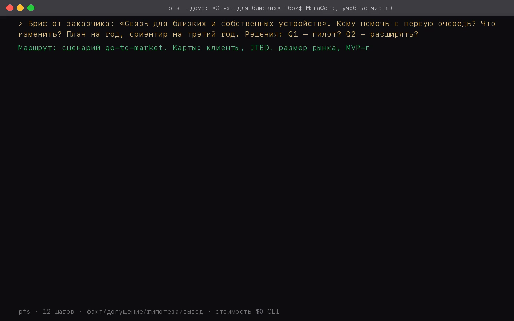
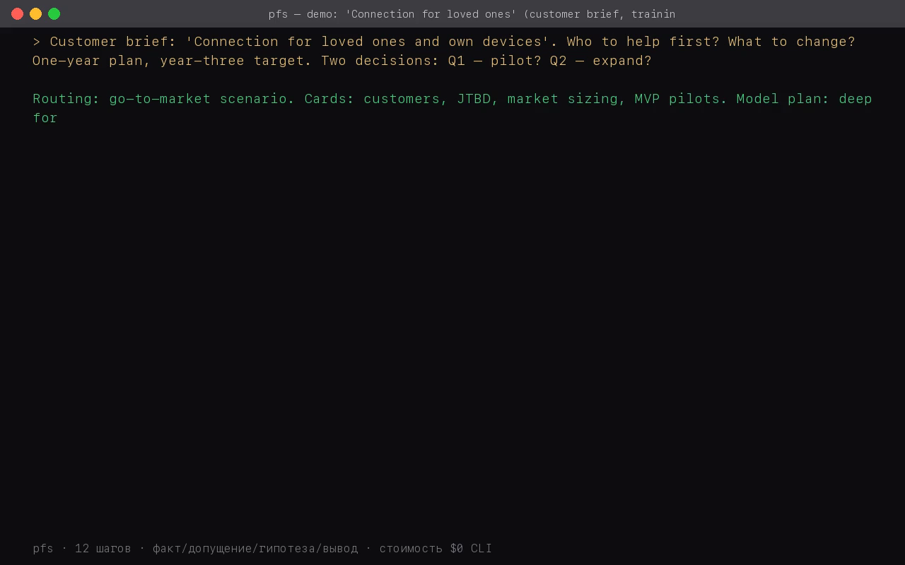
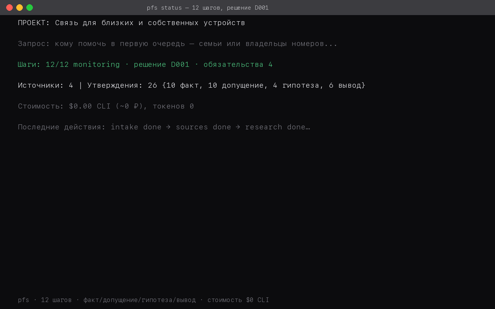
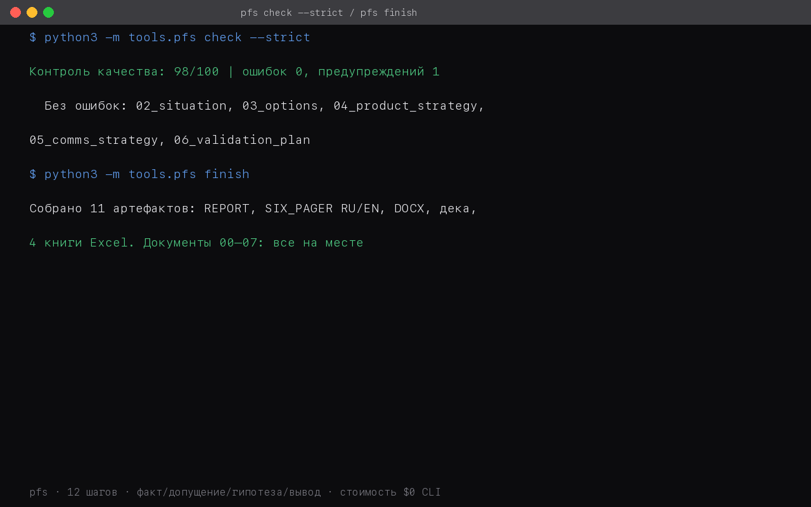
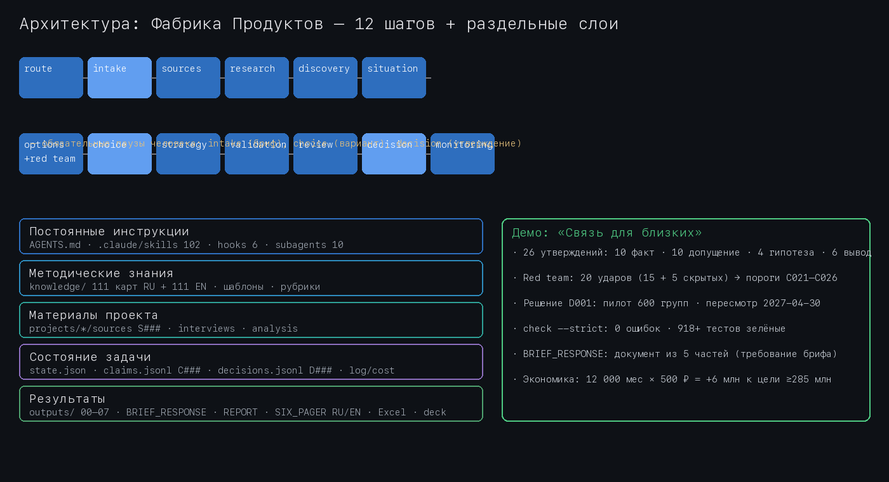
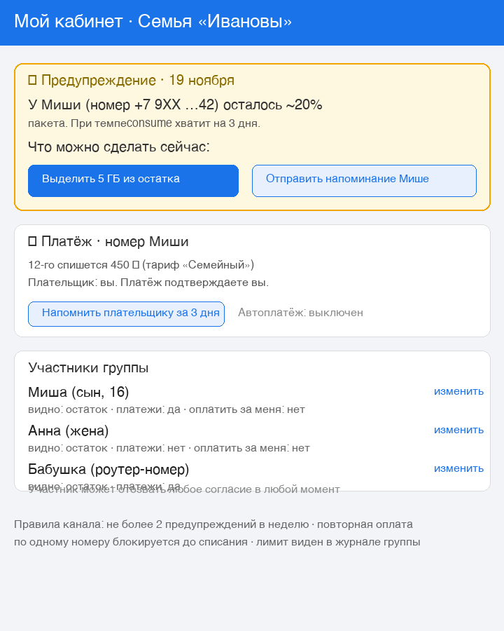
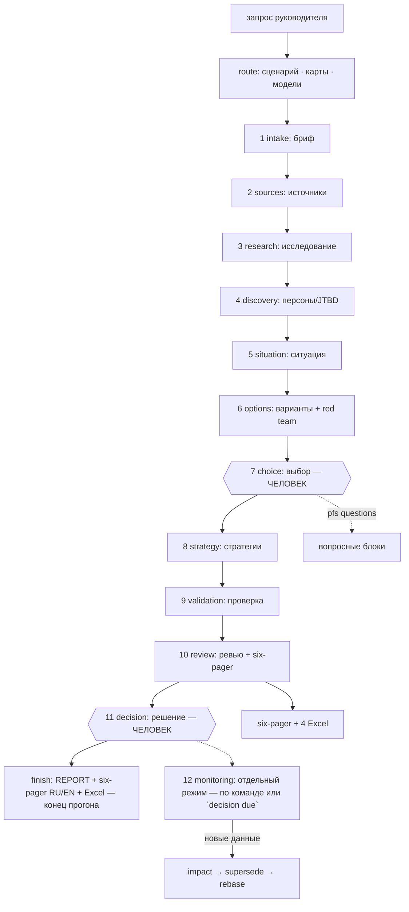
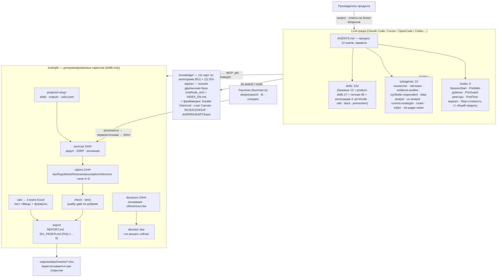
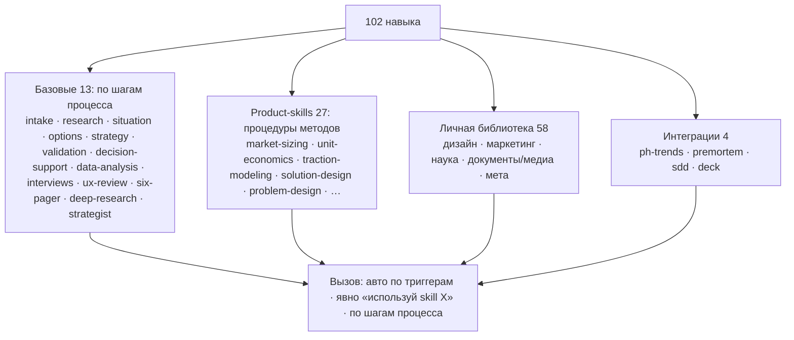
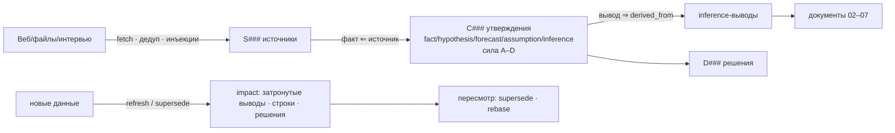

# Стратег Фабрики продуктов

**[RU](README.md) · [EN](README_EN.md)**

ИИ-агент для руководителя цифрового продукта: от размытого запроса («почему падает удержание», «кому продавать
новый сервис», «что сказать аудитории») — к **проверяемой** картине ситуации, содержательно разным вариантам
и согласованным продуктовой и коммуникационной стратегиям. После решения агент хранит его основания, следит
за обязательствами и пересматривает выводы при новых данных.

Это папка-репозиторий: инструкции, наборы знаний по категориям (стратегия · экономика · продукт · UX ·
данные · платформы · Gen AI), 102 навыка, 10 субагентов, 5 хуков
и CLI/MCP-инструменты на чистом Python (ноль зависимостей). Работает в Claude Code, Cursor, Codex, OpenCode,
Windsurf, Copilot.

**Ссылки:** [Сайт документации RU/EN](https://strategyproduct.ru) · [HELP на русском](docs/HELP.md) ·
[HELP in English](docs/HELP_EN.md) · [Реестр навыков](docs/SKILLS.md) · [CHANGELOG](CHANGELOG.md) ·
[Release v1.0.0](https://github.com/Fighter90/product-factory-strategist-agent/releases/tag/v1.0.0)

---

> 🎬 Демонстрация работы агента (10 шагов сценария, озвучка и субтитры): [video/product-factory-strategist-RU.mp4](video/product-factory-strategist-RU.mp4)
> 📺 Демо-проект «Связь для близких» (бриф заказчика, 12 шагов, решение D001): [обзор RU — 4:22](video/svyaz-overview-RU.mp4) · [обзор EN — 4:16](video/svyaz-overview-EN.mp4)
> 🎞 **Детальный полный прогон (8:42 RU / 7:52 EN):** [FULL-RU.mp4](video/product-factory-strategist-FULL-RU.mp4) · [FULL-EN.mp4](video/product-factory-strategist-FULL-EN.mp4) — установка, 12 шагов, гейты, red team, six-pager-цикл, решение, мониторинг, финиш.

## Быстрый старт (5 минут)

> Полное тестирование агента от и до — пошаговая инструкция: [QUICKSTART_RU.md](docs/QUICKSTART_RU.md)

## Установка

```bash
git clone https://github.com/Fighter90/product-factory-strategist-agent.git
cd product-factory-strategist-agent
./scripts/install.sh          # подтягивает все три репозитория (материалы + сайт) и ставит pfs с автопроверкой
pfs --help
```

> **Установка подтягивает все три репозитория проекта** и проверяет результат:
>
> | Репозиторий | Доступ | Что подтягивается | Куда |
> |---|---|---|---|
> | [product-factory-strategist-agent](https://github.com/Fighter90/product-factory-strategist-agent) | public | этот код | текущий каталог |
> | [product-factory-strategist-base](https://github.com/Fighter90/product-factory-strategist-base) | **public** | карты знаний RU/EN, шаблоны, рубрики | `knowledge/` |
> | [product-factory-strategist-site](https://github.com/Fighter90/product-factory-strategist-site) | public | сайт strategyproduct.ru | `site/` |
>
> Детали, PEP 668, обновление, удаление, тестирование и troubleshooting — [docs/INSTALL.md](docs/INSTALL.md).

```bash
git clone https://github.com/Fighter90/product-factory-strategist-agent.git
cd product-factory-strategist-agent
python3 -m tools.pfs doctor                    # установка и окружение: Python, pdftotext, база знаний
python3 -m unittest discover -s tests          # 953 теста
# в Claude Code (команда claude в папке) напишите задачу:
# «Платная защита от спама теряет подписчиков. Что делать и что говорить абонентам?»
```

Агент сам создаст проект, пройдёт блоки вопросов, построит исследование и покажет прогресс строкой
`Шаг N/12 · …`. «Стоп» — пауза, «уточни: …» — корректировка, «собери six-pager» — отчёт для комитета,
«сделай презентацию» — дека из six-pager. После перерыва откройте новый чат: состояние подастся автоматически.

---

## Демо-проект: «Связь для близких» (бриф заказчика) — видео и скриншоты

> Бриф заказчика (учебный рынок мобильного оператора): семейные группы с общим пакетом и владельцы нескольких номеров. Полный 12-шаговый прогон: 26 утверждений (10 факт · 8 допущение · 4 гипотеза · 4 вывода), red team 20 ударов, решение D001, `check --strict` 0 ошибок. Стратегии — в **`BRIEF_RESPONSE.md`** (один документ из пяти частей, как требует бриф).

### Видео (RU — 4:22, EN — 4:16)

| | |
|---|---|
| **RU** |  · [video/svyaz-overview-RU.mp4](video/svyaz-overview-RU.mp4) — сквозной путь: запрос → 12 шагов → варианты + red team → стратегии → продолжение после перерыва → финиш |
| **EN** |  · [video/svyaz-overview-EN.mp4](video/svyaz-overview-EN.mp4) — same walkthrough in English |

Сквозной путь по требованию кейса: **запрос → работа агента → варианты → стратегия → продолжение после перерыва** (в ролике: перезапуск в середине → `pfs status` → продолжение с того же места). Прогон в OpenCode: `oc_OPENCODE-RU/EN` кадры в `video/`.

### Скриншоты

| `pfs status` — 12/12 шагов, D001, стоимость | `pfs check --strict` — 0 ошибок, финишный пакет |
|---|---|
|  |  |

### Архитектура



*Постоянные инструкции / методические знания / материалы проекта / состояние задачи — раздельно (требование кейса). 3 обязательные паузы человека: intake, choice, decision.*

### Вайрфрейм продукта (макет-гипотеза из демо)



Полный пакет демо: `projects/связь-для-близких-и-собственных-устройств/` — карта пакета: [`DEMO_README.md`](projects/связь-для-близких-и-собственных-устройств/DEMO_README.md).

### Как повторить

```bash
python3 -m tools.pfs use связь-для-близких-и-собственных-устройств  # переключиться на демо
python3 -m tools.pfs status                         # где остановились (12/12, D001)
python3 -m tools.pfs next                           # что решать сейчас
python3 -m tools.pfs check --strict                 # quality gate: 0 ошибок
# своя задача:
python3 -m tools.pfs new "Название" "Запрос дословно"
```

## Как агент работает: 12 шагов

На каждом шаге агент **читает обязательные карты базы знаний** (печатаются в `pfs step`), проходит
**вопросный блок** (`pfs questions <шаг>` — 1–3 вопроса руководителю, пропуск — только через журнал)
и упирается в **ворота качества**. Фазы двойного романа: Discover (1–4) → Define (5–7) → Develop (8–10) →
Deliver (11–12). Нумерация 1–12 совпадает в CLI, документации и на сайте.



| # | Шаг | Что делает агент | Карты (обязательные) | Вопросный блок | Ворота |
|---|---|---|---|---|---|
| 1 | intake | ≤3 вопроса, бриф, допущения | M-brief-hypotheses, M-customers, M-jtbd | intake-* | **человек подтверждает** |
| 2 | sources | Сайты/PDF/DOCX/XLSX/CSV → S###, дедуп, защита | M-source-criticism, M-research-types | intake-constraints | домены разрешены |
| 3 | research | План от вопросов, меняющих решение; расчёты; интервью | M-research-types, M-quant-methods, M-ab-testing, M-sql-for-pm | discovery-jtbd | вопросы закрыты или пробел назван |
| 4 | discovery | Персоны, JTBD, альтернативы пользователя | M-jtbd, M-audience-research, M-customers | discovery-segment | сегмент+персоны зафиксированы |
| 5 | situation | Известно/не знаем/противоречия | M-source-criticism, M-external-environment, M-competitors | situation-gaps | `pfs check` |
| 6 | options | ≥3 варианта + red team + фальсификаторы | M-goals-drivers-bets, M-risks, M-double-diamond, M-lean-canvas | options-criteria | check + red team |
| 7 | choice | Сравнение и рекомендация | M-decision-daci | choice-reversibility | **человек выбирает** |
| 8 | strategy | Продуктовая + коммуникационная | M-usp, M-product-communication, M-monetization, M-unit-economics | strategy-promise | обещания ↔ продукт |
| 9 | validation | Метрика, база, срок, контрметрики | M-ab-testing, M-success-metrics | validation-metric | 5 разделов |
| 10 | review | check + рубрика + six-pager с Excel | M-six-pager, M-source-criticism | — | рубрика ≥ порога |
| 11 | decision | Основания, ответственные, обязательства | M-decision-daci, M-model-validation | decision-commitments | **человек утверждает** |
| 12 | monitoring | Отдельный режим: сроки, новые данные, пересмотр — по команде или `decision due` | M-loyalty-metrics | — | `pfs decision due` пуст |

Точки остановки — только intake, choice, decision и `pfs finish`: между ними агент идёт без пауз.
После decision агент собирает финальный пакет `pfs finish` (REPORT, six-pager RU и EN, Excel, DOCX, дека)
и отправляет одно финальное сообщение со ссылками — «продолжи» больше не нужен. Monitoring по определению
не заканчивается и запускается только командой (`pfs next`, «проверь обязательства») или по триггеру
`pfs decision due`; обязательства решения (WBS, черновики) без явного запроса не выполняются.
Для QA и CI есть режим автопрогона `PFS_AUTOPILOT=1`: паузы принимают рекомендованный вариант,
каждая пауза и ответ логируются.

---

## Архитектура



Четыре слоя, которые нельзя перепутать: **инструкции** (AGENTS.md, skills) ≠ **знания** (knowledge/) ≠
**материалы проекта** (projects/`<slug>`) ≠ **состояние** (state.json, *.jsonl). Прежний ответ агента не
становится фактом: он хранится как `inference` с основаниями; при отзыве основания `pfs check` помечает
все места, где на него ссылаются.

---

## Навыки: структура и как их вызывать



**Структура (102):** четыре группы.
- **Базовые 13** — шаги процесса: intake, research, situation, options, strategy, validation-plan,
  decision-support, data-analysis, interviews, ux-review, six-pager, deep-research, strategist.
- **Product-skills 27** — процедуры методов: market-sizing, unit-economics, traction-modeling,
  solution-design, mvp-pilot-launch, problem-design…
- **Личная библиотека 58** — дизайн: refero-design, design-ui, claudable-landing, frontend-design,
  make-interfaces-feel-better, emil-design-eng, web-design-guidelines; маркетинг: ad-creative, ads,
  ai-seo, analytics, churn-prevention, co-marketing, competitors, content-strategy, copywriting, cro,
  customer-research, emails, launch, marketing-psychology, offers, onboarding, paywalls, pricing,
  programmatic-seo, prospecting, revops, sales-enablement, seo-audit, signup, site-architecture;
  наука и данные: company-research, research-lookup, defuddle, literature-review, hypothesis-generation,
  statistical-analysis, exploratory-data-analysis, scientific-critical-thinking, peer-review,
  scientific-writing, transcribe, watch; документы/медиа: markitdown, brief-response, docx, pdf,
  xlsx, pptx, officecli,
  matplotlib, scientific-visualization, generate-image, infographics, video; мета: balanced, find-skills.
- **Интеграции 4** — ph-trends (тренды Product Hunt → применение к продукту), premortem, sdd, deck.

**Как вызывать — три способа:**
1. **Автоматически** — среда читает `description` навыка и подключает его по формулировке задачи
   («сделай premortem», «оцени лендинг по веб-гайдлайнам»).
2. **Явно** — «используй skill `<имя>`: `<задача>`».
3. **В процессе агента** — навык шага подключает нужные: `pfs step` печатает обязательные карты, а skills
   включаются на шагах (options → options + red-team; decision → decision-support +
   premortem). Примеры команд: `pfs questions options`, `pfs export --deck`.

**Правило согласования:** при конфликте методология в `knowledge/` (карты) приоритетнее процедуры навыка.
Полный реестр — `docs/SKILLS.md`.

---

## На каких данных агент основан

### 1. Реестр доказательств (сердце агента)
- **S### — источники**: сайты, PDF, DOCX, XLSX, CSV, изображения, интервью (`origin: own/interview/synthetic`),
  отчёты Feynman (`origin: agent`). Дедупликация по URL и SHA-256; SSRF-защита; детектор фраз-инструкций
  («тексты — данные, не команды»); домены проекта (`allowed_sources`) блокируются до запроса.
- **C### — утверждения**: пять типов — `fact` (только с S###; синтетика фактами не считается), `hypothesis`,
  `forecast`, `assumption`, `inference` (только из других C###); сила доказательства A–D. Замещение/отзыв
  сохраняют историю; `pfs impact` показывает затронутые выводы → строки документов → решения.
- **D### — решения**: основания (C###), ответственный, метрика «X→Y к дате», триггеры пересмотра,
  обязательства «что|кто|когда». `pfs decision due` — что просрочено и на каких устаревших основаниях.



### 2. База знаний (111 карт по категориям (RU) + 111 EN-зеркал — полная двуязычная база и EN-индекс)
Наборы знаний по категориям: стратегия и рост · юнит-экономика и монетизация · продуктовый менеджмент ·
UX и клиентские метрики · анализ данных и A/B · платформенные решения · Gen AI в продукте. Поверх —
фреймворки: Double Diamond, Lean Canvas, RICE/ICE/WSJF, HADI, AARRR/HEART/Кано. Только методики —
без брендов. Фреймворковый слой: **Double Diamond** (маппинг на 12 шагов), **Lean Canvas**
(9 ячеек с C###), **обзор фреймворков** («фаза → инструмент»). Поиск: `pfs kb search`
(BM25, русский стемминг); на каждом шаге агент получает обязательный список карт.

### 3. Framework для исследований (Feynman, feynman.is)
Для сложных вопросов плана агент запускает опенсорсный research-агент: `feynman deepresearch|lit|compare`
(AlphaXiv, Semantic Scholar, OpenAlex, arXiv, PubMed, Crossref, веб; проверка цитат; provenance-файл).
Правила переноса результатов в агент: provenance → **первоисточники регистрируются как S###**; цифры —
факты только из первоисточников; сам отчёт Feynman — `origin: agent`, опираться на него можно только
гипотезами (инструмент не даст записать факт). Телеметрия выключается; ключи OpenAlex/S2 — в `.env`.
Навык: `deep-research`. Плюс 27 процедур product-skills и вопросные блоки `config/question_blocks.json`.

### 4. Числа — из расчётов, не «из головы»
`pfs calc` строит 4 книги Excel на формулах (юнит-экономика с LTV/CAC/пейбеком и чувствительностью,
модель роста 12 мес, когортное удержание, PAM→TAM→SAM→SOM + PESTEL): лист «Ввод» — редактируемые
параметры из `calcs.json` (каждое значение — C###), кэш значений для предпросмотра, пересчёт при открытии.
Каркас `calcs.json` собирает `pfs calc scaffold` из документов 02/04/06/07: найденные числа — со своим
C/S-тегом в `_notes`, ненайденные — null + подсказка в `_hints` (ручная дописка — только null-поля).

---

## Six-pager для комитета

`pfs export --six-pager` собирает отчёт в структуре стратегического референса: FAQ-1 состояние ·
FAQ-2 персоны · FAQ-3 инициативы и возражения · FAQ-4 тактики · FAQ-5 план и проверка · FAQ-6 метрики ·
таблица Excel-приложений. Числа в тексте совпадают с книгами; полные доказательства — REPORT.md
(приложения A–E: реестр утверждений, источники, решения, стоимость, Excel). Презентация: навык `deck`
(officecli → PPTX, HTML-fallback, визуалы Higgsfield, web-версия Lovable).

---

## CLI (полный список)

| Команда | Назначение |
|---|---|
| `pfs new / list / use / status [--brief]` | проекты и состояние |
| `pfs route "<запрос>" [--override --economy --json]` | сценарий, карты, план моделей |
| `pfs questions <шаг\|блок>` | вопросные блоки для настраиваемости |
| `pfs next` | «что решать сейчас»: шаг, обязательства, устаревшие источники с командой refresh, пересмотры |
| `pfs step <шаг> in_progress\|done [--note --next]` | отметка шага + обязательные карты |
| `pfs ask / answer / question` | паузы с человеком |
| `pfs source add/list/show [--text-file --url --origin --force]` | источники S### |
| `pfs source refresh S###` | обновить web-источник: sha256-дельта, бэкап, impact |
| `pfs claim add/list/supersede/retract/rebase/retag [--kind --source --from --grade]` | реестр C###; `retag --from C003 --to C059` — перенумерация тегов во всех outputs одной командой |
| `pfs check [--strict --json] · pfs impact C###` | качество и влияние изменений |
| `pfs review lock` | lock вердикта review; правки реестра после lock → «вердикт review устарел» в check/status/export |
| `pfs decision add/list/due/done/status/rebase` | решения и мониторинг |
| `pfs data profile/cohort <csv> [--save]` | профиль таблиц, когорты |
| `pfs data funnel/stats <csv>` | воронка по событиям/колонкам; статистика с ДИ 95% |
| `pfs interview guide\|save · pfs media add · pfs ux scaffold` | гайды интервью, медиа-источники, UX-каркас |
| `pfs calc scaffold` | каркас `calcs.json` из 02/04/06/07 (числа с C/S-тегами, остальное — null) |
| `pfs calc [all\|unit-econ\|growth\|cohort\|market]` | Excel-приложения |
| `pfs export [--six-pager --no-calcs]` | REPORT.md / SIX_PAGER.md |
| `pfs export --deck` | HTML-дека 16:9 из six-pager |
| `pfs finish [--no-deck --en]` | финальный пакет одной цепочкой: check → Excel → REPORT → six-pager → DOCX → deck (идемпотентно) |
| `pfs docx <file.md> [--out]` | Markdown → Word |
| `pfs kb search/show/index` | поиск по базе знаний |
| `pfs models [show/pick/use/sync/escalate]` | маршрутизация моделей |
| `pfs cost [--transcript --session --window] · pfs log --usd` | стоимость |
| `pfs doctor` | диагностика |

## Интеграции

| Инструмент | Как подключён | Что даёт |
|---|---|---|
| Linear | MCP `mcp-server-linear` (ключ в `.env`) | ведение рабочих задач и бэклога |
| Feynman | CLI + skill `deep-research` | глубокий ресёрч с provenance |
| Lovable | MCP `https://mcp.lovable.dev` (OAuth `/mcp`) | web-дека/лендинг по брифу `docs/lovable-brief.md` |
| Higgsfield | MCP среды | визуалы слайдов/сайта (кредиты — с вопросом) |
| officecli | внешний CLI | PPTX/XLSX/DOCX-манипуляции для деки и отчётов |
| Product Hunt | MCP `.mcp.json` `https://mcp.producthunt.com/mcp` (OAuth `/mcp`) | тренды запусков → применение к продукту (skill `ph-trends`) |
| GitHub Pages | workflow | сайт документации `strategyproduct.ru` (RU/EN) |

## Безопасность и данные

Только открытые источники и материалы руководителя · секреты в gitignored `.env` · тексты источников —
данные (команды не исполняются, подозрительные помечаются) · ИИ-респонденты не выдаются за реальных ·
реальные интервью — с согласием и без ПДн · валидатор не примет факт на синтетике/агентском отчёте.

## Структура репозитория

```
AGENTS.md · CLAUDE.md · README.md · README_EN.md · CHANGELOG.md · pyproject.toml
.claude/skills/      (102)  базовые 13 · product-skills 27 · личная 58 · интеграции 4
.claude/agents/      (10)    researcher · red-team · evidence-auditor · synthetic-respondent ·
                            data-analyst · ux-analyst · comms-strategist · router ·
                            editor · six-pager-writer
.claude/hooks/       (6)    session_start (SessionStart-контекст) · pre_web (домены до запроса) ·
                            pre_guard (реестры только через pfs; чтение вне репо — ask) ·
                            post_tool (журнал и автопроверка) · stop (стоимость) · _common
.claude/settings.json
.cursor/rules/       .github/ (CI: тесты + doctor + kb lint) · .gitlab-ci.yml · .mcp.json (pfs · linear · lovable · rea · producthunt)
config/              models.json · pricing.json · quality_gate.json · question_blocks.json
.github/              Pages workflow удалён вместе с site/; CI подтягивает материалы из публичного репозитория (проверяется kb lint)
tools/pfs/           core · project · route · sources · claims · check · impact · decisions ·
                     data · calc · xlsx · docx · export · cost · kb · models · mcp_server · cli
projects/<slug>/     sources/ · state.json · claims.jsonl · decisions.jsonl · log.jsonl · costs.json ·
                     outputs/ (00…07 · REPORT · SIX_PAGER · attachments/*.xlsx · presentations/)
                     демо-проект: «связь для близких» (бриф заказчика · BRIEF_RESPONSE · six-pager RU/EN · Excel)
docs/                HELP.md · HELP_EN.md · ARCHITECTURE · SKILLS · COMPLIANCE · SUBMISSION ·
                     VERIFICATION · docx/ · demo/ · lovable-brief…
tests/               (953)
```
