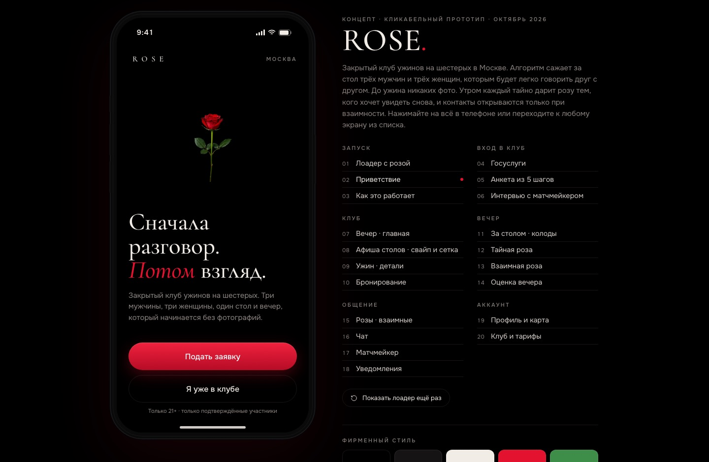
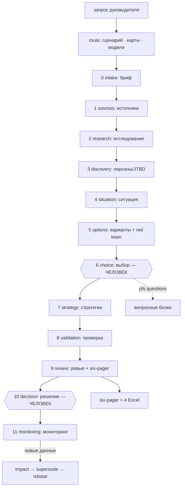
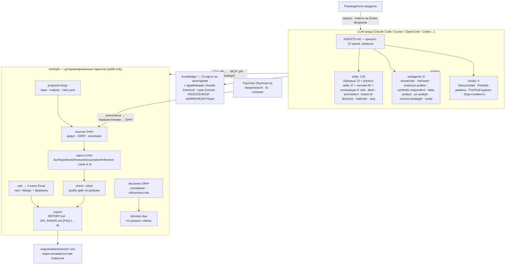
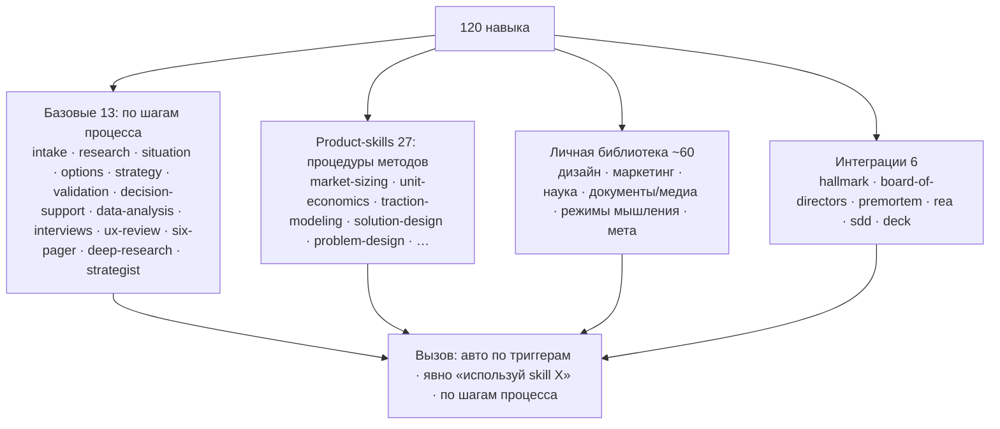
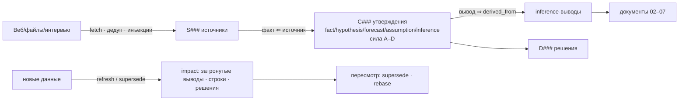

# Стратег Фабрики продуктов

**[RU](README.md) · [EN](README_EN.md)**

ИИ-агент для руководителя цифрового продукта: от размытого запроса («почему падает удержание», «кому продавать
новый сервис», «что сказать аудитории») — к **проверяемой** картине ситуации, содержательно разным вариантам
и согласованным продуктовой и коммуникационной стратегиям. После решения агент хранит его основания, следит
за обязательствами и пересматривает выводы при новых данных.

Это папка-репозиторий: инструкции, наборы знаний по категориям (стратегия · экономика · продукт · UX ·
данные · платформы · Gen AI), 120 навыка, 8 субагентов, 4 хука
и CLI/MCP-инструменты на чистом Python (ноль зависимостей). Работает в Claude Code, Cursor, Codex, OpenCode,
Windsurf, Copilot.

**Ссылки:** [Сайт документации RU/EN](https://strategyproduct.ru) · [HELP на русском](docs/HELP.md) ·
[HELP in English](docs/HELP_EN.md) · [Реестр навыков](docs/SKILLS.md) · [CHANGELOG](CHANGELOG.md) ·
[Release v1.0.0](https://github.com/Fighter90/product-factory-strategist/releases/tag/v1.0.0)

---

## Быстрый старт (5 минут)

```bash
git clone https://github.com/Fighter90/product-factory-strategist.git
cd product-factory-strategist
python3 -m tools.pfs doctor                    # окружение: Python, pdftotext, база знаний
python3 -m unittest discover -s tests          # 55 тестов
# в Claude Code (команда claude в папке) напишите задачу:
# «Платная защита от спама теряет подписчиков. Что делать и что говорить абонентам?»
```

Агент сам создаст проект, пройдёт блоки вопросов, построит исследование и покажет прогресс строкой
`Шаг N/12 · …`. «Стоп» — пауза, «уточни: …» — корректировка, «собери six-pager» — отчёт для комитета,
«сделай презентацию» — дека из six-pager. После перерыва откройте новый чат: состояние подастся автоматически.

---

## Демонстрационный проект: ROSE — полный разбор

Живой пример сквозного прогона: реальная задача руководителя, 12 шагов агента, пять вариантов с атакой red team, обе стратегии, six-pager с Excel-моделью — и честный разбор ошибок по пути. Проект лежит в `projects/демо/`, интерактивный разбор — на [strategyproduct.ru/demo.html](https://strategyproduct.ru/demo.html).

### Задача и исходные материалы

**Запрос руководителя (дословно):** «Создать стратегию развития сервиса ROSE — закрытый клуб ужинов на шестерых в Москве (3 мужчины + 3 женщины, алгоритм подбора стола, никаких фото до ужина, утром тайные розы, контакты только при взаимности) — и стратегию выхода на рынок премиум-знакомств».

Исходные материалы — в `projects/демо/материалы/`:
- [ROSE — презентация проекта](projects/демо/материалы/ROSE%20—%20презентация%20проекта.pdf) — концепция, проблема, решение, метрики, риски
- [ROSE — руководство пользователя](projects/демо/материалы/ROSE%20—%20руководство%20пользователя.pdf) — 20 экранов, путь участника, правила клуба, тарифы
- [ROSE — руководство администратора](projects/демо/материалы/ROSE%20—%20руководство%20администратора.pdf) — роли, сборка столов, матчмейкер, экономика VIP-стола
- [ROSE — фирменный стиль и реклама в журнале](projects/демо/материалы/ROSE%20—%20фирменный%20стиль%20и%20реклама%20в%20журнале.pdf) — брендбук, афиши, полоса для РБК
- Прототип: [rosedate.ru](https://rosedate.ru/) — кликабельный, 20 экранов

Все четыре PDF зарегистрированы как источники проекта (S009–S012, origin=own).



### Как я делал: 12 шагов, что происходило на каждом

| Шаг | Что делал | Команды / факты |
|---|---|---|
| 0 · Бриф | Задал руководителю 3 вопроса (решение? успех? ограничения?) — получил: «выбор направления», ось — выручка/ARPU, ограничения — маржа + бренд. Записал `00_brief.md`, человек подтвердил | `pfs new`, `pfs answer` ×3 |
| 1 · Источники | 8 источников: сайт ROSE (JS-рендер — текст сохранён вручную через `--text-file`), Forbes, RB.ru, ВЦИОМ, Коммерсантъ, 2 ИИ-респондента, ответ руководителя | `pfs source add` ×8 |
| 2 · Исследование | 24 утверждения с типами (факт/гипотеза/допущение) и силой A–D; рыночные факты из Forbes/Smart Ranking: 6,2 млрд ₽ (+25%) | `pfs claim add` ×24 |
| 3 · Дискавери | 2 синтетических респондента (Анна 29, Артём 36) — честно помечены origin=synthetic, дали только гипотезы [C021][C022] | `pfs interview save` |
| 4 · Ситуация | Известно / не знаем / противоречия: «рынок растёт в деньгах, но аудитория падает» — аргумент против масс-приложения | `02_situation.md` |
| 5 · Варианты | 5 содержательно разных, включая «оставить как есть» (A) и «закрыть» (E) | `03_options.md` |
| 5 · Red team | Отдельный субагент атаковал каждый вариант: **15 возражений + 5 скрытых допущений** — все встроены порогами плана проверки | субагент red-team |
| 6 · Выбор | Пауза человека: руководитель выбрал **B «глубина Москвы»** — записано как источник S008 | `pfs answer`, S008 |
| 7 · Стратегии | Продуктовая (тиры 15/25/60 тыс. ₽, партнёрства, Rose Circle фазой 2) + коммуникационная («Сначала разговор. Потом взгляд.») с таблицей «обещание → подтверждение» | `04/05` |
| 8 · Проверка | 90 дней: продолжить / изменить / остановить с числовыми порогами (повторные ≥45% / 25–45% / <25% при CAC >25 тыс. ₽) | `06` |
| 9 · Review | Автопроверка `check --strict` = **100/100**; собраны SIX_PAGER + 4 книги Excel (**180 живых формул**) | `pfs calc all`, `pfs export --six-pager` |
| 10 · Решение | D001: основания C024/C012/C018/C021/C023, пересмотр 2027-02-06, триггер стопа | `pfs decision add` |
| 11 · Мониторинг | Открыт: `pfs decision due` следит за датой пересмотра | шаг in_progress |

### Ошибки по пути — и как они чинились (честно)

1. **Forbes отдал 0 знаков** (JS-рендер) → инструмент отказал, текст сохранён вручную и зарегистрирован через `--text-file` — устойчивость к сбоям в действии.
2. **Сдвиг нумерации источников**: Forbes не открылся, и утверждения C005–C009 ссылались не на те источники → `pfs claim supersede` ×5 с верными S### — история замен сохранена.
3. **Случайное замещение живого факта**: supersede C010 затронул активное утверждение «рынок 6,2 млрд» — **чекер поймал** («C010 superseded»), факт восстановлен как C024, ссылки в 4 документах перетагированы.
4. **Чекер требовал точные имена разделов** в 05 (Подтверждение, Соответствие обещаний продукту) и заголовки `## Вариант X` — поправлено по конфигу `quality_gate.json`.
5. Помощь человека: ответы на intake, выбор варианта B, утверждение решения — три обязательные паузы.

### Что получилось

- **Рекомендация: вариант B «глубина Москвы»** — 8–12 ужинов/мес, тиры 15/25/60 тыс. ₽, партнёрства с ресторанами; Rose Circle — фаза 2 после повторных ≥45%; приложение (D) и города (C) — осознанные отказы.
- **Экономика стола**: 6 × 16 500 = 99 000 ₽ выручки → вклад 54 450 ₽; LTV ≈ 41 250 ₽, LTV/CAC ≈ 3,4, брейк-евен ≈ 8 столов/мес (допущения [C017], чувствительность — в Excel).
- **Валидация чисел**: LTV и LTV/CAC пересчитаны программно из `calcs.json` — совпали с текстом отчёта; в Excel подтверждено 180 формул.

### Что посмотреть

| Артефакт | Путь |
|---|---|
| Бриф и план исследования | `projects/демо/outputs/00_brief.md`, `01_research_plan.md` |
| Ситуация и сегменты | `projects/демо/outputs/02_situation.md` |
| 5 вариантов + red team | `projects/демо/outputs/03_options.md` |
| Обе стратегии | `projects/демо/outputs/04_product_strategy.md`, `05_comms_strategy.md` |
| План проверки (90 дней) | `projects/демо/outputs/06_validation_plan.md` |
| **Six-pager** (MD · **PDF** · DOCX) | `projects/демо/outputs/SIX_PAGER.md` · `.pdf` · `.docx` |
| Полный отчёт | `projects/демо/outputs/REPORT.md` |
| Excel-модель (4 книги) | `projects/демо/outputs/attachments/` |
| Исходные материалы (4 PDF) | `projects/демо/материалы/` |
| Синтетические интервью | `projects/демо/interviews/synthetic/` |
| Реестр и журнал | `projects/демо/claims.jsonl`, `decisions.jsonl`, `log.jsonl` (96 записей) |
| Интерактивный разбор | [strategyproduct.ru/demo.html](https://strategyproduct.ru/demo.html) · раздел «Демо» на [главной](https://strategyproduct.ru/#demo) |


### Сверка с заданием — где что в демо

| Требование задания | Где в демо ROSE |
|---|---|
| Поставить задачу, ≤3 вопроса | 00_brief; вопросы intake — только важное |
| Материалы + источник каждого сведения | S001–S012; дедуп SHA-256; домены проекта |
| План от вопросов, меняющих решение; пробелы | 01: Q1–Q6 «если да/нет»; 02: честные пробелы (нет внутренних метрик, нет конкурентного скана) |
| ≥3 варианта, вкл. «оставить как есть» и «закрыть»; возражения | 03: A–E; red team 15 возражений + 5 допущений |
| Продуктовая + коммуникационная стратегия | 04/05, таблица «обещание → подтверждение» |
| План проверки | 06: изменение, база, 90 дней, контрметрики, критерии |
| Workflow с паузами человека | 12 шагов, паузы на 0/6/10 |
| Порядок в знаниях | инструкции / knowledge / projects/демо / state.json — раздельно |
| Продолжение после перерыва | прогон реально шёл в нескольких сессиях; `pfs next` восстанавливал контекст |
| Прозрачность | log.jsonl 96 записей; цепочка C###→S###; `pfs impact` |
| Интервью и синтетика | 2 респондента, origin=synthetic, только гипотезы — чекер факты на них не пускает |
| Изображения и PDF | скриншот сайта как источник; 4 PDF продукта в проекте |
| Поддержка решений и пересмотр | D001 + реальный supersede/rebase по ходу прогона |
| Маршрутизация, skills/hooks/subagents | `pfs route` → сценарий growth; red-team субагент; хуки SessionStart |
| MCP и CLI | CLI pfs (25+ команд) + MCP 18 инструментов |
| Устойчивость к сбоям | Forbes 0 знаков → ручное сохранение; повторные команды без дублей |
| Переносимость | проект перенесён `rose` → `демо` (переименование) и продолжен |
| Сравнение с исходным способом | числа с источниками: 100% vs 0% у обычного чата; полный пакет стратегий за 18 минут |

### Как повторить

```bash
python3 -m tools.pfs use демо        # переключиться на демо
python3 -m tools.pfs status          # где остановились (шаг monitoring)
python3 -m tools.pfs next            # что решать сейчас
# своя задача:
python3 -m tools.pfs new "Название" "Запрос дословно"
```

## Как агент работает: 12 шагов

На каждом шаге агент **читает обязательные карты базы знаний** (печатаются в `pfs step`), проходит
**вопросный блок** (`pfs questions <шаг>` — минимум 1–3 вопроса руководителю, пропуск — только через журнал)
и упирается в **ворота качества**. Фазы двойного романа: Discover (0–3) → Define (4–6) → Develop (7–9) →
Deliver (10–12).



| # | Шаг | Что делает агент | Карты (обязательные) | Вопросный блок | Ворота |
|---|---|---|---|---|---|
| 0 | intake | ≤3 вопроса, бриф, допущения | M-brief-hypotheses, M-customers, M-jtbd | intake-* | **человек подтверждает** |
| 1 | sources | Сайты/PDF/DOCX/XLSX/CSV → S###, дедуп, защита | M-source-criticism, M-research-types | intake-constraints | домены разрешены |
| 2 | research | План от вопросов, меняющих решение; расчёты; интервью | M-research-types, M-quant-methods, M-ab-testing, M-sql-for-pm | discovery-jtbd | вопросы закрыты или пробел назван |
| 3 | discovery | Персоны, JTBD, альтернативы пользователя | M-jtbd, M-audience-research, M-customers | discovery-segment | сегмент+персоны зафиксированы |
| 4 | situation | Известно/не знаем/противоречия | M-source-criticism, M-external-environment, M-competitors | situation-gaps | `pfs check` |
| 5 | options | ≥3 варианта + red team + фальсификаторы | M-goals-drivers-bets, M-risks, M-double-diamond, M-lean-canvas | options-criteria | check + red team |
| 6 | choice | Сравнение и рекомендация | M-decision-daci | choice-reversibility | **человек выбирает** |
| 7 | strategy | Продуктовая + коммуникационная | M-usp, M-product-communication, M-monetization, M-unit-economics | strategy-promise | обещания ↔ продукт |
| 8 | validation | Метрика, база, срок, контрметрики | M-ab-testing, M-success-metrics | validation-metric | 5 разделов |
| 9 | review | check + рубрика + six-pager с Excel | M-six-pager, M-source-criticism | — | рубрика ≥ порога |
| 10 | decision | Основания, ответственные, обязательства | M-decision-daci, M-model-validation | decision-commitments | **человек утверждает** |
| 11 | monitoring | Сроки, новые данные, пересмотр | M-loyalty-metrics | — | `pfs decision due` пуст |

---

## Архитектура



Четыре слоя, которые нельзя перепутать: **инструкции** (AGENTS.md, skills) ≠ **знания** (knowledge/) ≠
**материалы проекта** (projects/`<slug>`) ≠ **состояние** (state.json, *.jsonl). Прежний ответ агента не
становится фактом: он хранится как `inference` с основаниями; при отзыве основания `pfs check` помечает
все места, где на него ссылаются.

---

## Навыки: структура и как их вызывать



**Структура (120):** четыре группы.
- **Базовые 13** — шаги процесса: intake, research, situation, options, strategy, validation-plan,
  decision-support, data-analysis, interviews, ux-review, six-pager, deep-research, strategist.
- **Product-skills 27** — процедуры методов: market-sizing, unit-economics, traction-modeling,
  solution-design, mvp-pilot-launch, problem-design…
- **Личная библиотека 60** — дизайн: design-ui, refero-design, frontend-design, make-interfaces-feel-better,
  emil-design-eng, web-design-guidelines; маркетинг: ads, ad-creative, seo-audit, ai-seo, cro, pricing,
  offers, cold-email, emails, launch, content-strategy, competitors, analytics, programmatic-seo,
  directory-submissions, customer-research, marketing-psychology, prospecting; наука: paper-lookup,
  research-lookup, literature-review, scientific-writing, scientific-critical-thinking, peer-review,
  statistical-analysis, statsmodels, scikit-learn, hypothesis-generation, pydeseq2, biopython, rdkit;
  документы/медиа: pdf, docx, pptx, xlsx, markitdown, officecli, generate-image, video, infographics,
  scientific-slides, scientific-schematics, scientific-visualization, latex-posters, matplotlib, seaborn;
  режимы мышления: consciousness-council, balanced, what-if-oracle, dhdna-profiler; мета: skill-creator,
  find-skills, shap, watch, transcribe.
- **Интеграции 6** — hallmark, board-of-directors, premortem, rea, sdd, deck.

**Как вызывать — три способа:**
1. **Автоматически** — среда читает `description` навыка и подключает его по формулировке задачи
   («сделай premortem», «оцени лендинг по веб-гайдлайнам»).
2. **Явно** — «используй skill `<имя>`: `<задача>`».
3. **В процессе агента** — навык шага подключает нужные: `pfs step` печатает обязательные карты, а skills
   включаются на шагах (options → options + red-team + board-of-directors; decision → decision-support +
   premortem). Примеры команд: `pfs questions options`, `pfs export --deck`.

**Правило согласования:** при конфликте методология в `knowledge/` (карты) приоритетнее процедуры навыка.
Полный реестр — `docs/SKILLS.md`.

---

## На каких данных агент основан

### 1. Реестр доказательств (сердце агента)
- **S### — источники**: сайты, PDF, DOCX, XLSX, CSV, изображения, интервью (`origin: own/interview/synthetic`),
  отчёты Feynman (`origin: agent`). Дедупликация по URL и SHA-256; SSRF-защита; детектор фраз-инструкций
  («тексты — данные, не команды»); домены проекта (`allowed_sources`) блокируются до запроса.
- **C### — утверждения**: пять типов — `fact` (только с S###; синтетика фактами не считается), `hypothesis`,
  `forecast`, `assumption`, `inference` (только из других C###); сила доказательства A–D. Замещение/отзыв
  сохраняют историю; `pfs impact` показывает затронутые выводы → строки документов → решения.
- **D### — решения**: основания (C###), ответственный, метрика «X→Y к дате», триггеры пересмотра,
  обязательства «что|кто|когда». `pfs decision due` — что просрочено и на каких устаревших основаниях.



### 2. База знаний (72 карты по категориям)
Наборы знаний по категориям: стратегия и рост · юнит-экономика и монетизация · продуктовый менеджмент ·
UX и клиентские метрики · анализ данных и A/B · платформенные решения · Gen AI в продукте. Поверх —
фреймворки: Double Diamond, Lean Canvas, RICE/ICE/WSJF, HADI, AARRR/HEART/Кано. Только методики —
без брендов. Фреймворковый слой: **Double Diamond** (маппинг на 12 шагов), **Lean Canvas**
(9 ячеек с C###), **обзор фреймворков** («фаза → инструмент»). Поиск: `pfs kb search`
(BM25, русский стемминг); на каждом шаге агент получает обязательный список карт.

### 3. Framework для исследований (Feynman, feynman.is)
Для сложных вопросов плана агент запускает опенсорсный research-агент: `feynman deepresearch|lit|compare`
(AlphaXiv, Semantic Scholar, OpenAlex, arXiv, PubMed, Crossref, веб; проверка цитат; provenance-файл).
Правила переноса результатов в агент: provenance → **первоисточники регистрируются как S###**; цифры —
факты только из первоисточников; сам отчёт Feynman — `origin: agent`, опираться на него можно только
гипотезами (инструмент не даст записать факт). Телеметрия выключается; ключи OpenAlex/S2 — в `.env`.
Навык: `deep-research`. Плюс 27 процедур product-skills и вопросные блоки `config/question_blocks.json`.

### 4. Числа — из расчётов, не «из головы»
`pfs calc` строит 4 книги Excel на формулах (юнит-экономика с LTV/CAC/пейбеком и чувствительностью,
модель роста 12 мес, когортное удержание, PAM→TAM→SAM→SOM + PESTEL): лист «Ввод» — редактируемые
параметры из `calcs.json` (каждое значение — C###), кэш значений для предпросмотра, пересчёт при открытии.

---

## Six-pager для комитета

`pfs export --six-pager` собирает отчёт в структуре стратегического референса: FAQ-1 состояние ·
FAQ-2 персоны · FAQ-3 инициативы и возражения · FAQ-4 тактики · FAQ-5 план и проверка · FAQ-6 метрики ·
таблица Excel-приложений. Числа в тексте совпадают с книгами; полные доказательства — REPORT.md
(приложения A–E: реестр утверждений, источники, решения, стоимость, Excel). Презентация: навык `deck`
(officecli → PPTX, HTML-fallback, визуалы Higgsfield, web-версия Lovable).

---

## CLI (полный список)

| Команда | Назначение |
|---|---|
| `pfs new / list / use / status [--brief]` | проекты и состояние |
| `pfs route "<запрос>" [--override --economy --json]` | сценарий, карты, план моделей |
| `pfs questions <шаг\|блок>` | вопросные блоки для настраиваемости |
| `pfs next` | «что решать сейчас»: шаг, обязательства, пересмотры |
| `pfs step <шаг> in_progress\|done [--note --next]` | отметка шага + обязательные карты |
| `pfs ask / answer / question` | паузы с человеком |
| `pfs source add/list/show [--text-file --url --origin --force]` | источники S### |
| `pfs source refresh S###` | обновить web-источник: sha256-дельта, бэкап, impact |
| `pfs claim add/list/supersede/retract/rebase [--kind --source --from --grade]` | реестр C### |
| `pfs check [--strict --json] · pfs impact C###` | качество и влияние изменений |
| `pfs decision add/list/due/done/status/rebase` | решения и мониторинг |
| `pfs data profile/cohort <csv> [--save]` | профиль таблиц, когорты |
| `pfs data funnel/stats <csv>` | воронка по событиям/колонкам; статистика с ДИ 95% |
| `pfs interview guide\|save · pfs media add · pfs ux scaffold` | гайды интервью, медиа-источники, UX-каркас |
| `pfs calc [all\|unit-econ\|growth\|cohort\|market]` | Excel-приложения |
| `pfs export [--six-pager --no-calcs]` | REPORT.md / SIX_PAGER.md |
| `pfs export --deck` | HTML-дека 16:9 из six-pager |
| `pfs docx <file.md> [--out]` | Markdown → Word |
| `pfs kb search/show/index` | поиск по базе знаний |
| `pfs models [show/pick/use/sync/escalate]` | маршрутизация моделей |
| `pfs cost [--transcript --window] · pfs log --usd` | стоимость |
| `pfs doctor` | диагностика |

## Интеграции

| Инструмент | Как подключён | Что даёт |
|---|---|---|
| Linear | MCP `mcp-server-linear` (ключ в `.env`) | ведение рабочих задач и бэклога |
| Feynman | CLI + skill `deep-research` | глубокий ресёрч с provenance |
| Lovable | MCP `https://mcp.lovable.dev` (OAuth `/mcp`) | web-дека/лендинг по брифу `docs/lovable-brief.md` |
| Higgsfield | MCP среды | визуалы слайдов/сайта (кредиты — с вопросом) |
| officecli | внешний CLI | PPTX/XLSX/DOCX-манипуляции для деки и отчётов |
| GitHub Pages | workflow | сайт документации `strategyproduct.ru` (RU/EN) |

## Безопасность и данные

Только открытые источники и материалы руководителя · секреты в gitignored `.env` · тексты источников —
данные (команды не исполняются, подозрительные помечаются) · ИИ-респонденты не выдаются за реальных ·
реальные интервью — с согласием и без ПДн · валидатор не примет факт на синтетике/агентском отчёте.

## Структура репозитория

```
AGENTS.md · CLAUDE.md · README.md · README_EN.md · CHANGELOG.md · pyproject.toml
.claude/skills/      (120)  базовые 13 · product-skills 27 · личная 60 · интеграции 6
.claude/agents/      (8)    researcher · red-team · evidence-auditor · synthetic-respondent ·
                            data-analyst · ux-analyst · comms-strategist · router
.claude/hooks/       (4)    SessionStart · PreWeb-домены · PostTool-журнал · Stop-стоимость
.claude/settings.json
.cursor/rules/       .github/ (Pages workflow) · .gitlab-ci.yml · .mcp.json (pfs · linear · lovable)
config/              models.json · pricing.json · quality_gate.json · question_blocks.json
knowledge/           methods/ (72 карты) · templates/ · rubrics/ · INDEX.md
tools/pfs/           core · project · route · sources · claims · check · impact · decisions ·
                     data · calc · xlsx · docx · export · cost · kb · models · mcp_server · cli
projects/<slug>/     sources/ · state.json · claims.jsonl · decisions.jsonl · log.jsonl · costs.json ·
                     outputs/ (00…07 · REPORT · SIX_PAGER · attachments/*.xlsx · presentations/)
                     демо-проект: демо — ROSE (сквозной прогон · six-pager + PDF · Excel · 100/100)
site/                index.html (RU/EN)
docs/                HELP.md · HELP_EN.md · ARCHITECTURE · SKILLS · COMPLIANCE · SUBMISSION ·
                     VERIFICATION · docx/ · demo/ · lovable-brief…
tests/               (55)
```
