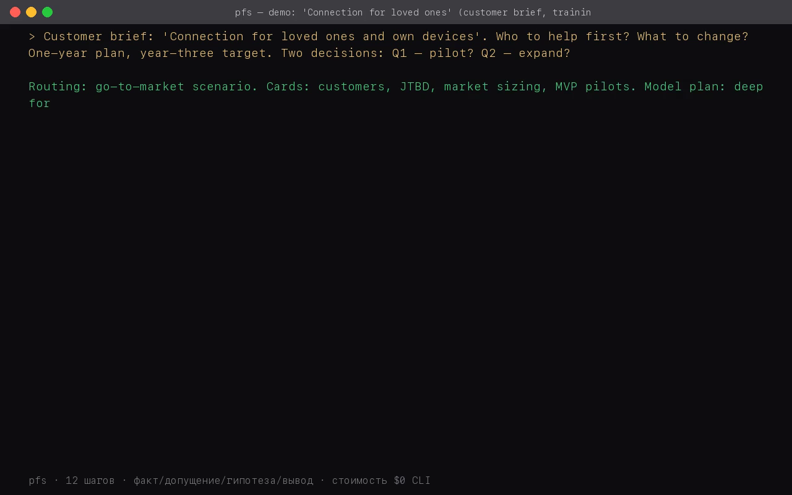
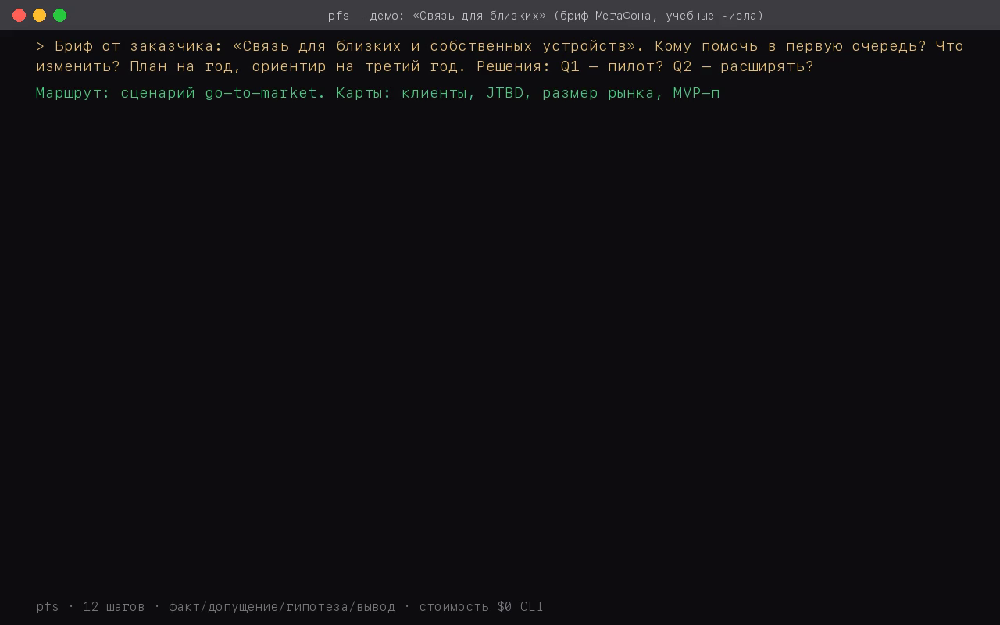
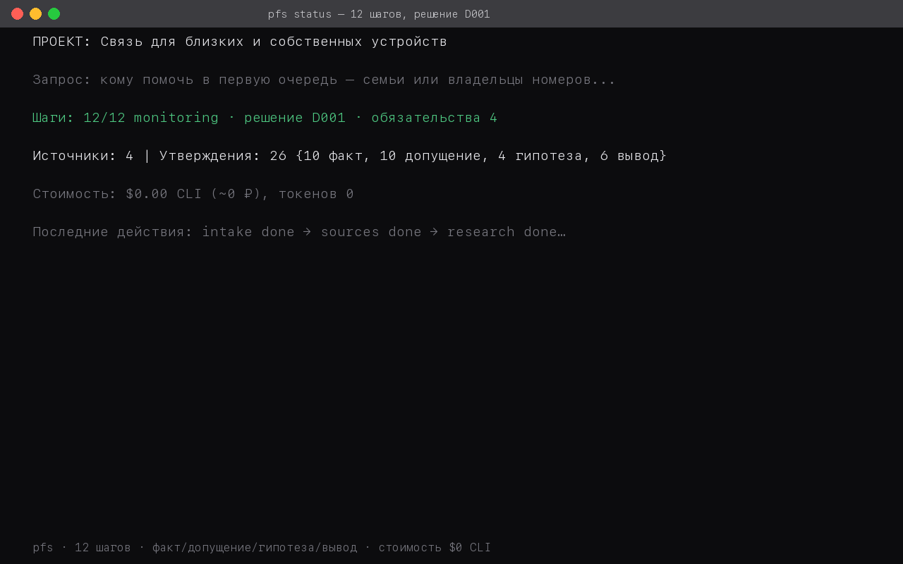
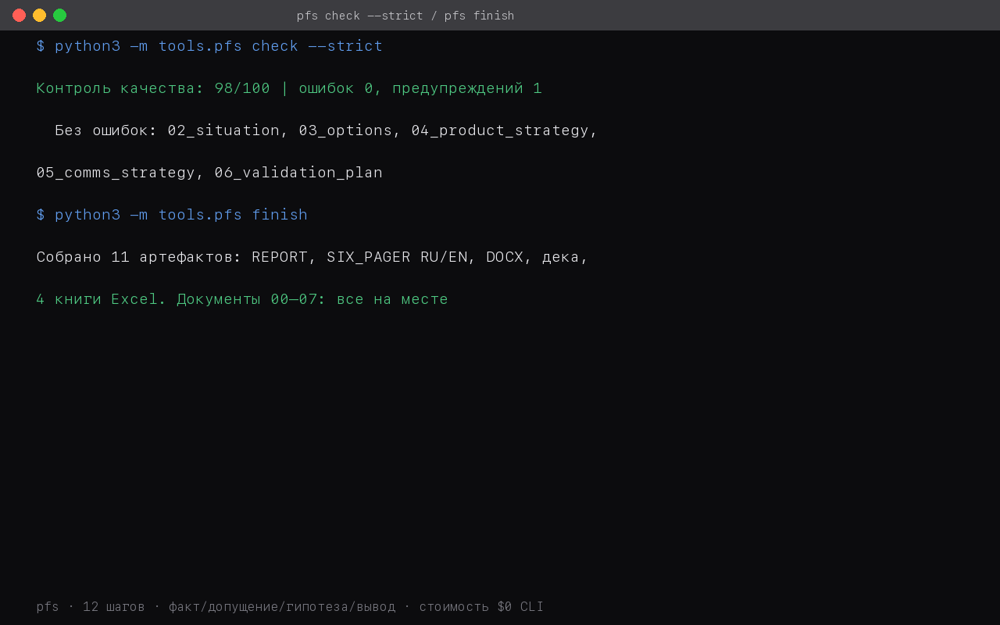
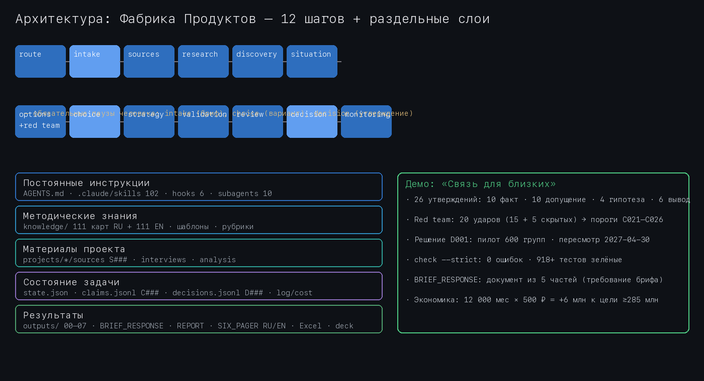
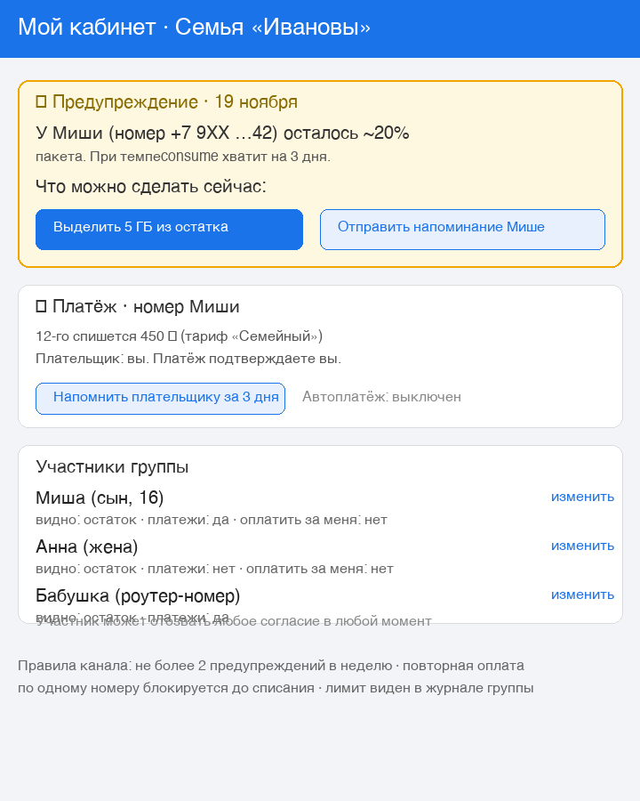
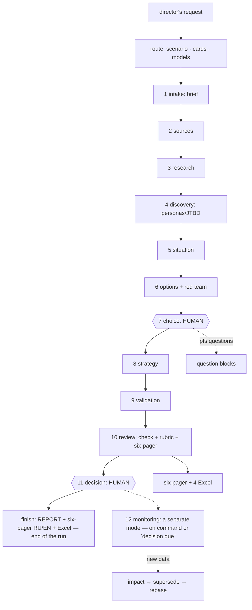
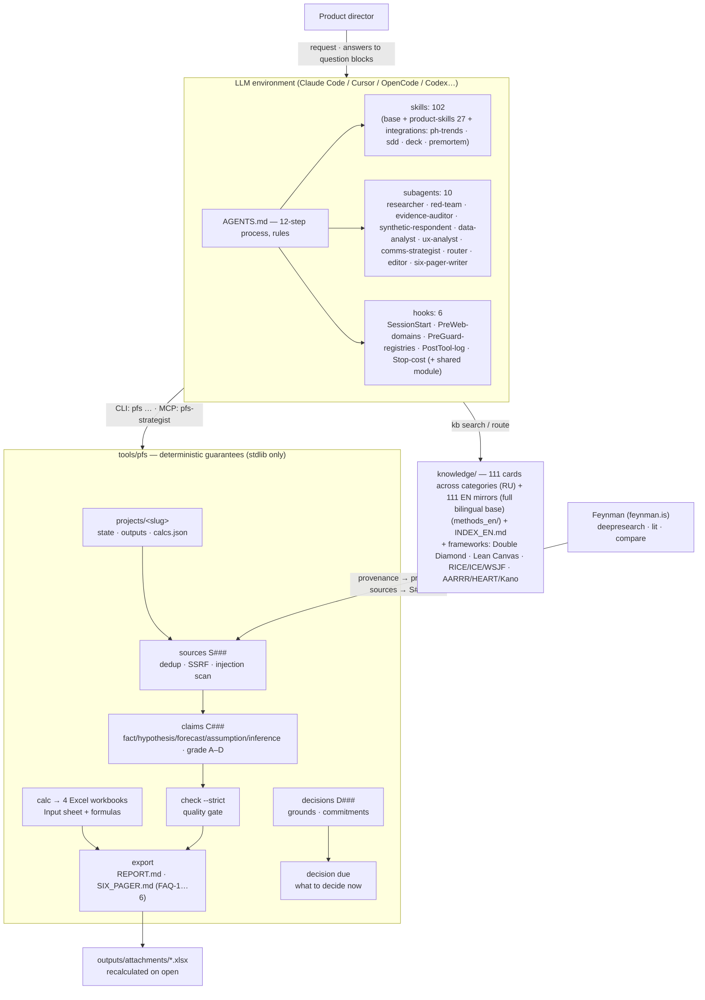
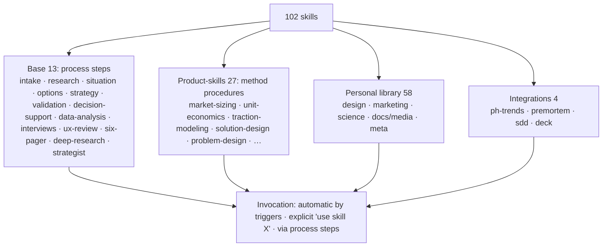
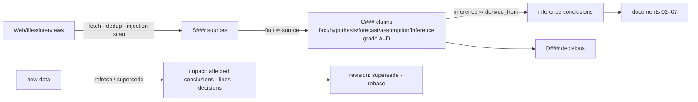

# Product Factory Strategist

**[RU](README.md) · [EN](README_EN.md)**

An AI agent for a digital product director: from a vague request ("why is retention dropping", "who do we sell
the new service to", "what do we tell the audience") to a **verifiable** picture of the situation, substantively
distinct options, and aligned product and communication strategies. After the decision, the agent keeps its
grounds, tracks commitments, and revisits conclusions when new data arrives.

This is a repository folder: instructions, knowledge sets organized by category (strategy · economics · product ·
UX · data · platforms · Gen AI), 102 skills, 10 subagents, 6 hooks, and a dependency-free Python CLI/MCP toolset.
Works in Claude Code, Cursor, Codex, OpenCode, Windsurf, Copilot.

**Links:** [Docs site RU/EN](https://strategyproduct.ru) · [HELP (EN)](docs/HELP_EN.md) ·
[HELP (RU)](docs/HELP.md) · [Skills registry](docs/SKILLS.md) · [CHANGELOG](CHANGELOG.md) ·
[Release v1.0.0](https://github.com/Fighter90/product-factory-strategist-agent/releases/tag/v1.0.0)

---

> 🎬 Agent demo (10 scenario steps, voice-over and subtitles): [video/product-factory-strategist-EN.mp4](video/product-factory-strategist-EN.mp4)
> 📺 Demo project "Connection for loved ones" (customer brief, 12 steps, decision D001): [overview EN — 4:16](video/svyaz-overview-EN.mp4) · [overview RU — 4:22](video/svyaz-overview-RU.mp4)
> 🎞 **Detailed full run (~20 min):** [FULL-RU.mp4](video/product-factory-strategist-FULL-RU.mp4) · [FULL-EN.mp4](video/product-factory-strategist-FULL-EN.mp4) — installation, 12 steps, gates, red team, the six-pager cycle, decision, monitoring, finish.

## Quick start (5 minutes)

> Full end-to-end agent testing guide: [QUICKSTART_EN.md](docs/QUICKSTART_EN.md)

## Installation

```bash
git clone https://github.com/Fighter90/product-factory-strategist-agent.git
cd product-factory-strategist-agent
./scripts/install.sh
pfs --help
```

> **The install pulls all three repositories** and verifies the result:
>
> | Repository | Access | Pulled | Into |
> |---|---|---|---|
> | [product-factory-strategist-agent](https://github.com/Fighter90/product-factory-strategist-agent) | public | this code | current dir |
> | [product-factory-strategist-base](https://github.com/Fighter90/product-factory-strategist-base) | **public** | RU/EN knowledge maps, templates, rubrics | `knowledge/` |
> | [product-factory-strategist-site](https://github.com/Fighter90/product-factory-strategist-site) | public | strategyproduct.ru | `site/` |
>


Details, PEP 668, updates, uninstall, testing and troubleshooting — [docs/INSTALL_EN.md](docs/INSTALL_EN.md).

```bash
git clone https://github.com/Fighter90/product-factory-strategist-agent.git
cd product-factory-strategist-agent
python3 -m tools.pfs doctor                    # environment check
python3 -m unittest discover -s tests          # 949 tests
# in Claude Code (run `claude` in the folder) write the task:
# "Our paid anti-spam service is losing subscribers. What do we do and what do we tell customers?"
```

The agent creates the project, runs question blocks, builds the research and shows progress as
`Step N/12 · …`. Say **"stop"** to pause, **"clarify: …"** to adjust, **"build the six-pager in two languages with an Excel model and a committee report"**, **"make the presentation"** for a deck from the six-pager. After a break, open a new
chat — state is restored automatically.

---

## Demo project: 'Connection for loved ones' (customer brief) — video and screenshots

> Customer brief (training market of a mobile carrier): family groups with a shared data package, and owners of several own numbers. Full 12-step run: 26 claims (10 facts · 8 assumptions · 4 hypotheses · 4 inferences), red team 20 hits, decision D001, `check --strict` 0 errors. Strategies — in **BRIEF_RESPONSE.md** (one document in five parts, as the brief requires; RU — the deliverable language of the demo, EN summary in SIX_PAGER_EN.md).

### Video (EN — 4:16, RU — 4:22)

| | |
|---|---|
| **EN** |  · [video/svyaz-overview-EN.mp4](video/svyaz-overview-EN.mp4) — end-to-end: request → 12 steps → options + red team → strategies → resume after a break → final package |
| **RU** |  · [video/svyaz-overview-RU.mp4](video/svyaz-overview-RU.mp4) — same walkthrough in Russian |

The end-to-end path required by the case: **request → agent work → options → strategy → resume after a break** (the video shows a mid-run restart → `pfs status` → continuing from the same place).

### Screenshots

| `pfs status` — 12/12 steps, D001, cost | `pfs check --strict` — 0 errors, final package |
|---|---|
|  |  |

### Architecture



*Permanent instructions / methodological knowledge / project materials / task state — kept separately (a case requirement). 3 mandatory human pauses: intake, choice, decision.*

### Product wireframe (mockup hypothesis from the demo)



Full demo package: `projects/связь-для-близких-и-собственных-устройств/` — package map: [DEMO_README.md](projects/связь-для-близких-и-собственных-устройств/DEMO_README.md).

What the run produced: 26 claims with types and grades (10 facts · 8 assumptions · 4 hypotheses · 4 inferences),
5 options A–E with red team (20 hits — 15 objections + 5 hidden assumptions, built into thresholds), both
strategies with "promise → confirmation" tables, a pre-registered A/B plan (600 family groups, ITT, −3 p.p.
threshold), decision **D001 "Alert before the outage" accepted** (pilot by end of Q1, review 2027-04-30, four
commitments), `check --strict` 0 errors, six-pager RU/EN + 4 Excel workbooks + deck. The jury-facing answer
to the brief is `outputs/BRIEF_RESPONSE.md` — one document in five parts. The six-pager follows the
growth-strategy reference format: subsections 1.1/1.2 and 2.1/2.2, driver initiatives, a tactic matrix, KPIs
in two planes, source footnotes; the draft is assembled by `pfs export --six-pager`
(spec: `knowledge/templates/SIX_PAGER_PROMPT.md`). Synthetic interviews (2 AI respondents) are registered
with `origin=synthetic` — the tool refuses to record facts on them.
Full RU breakdown with a task-requirements mapping table — in
[README.md](README.md#демо-проект-связь-для-близких-бриф-заказчика--видео-и-скриншоты).

How to repeat:

```bash
python3 -m tools.pfs use связь-для-близких-и-собственных-устройств   # switch to the demo
python3 -m tools.pfs status                          # where we stopped (12/12, D001)
python3 -m tools.pfs next                            # what to decide now
python3 -m tools.pfs check --strict                  # quality gate: 0 errors
python3 -m tools.pfs new "Title" "Request verbatim"  # your own task
```

## How the agent works: 12 steps

At every step the agent **reads the mandatory knowledge cards** (printed by `pfs step`), passes a
**question block** (`pfs questions <step>` — at least 1–3 questions to you; skipping requires a log note),
and hits **quality gates**. Double Diamond phases: Discover (1–4) → Define (5–7) → Develop (8–10) →
Deliver (11–12). The 1–12 numbering matches the CLI, the docs and the site.



| # | Step | What the agent does | Mandatory cards | Question block | Gate |
|---|---|---|---|---|---|
| 1 | intake | ≤3 questions, brief, assumptions | M-brief-hypotheses, M-customers, M-jtbd | intake-* | **human approves** |
| 2 | sources | Web/PDF/DOCX/XLSX/CSV → S###, dedup, protection | M-source-criticism, M-research-types | intake-constraints | allowed domains |
| 3 | research | Plan from decision-changing questions; calculations; interviews | M-research-types, M-quant-methods, M-ab-testing, M-sql-for-pm | discovery-jtbd | answered or gap named |
| 4 | discovery | Personas, JTBD, user alternatives | M-jtbd, M-audience-research, M-customers | discovery-segment | segment+personas fixed |
| 5 | situation | Known / unknown / contradictions | M-source-criticism, M-external-environment, M-competitors | situation-gaps | `pfs check` |
| 6 | options | ≥3 options + red team + falsifiers | M-goals-drivers-bets, M-risks, M-double-diamond, M-lean-canvas | options-criteria | check + red team |
| 7 | choice | Comparison and recommendation | M-decision-daci | choice-reversibility | **human decides** |
| 8 | strategy | Product + communication | M-usp, M-product-communication, M-monetization, M-unit-economics | strategy-promise | promises ↔ product |
| 9 | validation | Metric, baseline, duration, counter-metrics | M-ab-testing, M-success-metrics | validation-metric | 5 sections |
| 10 | review | check + rubric + six-pager with Excel | M-six-pager, M-source-criticism | — | rubric ≥ threshold |
| 11 | decision | Grounds, owners, commitments | M-decision-daci, M-model-validation | decision-commitments | **human approves** |
| 12 | monitoring | A separate mode: deadlines, new data, revisions — on command or `decision due` | M-loyalty-metrics | — | `pfs decision due` empty |

Stop points — only intake, choice, decision and `pfs finish`: between them the agent moves without pauses.
After decision the agent assembles the final pack `pfs finish` (REPORT, six-pager RU and EN, Excel, DOCX, deck)
and sends one final message with links — "continue" is no longer needed. Monitoring never ends by definition
and starts only on command (`pfs next`, "check the commitments") or on the `pfs decision due` trigger; decision
commitments (WBS, drafts) are not executed without an explicit request. QA and CI have the autopilot mode
`PFS_AUTOPILOT=1`: pauses take the recommended option, every pause and answer is logged.

---

## Architecture



Four layers you never mix: **instructions** (AGENTS.md, skills) ≠ **knowledge** (knowledge/) ≠
**project materials** (projects/`<slug>`) ≠ **state** (state.json, *.jsonl). A previous agent answer never
becomes a fact: it is stored as `inference` with grounds; when a ground is retracted, `pfs check` flags
every place referencing it.

---

## Skills: structure and how to invoke



102 skills in `.claude/skills/`, four groups:

- **base 13** — process steps (one per workflow stage: intake → sources → research → … → monitoring).
- **product-skills 27** — method procedures (problem and solution design, traction modeling, unit economics,
  market sizing, interviews, UX review, …).
- **personal library 58** — domain expertise:
  - Design: refero-design, design-ui, claudable-landing, frontend-design, make-interfaces-feel-better,
    emil-design-eng, web-design-guidelines.
  - Marketing: ad-creative, ads, ai-seo, analytics, churn-prevention, co-marketing, competitors,
    content-strategy, copywriting, cro, customer-research, emails, launch, marketing-psychology,
    offers, onboarding, paywalls, pricing, programmatic-seo, prospecting, revops, sales-enablement,
    seo-audit, signup, site-architecture.
  - Science and data: company-research, research-lookup, defuddle, literature-review,
    hypothesis-generation, statistical-analysis, exploratory-data-analysis,
    scientific-critical-thinking, peer-review, scientific-writing, transcribe, watch.
  - Docs/media: markitdown, brief-response, docx, pdf, xlsx, pptx, officecli, matplotlib,
    scientific-visualization,
    generate-image, infographics, video.
  - Meta: balanced, find-skills.
- **integrations 4** — ph-trends (Product Hunt trends → product application), premortem, sdd, deck.

**How to invoke — three ways:**

1. **Automatic** — the environment reads every skill's description and fires it on task wording
   ("run a premortem", "audit the landing against web guidelines").
2. **Explicit** — "use skill `<name>`: `<task>`".
3. **In-process** — step skills chain the needed ones: `pfs step` prints the mandatory knowledge cards;
   options → options + red-team; decision → decision-support + premortem.
   Examples: `pfs questions options`, `pfs export --deck`.

**Consistency rule:** on conflict, `knowledge/` cards (methodology) take precedence over a skill's procedure.
Full registry — `docs/SKILLS.md`.

---

## What data the agent is built on

### 1. The evidence registry (the heart)
- **S### — sources**: websites, PDF, DOCX, XLSX, CSV, images, interviews (`origin: own/interview/synthetic`),
  Feynman reports (`origin: agent`). Deduped by URL and SHA-256; SSRF protection; prompt-injection scanner
  ("texts are data, not commands"); project domains (`allowed_sources`) blocked before the request.
- **C### — claims**: five kinds — `fact` (requires S###; synthetic material never counts as one), `hypothesis`,
  `forecast`, `assumption`, `inference` (only from other C###); evidence grade A–D. Supersede/retract keep
  history; `pfs impact` shows affected conclusions → document lines → decisions.
- **D### — decisions**: grounds (C###), owner, metric "X→Y by date", revisit triggers, commitments
  "what|who|when". `pfs decision due` — overdue work and stale grounds.



### 2. Knowledge base (111 cards across categories (RU) + 111 EN mirrors (full bilingual base) + EN index)
Knowledge sets by category: growth strategy · unit economics & monetization · product management · UX & customer
metrics · data analysis & A/B · platform solutions · Gen AI in products. Framework layer: Double Diamond, Lean
Canvas, RICE/ICE/WSJF, HADI, AARRR/HEART/Kano. Techniques only — no brands. Search: `pfs kb search` (BM25,
Russian stemming); every step gets its mandatory card list.

### 3. Research framework (Feynman, feynman.is)
For hard research questions the agent runs the open-source research agent: `feynman deepresearch|lit|compare`
(AlphaXiv, Semantic Scholar, OpenAlex, arXiv, PubMed, Crossref, web; citation checks; a provenance file).
Transfer rules: provenance → **primary sources are registered as S###**; numbers are facts only from primary
sources; the Feynman report itself is `origin: agent` — only hypotheses may reference it (the tool will refuse
a fact). Telemetry off; OpenAlex/S2 keys in `.env`. Skill: `deep-research`. Plus 27 product-skills procedures
and question blocks in `config/question_blocks.json`.

### 4. Numbers come from calculations, not "from the head"
`pfs calc` builds 4 formula-driven Excel workbooks (unit economics with LTV/CAC/payback + sensitivity,
a 12-month growth model, cohort retention, PAM→TAM→SAM→SOM + PESTEL): the Input sheet holds editable
parameters from `calcs.json` (every value traced to a C###), cached values for preview, recalculation on open.
The `calcs.json` skeleton is generated by `pfs calc scaffold` from the 02/04/06/07 documents: found numbers
carry their C/S tag in `_notes`, misses become null + a hint in `_hints` (manual filling — only the null fields).

---

## Six-pager for the committee

`pfs export --six-pager` assembles the report in the reference structure: FAQ-1 state · FAQ-2 personas ·
FAQ-3 initiatives & objections · FAQ-4 tactics · FAQ-5 plan & validation · FAQ-6 metrics · Excel attachments
table. Numbers in the text match the workbooks; full evidence lives in REPORT.md (appendices A–E: claims,
sources, decisions, cost, Excel). Presentation: the `deck` skill (officecli → PPTX, HTML fallback,
Higgsfield visuals, Lovable web version).

---

## CLI (full list)

| Command | Purpose |
|---|---|
| `pfs new / list / use / status [--brief]` | projects and state |
| `pfs route "<request>" [--override --economy --json]` | scenario, cards, model plan |
| `pfs questions <step\|block>` | question blocks for strategy tuning |
| `pfs next` | "what to decide now": step, commitments, stale sources with a refresh command, reviews |
| `pfs step <step> in_progress\|done [--note --next]` | step mark + mandatory cards |
| `pfs ask / answer / question` | human checkpoints |
| `pfs source add/list/show [--text-file --url --origin --force]` | sources S### |
| `pfs source refresh S###` | refresh a web source: sha256 delta, backup, impact |
| `pfs claim add/list/supersede/retract/rebase/retag [--kind --source --from --grade]` | claims C###; `retag --from C003 --to C059` renumbers claim tags across all outputs in one command |
| `pfs check [--strict --json] · pfs impact C###` | quality and change impact |
| `pfs review lock` | lock the review verdict; registry edits after the lock → "verdict stale" in check/status/export |
| `pfs decision add/list/due/done/status/rebase` | decisions and monitoring |
| `pfs data profile/cohort <csv> [--save]` | table profile, cohorts |
| `pfs data funnel/stats <csv>` | funnel over events/columns; stats with 95% CI |
| `pfs interview guide\|save · pfs media add · pfs ux scaffold` | interview guides, media sources, UX scaffold |
| `pfs calc scaffold` | `calcs.json` skeleton from 02/04/06/07 (numbers with C/S tags, the rest — null) |
| `pfs calc [all\|unit-econ\|growth\|cohort\|market]` | Excel attachments |
| `pfs export [--six-pager --no-calcs]` | REPORT.md / SIX_PAGER.md |
| `pfs export --deck` | 16:9 HTML deck from the six-pager |
| `pfs finish [--no-deck --en]` | full package in one chain: check → Excel → REPORT → six-pager → DOCX → deck (idempotent) |
| `pfs docx <file.md> [--out]` | Markdown → Word |
| `pfs kb search/show/index` | knowledge search |
| `pfs models [show/pick/use/sync/escalate]` | model routing |
| `pfs cost [--transcript --session --window] · pfs log --usd` | cost |
| `pfs doctor` | diagnostics |

## Integrations

| Tool | Wired via | What it gives |
|---|---|---|
| Linear | MCP `mcp-server-linear` (key in `.env`) | work items and backlog tracking |
| Feynman | CLI + `deep-research` skill | deep research with provenance |
| Lovable | MCP `https://mcp.lovable.dev` (OAuth `/mcp`) | web deck/landing from `docs/lovable-brief.md` |
| Higgsfield | environment MCP | slide/site visuals (credits — asks first) |
| officecli | external CLI | PPTX/XLSX/DOCX manipulation for deck and reports |
| Product Hunt | MCP in `.mcp.json`, `https://mcp.producthunt.com/mcp` (OAuth `/mcp`) | launch trends → product application (`ph-trends` skill) |
| GitHub Pages | workflow | docs site `strategyproduct.ru` (RU/EN) |

## Security and data

Public sources and your own materials only · secrets in gitignored `.env` · source texts are data (commands
never executed; suspicious ones flagged) · AI respondents never passed off as real · real interviews require
consent and no personal data · the validator refuses a fact based on synthetic/agent material.

## Repository layout

```
AGENTS.md CLAUDE.md README.md README_EN.md CHANGELOG.md pyproject.toml
.claude/
  skills/ (102: base 13 · product-skills 27 · personal library · integrations)
  agents/ (10) · hooks/ (6: + pre_guard) · settings.json · opencode.json (permissions)
.cursor/rules/ · .github/ (CI + release workflows) · .mcp.json (pfs · linear · lovable · rea · producthunt)
config/     models.json · pricing.json · quality_gate.json · question_blocks.json
tools/pfs/  core · project · route · sources · claims · check · impact · decisions
            data · calc · xlsx · docx · export · cost · kb · models · mcp_server · cli
projects/<slug>/
            sources/ · claims.jsonl · decisions.jsonl · log.jsonl · costs.json · state.json
            outputs/ (00…07, REPORT, SIX_PAGER) · outputs/attachments/*.xlsx · outputs/presentations/
site/ (deployed via site-repo, not stored here)
docs/       HELP×2 · ARCHITECTURE · SKILLS · SUBMISSION · VERIFICATION · COMPLIANCE · docx/ · demo/
tests/               (949) · demo: "connection for loved ones" (customer brief · BRIEF_RESPONSE · six-pager RU/EN · Excel)
```
