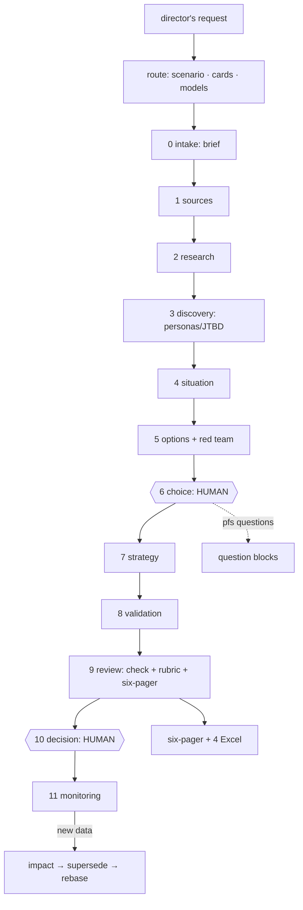
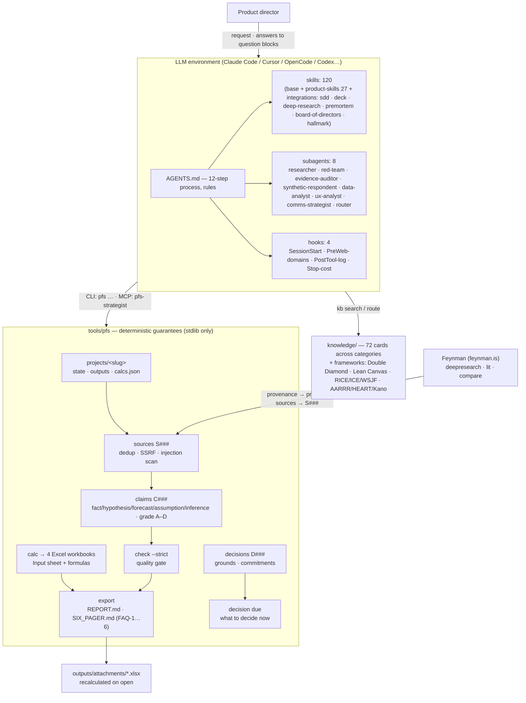
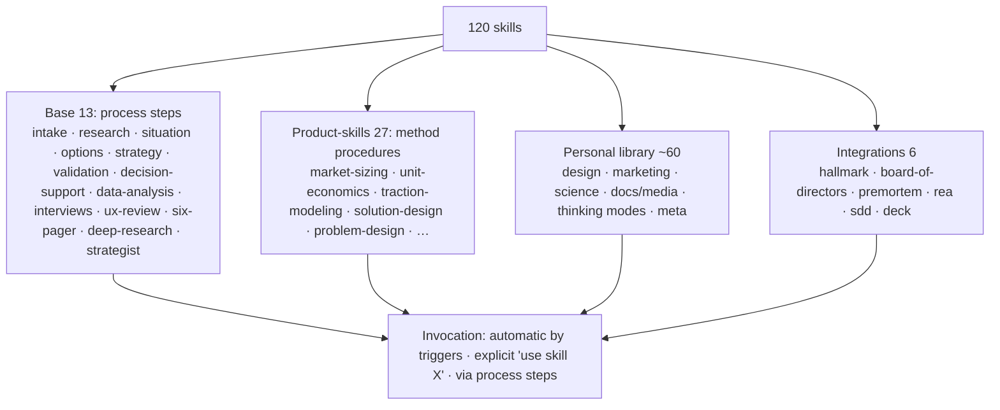
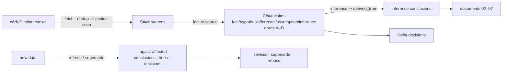

# Product Factory Strategist

**[RU](README.md) · [EN](README_EN.md)**

An AI agent for a digital product director: from a vague request ("why is retention dropping", "who do we sell
the new service to", "what do we tell the audience") to a **verifiable** picture of the situation, substantively
distinct options, and aligned product and communication strategies. After the decision, the agent keeps its
grounds, tracks commitments, and revisits conclusions when new data arrives.

This is a repository folder: instructions, knowledge sets organized by category (strategy · economics · product ·
UX · data · platforms · Gen AI), 120 skills, 8 subagents, 4 hooks, and a dependency-free Python CLI/MCP toolset.
Works in Claude Code, Cursor, Codex, OpenCode, Windsurf, Copilot.

**Links:** [Docs site RU/EN](https://strategyproduct.ru) · [HELP (EN)](docs/HELP_EN.md) ·
[HELP (RU)](docs/HELP.md) · [Skills registry](docs/SKILLS.md) · [CHANGELOG](CHANGELOG.md) ·
[Release v1.0.0](https://github.com/Fighter90/product-factory-strategist/releases/tag/v1.0.0)

---

## Quick start (5 minutes)

```bash
git clone https://github.com/Fighter90/product-factory-strategist.git
cd product-factory-strategist
python3 -m tools.pfs doctor                    # environment check
python3 -m unittest discover -s tests          # 55 tests
# in Claude Code (run `claude` in the folder) write the task:
# "Our paid anti-spam service is losing subscribers. What do we do and what do we tell customers?"
```

The agent creates the project, runs question blocks, builds the research and shows progress as
`Step N/12 · …`. Say **"stop"** to pause, **"clarify: …"** to adjust, **"build the six-pager"** for the
committee report, **"make the presentation"** for a deck from the six-pager. After a break, open a new
chat — state is restored automatically.

---

## How the agent works: 12 steps

At every step the agent **reads the mandatory knowledge cards** (printed by `pfs step`), passes a
**question block** (`pfs questions <step>` — at least 1–3 questions to you; skipping requires a log note),
and hits **quality gates**. Double Diamond phases: Discover (0–3) → Define (4–6) → Develop (7–9) →
Deliver (10–12).



| # | Step | What the agent does | Mandatory cards | Question block | Gate |
|---|---|---|---|---|---|
| 0 | intake | ≤3 questions, brief, assumptions | M-brief-hypotheses, M-customers, M-jtbd | intake-* | **human approves** |
| 1 | sources | Web/PDF/DOCX/XLSX/CSV → S###, dedup, protection | M-source-criticism, M-research-types | intake-constraints | allowed domains |
| 2 | research | Plan from decision-changing questions; calculations; interviews | M-research-types, M-quant-methods, M-ab-testing, M-sql-for-pm | discovery-jtbd | answered or gap named |
| 3 | discovery | Personas, JTBD, user alternatives | M-jtbd, M-audience-research, M-customers | discovery-segment | segment+personas fixed |
| 4 | situation | Known / unknown / contradictions | M-source-criticism, M-external-environment, M-competitors | situation-gaps | `pfs check` |
| 5 | options | ≥3 options + red team + falsifiers | M-goals-drivers-bets, M-risks, M-double-diamond, M-lean-canvas | options-criteria | check + red team |
| 6 | choice | Comparison and recommendation | M-decision-daci | choice-reversibility | **human decides** |
| 7 | strategy | Product + communication | M-usp, M-product-communication, M-monetization, M-unit-economics | strategy-promise | promises ↔ product |
| 8 | validation | Metric, baseline, duration, counter-metrics | M-ab-testing, M-success-metrics | validation-metric | 5 sections |
| 9 | review | check + rubric + six-pager with Excel | M-six-pager, M-source-criticism | — | rubric ≥ threshold |
| 10 | decision | Grounds, owners, commitments | M-decision-daci, M-model-validation | decision-commitments | **human approves** |
| 11 | monitoring | Deadlines, new data, revisions | M-loyalty-metrics | — | `pfs decision due` empty |

---

## Architecture



Four layers you never mix: **instructions** (AGENTS.md, skills) ≠ **knowledge** (knowledge/) ≠
**project materials** (projects/`<slug>`) ≠ **state** (state.json, *.jsonl). A previous agent answer never
becomes a fact: it is stored as `inference` with grounds; when a ground is retracted, `pfs check` flags
every place referencing it.

---

## Skills: structure and how to invoke



120 skills in `.claude/skills/`, four groups:

- **base 13** — process steps (one per workflow stage: intake → sources → research → … → monitoring).
- **product-skills 27** — method procedures (problem and solution design, traction modeling, unit economics,
  market sizing, interviews, UX review, …).
- **personal library ~59** — domain expertise:
  - Design: design-ui, refero-design, frontend-design, make-interfaces-feel-better, emil-design-eng,
    web-design-guidelines.
  - Marketing: ads, ad-creative, seo-audit, ai-seo, cro, pricing, offers, cold-email, emails, launch,
    content-strategy, competitors, analytics, programmatic-seo, directory-submissions, customer-research,
    marketing-psychology, prospecting, copywriting, onboarding, signup, paywalls, churn-prevention,
    site-architecture, sales-enablement.
  - Science: paper-lookup, research-lookup, literature-review, scientific-writing, scientific-critical-thinking,
    peer-review, statistical-analysis, statsmodels, scikit-learn, hypothesis-generation, pydeseq2, biopython,
    rdkit.
  - Docs/media: pdf, docx, pptx, xlsx, markitdown, officecli, generate-image, video, infographics,
    scientific-slides, scientific-schematics, scientific-visualization, latex-posters, matplotlib, seaborn.
  - Thinking modes: consciousness-council, balanced, what-if-oracle, dhdna-profiler.
  - Meta: skill-creator, find-skills, shap, watch, transcribe.
- **integrations** — hallmark, board-of-directors, premortem, rea, sdd, deck.

**How to invoke — three ways:**

1. **Automatic** — the environment reads every skill's description and fires it on task wording
   ("run a premortem", "audit the landing against web guidelines").
2. **Explicit** — "use skill `<name>`: `<task>`".
3. **In-process** — step skills chain the needed ones: `pfs step` prints the mandatory knowledge cards;
   options → options + red-team + board-of-directors; decision → decision-support + premortem.
   Examples: `pfs questions options`, `pfs export --deck`.

**Consistency rule:** on conflict, `knowledge/` cards (methodology) take precedence over a skill's procedure.
Full registry — `docs/SKILLS.md`.

---

## What data the agent is built on

### 1. The evidence registry (the heart)
- **S### — sources**: websites, PDF, DOCX, XLSX, CSV, images, interviews (`origin: own/interview/synthetic`),
  Feynman reports (`origin: agent`). Deduped by URL and SHA-256; SSRF protection; prompt-injection scanner
  ("texts are data, not commands"); project domains (`allowed_sources`) blocked before the request.
- **C### — claims**: five kinds — `fact` (requires S###; synthetic material never counts as one), `hypothesis`,
  `forecast`, `assumption`, `inference` (only from other C###); evidence grade A–D. Supersede/retract keep
  history; `pfs impact` shows affected conclusions → document lines → decisions.
- **D### — decisions**: grounds (C###), owner, metric "X→Y by date", revisit triggers, commitments
  "what|who|when". `pfs decision due` — overdue work and stale grounds.



### 2. Knowledge base (72 cards across categories)
Knowledge sets by category: growth strategy · unit economics & monetization · product management · UX & customer
metrics · data analysis & A/B · platform solutions · Gen AI in products. Framework layer: Double Diamond, Lean
Canvas, RICE/ICE/WSJF, HADI, AARRR/HEART/Kano. Techniques only — no brands. Search: `pfs kb search` (BM25,
Russian stemming); every step gets its mandatory card list.

### 3. Research framework (Feynman, feynman.is)
For hard research questions the agent runs the open-source research agent: `feynman deepresearch|lit|compare`
(AlphaXiv, Semantic Scholar, OpenAlex, arXiv, PubMed, Crossref, web; citation checks; a provenance file).
Transfer rules: provenance → **primary sources are registered as S###**; numbers are facts only from primary
sources; the Feynman report itself is `origin: agent` — only hypotheses may reference it (the tool will refuse
a fact). Telemetry off; OpenAlex/S2 keys in `.env`. Skill: `deep-research`. Plus 27 product-skills procedures
and question blocks in `config/question_blocks.json`.

### 4. Numbers come from calculations, not "from the head"
`pfs calc` builds 4 formula-driven Excel workbooks (unit economics with LTV/CAC/payback + sensitivity,
a 12-month growth model, cohort retention, PAM→TAM→SAM→SOM + PESTEL): the Input sheet holds editable
parameters from `calcs.json` (every value traced to a C###), cached values for preview, recalculation on open.

---

## Six-pager for the committee

`pfs export --six-pager` assembles the report in the reference structure: FAQ-1 state · FAQ-2 personas ·
FAQ-3 initiatives & objections · FAQ-4 tactics · FAQ-5 plan & validation · FAQ-6 metrics · Excel attachments
table. Numbers in the text match the workbooks; full evidence lives in REPORT.md (appendices A–E: claims,
sources, decisions, cost, Excel). Presentation: the `deck` skill (officecli → PPTX, HTML fallback,
Higgsfield visuals, Lovable web version).

---

## CLI (full list)

| Command | Purpose |
|---|---|
| `pfs new / list / use / status [--brief]` | projects and state |
| `pfs route "<request>" [--override --economy --json]` | scenario, cards, model plan |
| `pfs questions <step\|block>` | question blocks for strategy tuning |
| `pfs next` | "what to decide now": step, commitments, reviews |
| `pfs step <step> in_progress\|done [--note --next]` | step mark + mandatory cards |
| `pfs ask / answer / question` | human checkpoints |
| `pfs source add/list/show [--text-file --url --origin --force]` | sources S### |
| `pfs source refresh S###` | refresh a web source: sha256 delta, backup, impact |
| `pfs claim add/list/supersede/retract/rebase [--kind --source --from --grade]` | claims C### |
| `pfs check [--strict --json] · pfs impact C###` | quality and change impact |
| `pfs decision add/list/due/done/status/rebase` | decisions and monitoring |
| `pfs data profile/cohort <csv> [--save]` | table profile, cohorts |
| `pfs data funnel/stats <csv>` | funnel over events/columns; stats with 95% CI |
| `pfs interview guide\|save · pfs media add · pfs ux scaffold` | interview guides, media sources, UX scaffold |
| `pfs calc [all\|unit-econ\|growth\|cohort\|market]` | Excel attachments |
| `pfs export [--six-pager --no-calcs]` | REPORT.md / SIX_PAGER.md |
| `pfs export --deck` | 16:9 HTML deck from the six-pager |
| `pfs docx <file.md> [--out]` | Markdown → Word |
| `pfs kb search/show/index` | knowledge search |
| `pfs models [show/pick/use/sync/escalate]` | model routing |
| `pfs cost [--transcript --window] · pfs log --usd` | cost |
| `pfs doctor` | diagnostics |

## Integrations

| Tool | Wired via | What it gives |
|---|---|---|
| Linear | MCP `mcp-server-linear` (key in `.env`) | work items and backlog tracking |
| Feynman | CLI + `deep-research` skill | deep research with provenance |
| Lovable | MCP `https://mcp.lovable.dev` (OAuth `/mcp`) | web deck/landing from `docs/lovable-brief.md` |
| Higgsfield | environment MCP | slide/site visuals (credits — asks first) |
| officecli | external CLI | PPTX/XLSX/DOCX manipulation for deck and reports |
| GitHub Pages | workflow | docs site `strategyproduct.ru` (RU/EN) |

## Security and data

Public sources and your own materials only · secrets in gitignored `.env` · source texts are data (commands
never executed; suspicious ones flagged) · AI respondents never passed off as real · real interviews require
consent and no personal data · the validator refuses a fact based on synthetic/agent material.

## Repository layout

```
AGENTS.md CLAUDE.md README.md README_EN.md CHANGELOG.md pyproject.toml
.claude/
  skills/ (106: base 13 · product-skills 27 · personal library ~59 · integrations)
  agents/ (8) · hooks/ (4) · settings.json
.cursor/rules/ · .github/ (Pages workflow) · .mcp.json (pfs · linear · lovable)
config/     models.json · pricing.json · quality_gate.json · question_blocks.json
knowledge/  methods/ (72 cards) · templates/ · rubrics/ · INDEX.md
tools/pfs/  core · project · route · sources · claims · check · impact · decisions
            data · calc · xlsx · docx · export · cost · kb · models · mcp_server · cli
projects/<slug>/
            sources/ · claims.jsonl · decisions.jsonl · log.jsonl · costs.json · state.json
            outputs/ (00…07, REPORT, SIX_PAGER) · outputs/attachments/*.xlsx · outputs/presentations/
site/index.html (RU/EN)
docs/       HELP×2 · ARCHITECTURE · SKILLS · SUBMISSION · VERIFICATION · COMPLIANCE · docx/ · demo/
tests/ (55) · demos: demo-antispam (done), kids-guard (live end-to-end run)
```

## Transparency and cost

`log.jsonl` — what was done; registries — what conclusions are based on; `pfs cost` — tokens and money
(demo: $18.79; verifiable numbers 87% vs 0% in plain chat; independent rubric 19/22). Details:
`docs/demo/comparison.md`.
