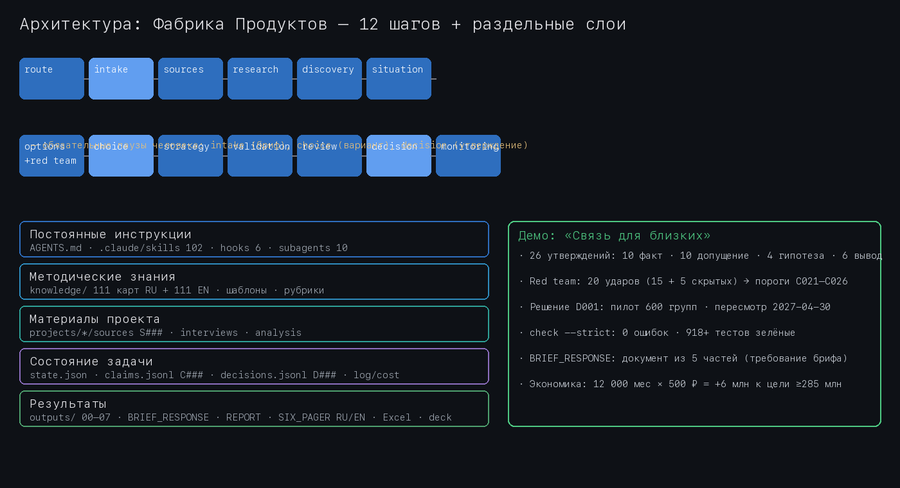
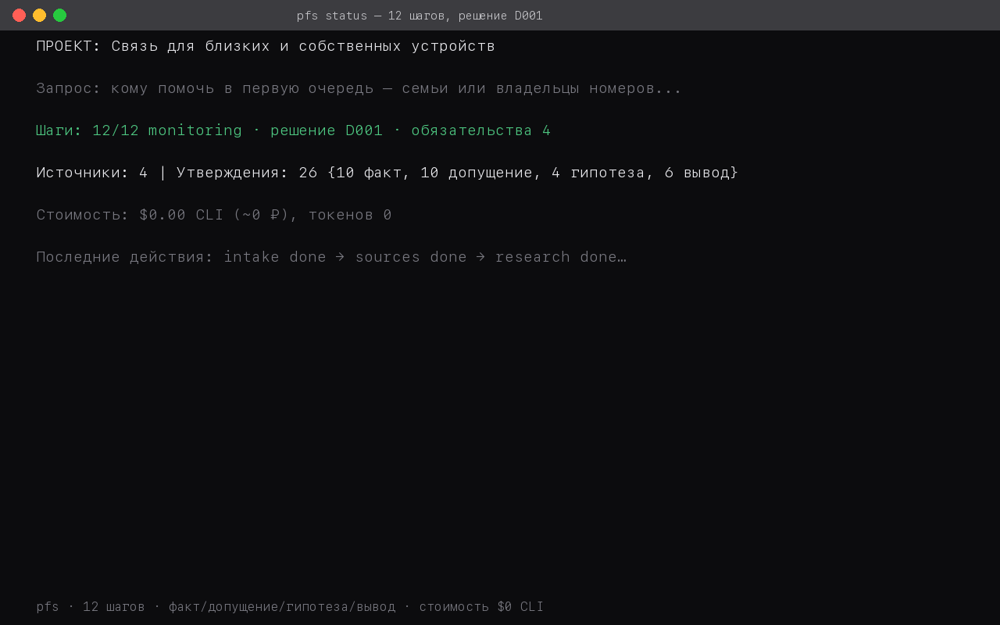
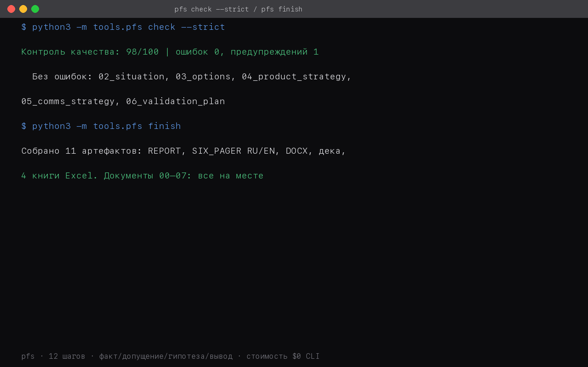
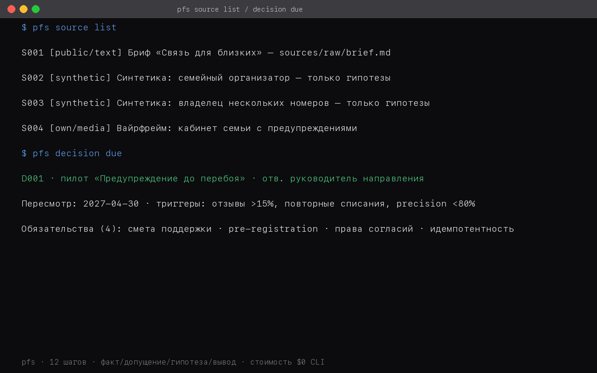

# Product Factory Strategist — work description

> Document for the jury. Converts to PDF: `pandoc docs/SUBMISSION_EN.md -o submission_en.pdf` (or "Print → PDF" from GitHub).

> Screenshots for the PDF: files in `projects/связь-для-близких-и-собственных-устройств/outputs/*`
> (BRIEF_RESPONSE.md, REPORT.md/.docx, SIX_PAGER RU/EN .docx, Excel in `outputs/attachments/`; product mockup: `sources/raw/wireframe-kabinet.png`).

## 1. What it is and how to run it

An agent repository for a digital product leader: it turns a vague request and heterogeneous materials into a verifiable
picture of the situation, ≥3 meaningfully different options (including "keep as is" and "shut down"), and aligned product
and communication strategies with a validation plan; after the decision — follow-through (grounds, commitments, revision).

Run: Python 3.9+ with no packages → `python3 -m tools.pfs doctor` → open the folder in Claude Code and write the task.
Details — [README_EN](../README_EN.md).

## 2. Architecture

See [ARCHITECTURE.md](ARCHITECTURE.md). In brief:

- **Process:** route → intake ⏸ → sources → research → discovery → situation → options (+red team) → choice ⏸ → strategy →
  validation → review → decision ⏸ → monitoring. ⏸ — the human decides; the agent drives the rest itself and marks steps in state.json.
- **Tooling:** the `pfs` CLI (Python stdlib): state and continuation, the source registry (website/PDF/DOCX/XLSX/CSV ingestion,
  deduplication, an injected-instruction detector, allowed domains, SSRF protection), the claims registry with rules,
  a quality gate, impact analysis, decisions, cost from transcripts, knowledge-base search, data profiling and cohorts,
  scenario and model routing. The same functions work over MCP (`.mcp.json`).
- **Context and knowledge:** instructions (AGENTS.md, skills, agents) / method knowledge (knowledge/, 111 RU maps + 111 EN mirrors — a fully bilingual base in methods_en/ + INDEX_EN.md) / settings
  (config/) / project materials (projects/*/sources) / state (state.json, *.jsonl) / outputs (outputs/) — kept separate.
  The agent never loads the whole base: `pfs route` lists the maps, `pfs kb search` returns map sections (BM25).
- **Hooks:** SessionStart (project context in a new chat), PreToolUse/WebFetch (allowed domains),
  PostToolUse (journal, injected-instruction detector in web answers, automatic document check), Stop (cost).

## 3. Models, services and tools

| Component | What for | Configured in |
|---|---|---|
| Claude Opus 5.5 (`deep`) | intake, the situation picture, options, red team, strategy | config/models.json |
| Claude Sonnet 5.5 (`balanced`) | desk research, data/UX/interview analysis, communication wording, validation plan, revision | config/models.json |
| Claude Haiku 5.5 (`fast`) | request classification, excerpts, claim type, rubric scoring, AI respondents | config/models.json |
| Claude Fable 5.1 (`frontier`, optional) | final check of high-stakes decisions (`--critical`) | config/models.json |
| Profiles `cursor-mixed`, `ru-local` | porting to Cursor / a RU-only setup (GigaChat etc.) | `pfs models use <profile>` |
| Claude Code | execution environment: the agent loop, WebSearch/WebFetch, skills, subagents, hooks, MCP | CLAUDE.md, .claude/ |
| Environment WebSearch / WebFetch | search and reading of open sources | — |
| pfs CLI + MCP server (Python stdlib) | verifiability guarantees, state, cost | tools/pfs |
| pdftotext / pypdf (optional) | extracting text from PDFs | — |
| unittest | 949 tool tests | tests/ |

## 4. Key prompts and instructions

- Main instructions: [AGENTS.md](../AGENTS.md) (EN mirror: [AGENTS_EN.md](../AGENTS_EN.md)) — 9 immutable rules, a process
  table with gates, models, transparency.
- Guides (RU/EN): [HELP](HELP_EN.md) · [INSTALL](INSTALL_EN.md) · [QUICKSTART](QUICKSTART_EN.md) · [USER_GUIDE](USER_GUIDE_EN.md) · [ADMIN_GUIDE](ADMIN_GUIDE_EN.md) · [SUPPORT](SUPPORT_EN.md); rendered versions (docx/pdf, 24 files) — `docs/manuals/`.
- Step skills: [.claude/skills/](../.claude/skills) — `strategist` (entry point), `intake`, `research`, `situation`,
  `options`, `strategy`, `validation-plan`, `interviews`, `ux-review`, `data-analysis`, `decision-support`.
- Subagents: [.claude/agents/](../.claude/agents) — `researcher`, `red-team`, `evidence-auditor`, `synthetic-respondent`,
  `data-analyst`, `ux-analyst`, `comms-strategist`, `router`, `six-pager-writer` (PRO-46), `editor`.
- Quality rubric: [knowledge/rubrics/strategy_quality.md](../knowledge/rubrics/strategy_quality.md); output templates: [knowledge/templates/](../knowledge/templates).
- Method base: 111 maps (RU) + 111 EN mirrors — a fully bilingual base (methods_en/) and an EN index (INDEX_EN.md) in [knowledge/](../knowledge) — knowledge sets by category (strategy, economics, product, UX, data, platforms, Gen AI) + the "PM approaches" set (Continuous Discovery, PMF Survey, Lean Startup, North Star Playbook, Crossing the Chasm, Dual-Track Agile, Wardley Mapping, the product life cycle):
  strategy and growth · unit economics and monetization · product management · UX and customer metrics · data analysis ·
  platform decisions · Gen AI (methods only, no brands); navigation — [INDEX.md](../knowledge/INDEX.md).

## 5. Extra-level features implemented

| Feature | How it is implemented | Proof in the demo |
|---|---|---|
| Interviews and model respondents | the `interviews` skill, a guide template, the `synthetic-respondent` subagent; origin `synthetic` → hypotheses only (a rule in code) | 2 AI respondents (a community organizer, a router owner) → S002–S003 → hypotheses |
| Images, audio, video | registering media as a source + describing only what is visible | the cabinet mockup — source S004 (`pfs media add`), description of only what is visible; overview videos RU/EN in `video/` |
| UX analysis | the `ux-review` skill, a heuristic map tied to the visible element; the `ux-analyst` subagent | `06_ux_review_S004.md` — the mockup analyzed by heuristics, only what is visible |
| Data analysis | `pfs data profile` (types, gaps, duplicates, units, missing periods), `pfs data cohort`, scripts in analysis/ with a reproduction command | a reproducible calculation: `analysis/economics.py` → `economics_out.txt` — scenarios +6.75/+4.5/+1.5/−1.5/−3.5M [C003,C021] |
| Decision support | `pfs decision add/due/done/status`: grounds C###, owners, metrics, revision conditions, commitments, stale grounds | D001 + `decision due` |
| Revision on new data | `claim supersede/retract/rebase` + `pfs impact` (the graph source → claim → inference → document line → decision) + `check` catches references to retracted claims | the `claims.jsonl` registry (26 active claims; history preserved — C018 superseded); the mechanism is covered by tests |
| Routing | `pfs route` (scenario, maps, questions), `config/models.json` (a model per task, escalation, economy, profiles), the `--override` fix | the model plan in the demo |
| Skills, hooks, subagents | 102 skills / 6 hooks / 10 subagents (router, researcher, data-analyst, synthetic-respondent, ux-analyst, red-team, comms-strategist, evidence-auditor, six-pager-writer, editor) | the whole demo run |
| MCP and CLI | the `pfs` CLI (25+ commands) + the `pfs-strategist` MCP server (18 tools) | the demo run goes through CLI+MCP |
| Knowledge base | 111 maps (RU) + 111 EN mirrors — a fully bilingual base and an EN index, BM25 search, `related` links, a broken-link check; project memory without turning inferences into facts; record retraction | `pfs kb search` |
| Resilience | atomic writes, idempotent commands, explicit network errors, a journal | an interruption in the demo run: a new chat → `pfs status` → continuation from the same place (shown in the video, §7) |
| Portability | state in files; AGENTS.md + .cursor/rules + copilot-instructions + MCP | — |
| Comparison with the original way | `docs/demo/compare.py` against a plain-chat answer | [demo/comparison.md](demo/comparison.md) — the baseline vs the agent (BRIEF_RESPONSE) on 7 measurable criteria |

## 6. Demo project: "Connection for Loved Ones" — 12 steps, synthetic respondents, human help

**Task (the client brief, a fictional mobile-operator market):** "Your team is responsible for the services of a fictional
mobile operator. Some customers help their loved ones stay connected. Others run several numbers of their own.
Decide who to help first, what exactly to change, and why the operator should invest money in this".
Axes: planned-year gross profit ≥ ₽285M (the "no change" base — 279 [C002]); constraints due to exhaustion 12% → 9%
(−3 pp) [C013]. Per the brief, the answer is given as **one five-part memo** — this is
[BRIEF_RESPONSE.md](../projects/связь-для-близких-и-собственных-устройств/outputs/BRIEF_RESPONSE.md):
calculations next to decisions, every number tagged with its sources.
The result: [REPORT.md](../projects/связь-для-близких-и-собственных-устройств/outputs/REPORT.md) (MD/DOCX/PDF),
six-pagers in two languages — [SIX_PAGER](../projects/связь-для-близких-и-собственных-устройств/outputs/SIX_PAGER.md) and
[SIX_PAGER_EN](../projects/связь-для-близких-и-собственных-устройств/outputs/SIX_PAGER_EN.md) (each in MD/DOCX —
the committee's detailed text: inferences, grounds, calculations), an Excel model — 4 formula workbooks in `outputs/attachments/`,
the deck — `outputs/presentations/deck.html`. A 60-second map of the package —
[DEMO_README.md](../projects/связь-для-близких-и-собственных-устройств/DEMO_README.md).
Public context: the brief [S001] is published on the case page; it entered the run as the lead's material —
the full text is in `sources/raw/brief.md`.

**How the work went (12 steps, per the `log.jsonl` journal):** route → the map brigade and the model plan → intake (the brief
from the lead, decisions Q1 "allocate people and money for a pilot?", Q2 "expand the coverage?") → 4 sources
(S001 the brief, S002–S003 AI respondents — a community organizer and a router owner, S004 the cabinet mockup) → a research plan
built from 7 questions that could change the decision → discovery: segments C1–C3 → situation: what is known [C001–C010],
what we don't know (cause frequencies — assumptions [C011,C012]), the contradiction "data exists — no alerts" →
**5 options A–E, including "keep as is" and "shut down the service"** → the red-team subagent: 15 objections + 5 hidden
assumptions (20 hits), built in as thresholds [C021–C026] → the lead's choice: **B — "Alert before disruption"**
(an alert to the organizer when a member's balance is low and a payment is due; granular consents) →
both strategies with "promise → what confirms it" tables → the validation plan: pre-registration, an A/B test on 600 family groups
(6 weeks of recruitment + 14 days of observation, ITT), the expansion threshold −3 pp, stop metrics (precision ≥80%,
the recruitment pace, repeat charges) → **review: `check --strict`, 0 errors** → decision D001 approved by the lead (the pilot by the end of
Q1; planned-year expansion only at effect ≥−3 pp; review on 2027-04-30; 4 commitments) →
monitoring: `pfs decision due`.

| Indicator | Value |
|---|---|
| Sources / claims | 4 sources (S001–S004; 2 of them — AI respondents); 26 active claims C001–C027 (10 facts · 8 assumptions · 4 hypotheses · 4 inferences), the registry history is preserved (C018 superseded) |
| Options and red team | 5 options A–E; 20 red-team hits (15 objections + 5 hidden assumptions) |
| Excel | 4 formula workbooks; recalculated on open |
| Quality | `check --strict`: 0 errors (98/100; the only warning is a false positive — the full text of brief S001 was verified manually); six-pagers RU/EN — 0 linter errors |
| Human help | 3 mandatory pauses: the brief, choosing option B, approving decision D001 |
| Synthetic — honestly | the AI respondents (S002–S003) are marked origin=synthetic: hypotheses, not proof of demand — the checker refuses to record facts based on them |

**Demo economics** [C003]: the ₽6M gap to target = **12,000 additional paid months × ₽500**; the target scenario
5,500 numbers × 3 months − ₽1.5M expenses = **+₽6.75M → ₽285.8M (the target is met)**; conservative 283.5,
adverse 280.5, "zero" 277.5, "minus" with churn 275.5 [C003,C021]. The calculation is reproducible:
`analysis/economics.py` → `economics_out.txt`.

**Comparison with the original way:** every number in the report carries source tags and passed `check --strict`
(0 errors); the full package "research → options → strategies → plan → decision" is produced by one end-to-end
agent run.

## 7. Video recording of the agent's work (≤10 minutes)

- **RU (the required recording, 4:22 ≤ 10 min):** [video/svyaz-overview-RU.mp4](../video/svyaz-overview-RU.mp4) — the end-to-end path through the "Connection for Loved Ones" demo: the request → 12 steps → 5 options + red team (20 hits) → strategies → **continuation after an interruption** (`pfs status` → the same place) → decision D001 → the finish pack with BRIEF_RESPONSE (5 parts). Voice-over and subtitles.
- **EN (the required recording, 4:16 ≤ 10 min):** [video/svyaz-overview-EN.mp4](../video/svyaz-overview-EN.mp4) — the same walkthrough in English.
- **Demo walkthrough (RU 1:01 / EN 1:04):** [video/svyaz-walkthrough-RU.mp4](../video/svyaz-walkthrough-RU.mp4) · [video/svyaz-walkthrough-EN.mp4](../video/svyaz-walkthrough-EN.mp4) — the demo package in 60 seconds: files, numbers, registries.
- **The detailed full run of the new demo (RU 8:42 / EN 7:52):** [video/svyaz-FULL-RU.mp4](../video/svyaz-FULL-RU.mp4) · [video/svyaz-FULL-EN.mp4](../video/svyaz-FULL-EN.mp4) — in the build (the final assembly).
- **Also included — overview walkthroughs:** RU (1:50) [video/product-factory-strategist-RU.mp4](../video/product-factory-strategist-RU.mp4) · EN (1:37) [video/product-factory-strategist-EN.mp4](../video/product-factory-strategist-EN.mp4) — 10 scenarios from VIDEO_SCRIPT.md; the agent presentation (24 slides) — [presentation/agent-overview-RU.pptx](../presentation/agent-overview-RU.pptx) / [.pdf](../presentation/agent-overview-RU.pdf) / [EN](../presentation/agent-overview-EN.pptx) / [EN .pdf](../presentation/agent-overview-EN.pdf).
- **Also included — the detailed full run (~20 min):** [video/product-factory-strategist-FULL-RU.mp4](../video/product-factory-strategist-FULL-RU.mp4) — installation and doctor, the test suite, project creation and routing, the intake pause, sources with protections, the claims registry, steps 1–12, red team, the strict gate, 4 Excel workbooks, the six-pager writer loop down to 0 errors, the decision with grounds, monitoring, continuation after an interruption, finish, cost; [FULL-EN.mp4](../video/product-factory-strategist-FULL-EN.mp4) — the same walkthrough in English.

## 8. Time and costs

**Installation:** one command, `bash scripts/install.sh` — 3 repositories, the `pfs` CLI globally,
the `pfs doctor` self-check; ~5 minutes with no manual setup (confirmed by an independent QA run
on a clean Linux machine).

**The reference QUICKSTART CLI run** (12 steps + decision + the finish assembly, no LLM):
~3 seconds for the full cycle; 0 tokens, $0.00 — all the mechanics (registries, gates, the committee linter,
Excel, export, journals) runs on stdlib Python. RU and EN cycles run identically
(EN: `pfs new --lang en`).

**The full cycle with the agent (LLM):** time and cost depend on the execution environment, the chosen
models (`pfs models`, the fast/balanced/deep profiles, the `--economy` mode) and provider pricing.
The "Connection for Loved Ones" demo completed the full 12-step cycle in **~59 minutes** (the `log.jsonl`
journal: 14:30 → 15:29 — from project creation to decision D001, including three human pauses). The cost of
LLM sessions was not passed to `pfs cost` by the development environment; the accounting mechanisms
(`pfs cost`, `pfs log --usd`, `--human-minutes`) work and are covered by tests.

**Human participation:** three mandatory pauses — the brief (intake), choosing an option (choice),
approving the decision (decision); between them the agent drives the steps itself. The `PFS_AUTOPILOT=1`
mode passes the pauses without a human (the QA/CI mode).

**Live runs on new tasks (the OpenCode autopilot, reports in [qa/](../qa)):** three tasks that were not in the demo — anti-spam,
budget-app, a price increase (RU/EN, 2026-11-11) — and two runs on the brief's topic on fresh clones, 2026-11-19:
[RU](../qa/E2E-2026-11-19-svyaz-ru.md) — all 12 steps in one session up to `pfs finish`, `check --strict` 0 errors, 69.7 min;
[EN](../qa/E2E-2026-11-19-svyaz-en.md) — 96/100, 0 errors, `pfs finish`. The live LLM cycle in these runs was reproduced
independently of the development environment.

**Known development-cycle errors** — found and fixed along the way (the full history:
`CHANGELOG.md` and tasks PRO-46…PRO-130 in Linear). In the "Connection for Loved Ones" demo: the only
`check --strict` warning is a false positive (the detector did not see the full text of brief S001,
verified manually); the independent review audit gave **46/60 — five defects** (red-team
hit counts, a scenario mismatch, the target scenario taken from inside the decision boundary, the timeline, the consent
thresholds) — all fixed (PRO-130). Earlier: the arithmetic cross-check caught discrepancies
with `calcs.json` (a share instead of a percentage), the committee linter demanded term explanations and
footnotes, `pfs finish` refused to assemble the package with one linter error — the gates work
as detectors, not formalities.

## 10. Data and security

- **Open data only:** the demo is built on the published case brief [S001] and the product mockup [S004]; there is no client
  internal data. The allowed domains are listed in `project.json` and enforced by the hook before every WebFetch
  (SSRF protection).
- **No secrets in the repo:** `.env` is in `.gitignore`; the repository contains only `.env.example`; the independent check is
  [VERIFICATION.md](VERIFICATION.md) ("secrets and personal data are absent").
- **Instructions from sources do not change the rules:** page texts are data, not instructions (rule №4 in [AGENTS.md](../AGENTS.md));
  the injected-instruction detector flags such places in the journal.
- **Interviews:** in the demo the respondents are synthetic (AI, `interviews/synthetic/`, origin=synthetic, hypotheses only
  [S002–S003]); there is no personal data, and real interviews are registered only from materials explicitly provided by the lead.

## 9. Limitations of the claimed capabilities

1. **The live LLM cycle** was not independently reproduced outside the development environment:
   the work of the agent "brain" is confirmed by the demo-run artifacts (BRIEF_RESPONSE,
   documents 00–07, six-pagers RU/EN, REPORT, Excel, the deck) and the instruction files, not by a repeat run.
2. **Live external MCP servers** (`linear`, `producthunt`, `lovable`, `rea`) require
   OAuth authorization or keys in `.env` and connect optionally; without them the agent
   runs on CLI mechanics and the built-in `pfs-strategist` MCP server.
3. **pypdf** — an optional component: without it, PDF source ingestion degrades
   (text is not extracted; a manual excerpt via `--text-file` remains).
4. **The LLM-part cost** depends on the environment, the models and provider pricing — cost figures
   are not given in the materials; the run time is recorded from the journal (§8: ~59 minutes) along with the CLI part.
5. **SSL remediation** depends on the installation method (uv tool → `uv tool install --with certifi`;
   venv/system → `pip install certifi`, on macOS — "Install Certificates.command"):
   the hint adapts automatically (PRO-82); TLS verification is never disabled.
6. **Localization cosmetics:** Excel attachment sheet captions stay in RU spelling
   for EN projects; Cyrillic in quotes of Russian-language sources inside an EN document is legitimate
   (the source is quoted verbatim). Question blocks have EN variants for every step (PRO-132);
   a few deeper CLI strings may still print in Russian.
