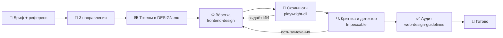

# 🎨 Фронтенд без AI-слопа

**Установка лучшего бесплатного сетапа для дизайна и фронтенда в Claude Code**

`Стоимость: 0 ₽ сверх подписки Claude` · `Время: ~40 минут` · `Среда: VS Code + WSL Ubuntu + Claude Code` · `Актуально на: 24.09.2026`

---

## ⚡ TL;DR

1. **Модель решает больше всего.** На Pro работаем на Opus 5, на Max переключаемся на Fable 5.1 для UI-задач.
2. **Генерирует** официальный `frontend-design` от Anthropic. У него самые сильные доказательства в слепых тестах.
3. **Критикует и ловит слоп** `Impeccable`: 24 команды и детерминированный детектор без LLM.
4. **Смотрит глазами** `playwright-cli`: скриншоты на трёх ширинах после каждой итерации.
5. **Всё связывает** один скилл `/design-ui`: бриф → направление → токены → вёрстка → скриншоты → проверки.

> [!TIP]
> Правило одного генератора. На проекте работает один скилл, который придумывает дизайн (`frontend-design`). Остальные только проверяют. Два генератора спорят друг с другом, и результат становится хуже.

---

## 🧭 Почему именно так

| Решение | На чём основано |
|---|---|
| Opus 5 / Fable 5.1 | Слепой тест Startrise: Opus 5 выиграл 8 из 12 фронтенд-задач, вровень с Kimi K3. Fable 5.1 на 2-м месте Arena WebDev (1762 Elo) |
| `frontend-design` как генератор | Happycapy Skill Arena (одна модель, слепые судьи): 8.0/10, лучший на портфолио и дашборде. Отдельный бенчмарк: 100% прохождения против 28% без скилла |
| `Impeccable` как критик | Сильнее всего на втором проходе по уже работающему интерфейсу. 61 правило детектора работает без LLM и API-ключа |
| `playwright-cli` | Microsoft рекомендует CLI для кодинг-агентов: экономит токены. Цикл визуальной проверки называют главным рычагом качества |
| `context7` | Свежая документация Tailwind 4, shadcn, React. Меньше выдуманных API |

> [!NOTE]
> Честная оговорка: `Impeccable`, `Hallmark` и `frontend-design` ещё никто не сравнивал вслепую между собой. Как проверить на своих задачах, описано в разделе [🧪 Проверить самому](#-проверить-самому).

---

## 🗺️ Как это работает



---

## 🧰 Карта инструментов

| Слой | Инструмент | Роль | Цена |
|---|---|---|---|
| 🧠 Модель | Opus 5 / Fable 5.1 | Думает и пишет код | Pro / Max |
| 🎨 Генерация | `frontend-design` | Задаёт вкус и направление | Бесплатно |
| 🔍 Критика | `Impeccable` | Ревью, аудит, полировка, детектор слопа | Бесплатно |
| 🎞️ Моушн | `emil-design-eng`, `review-animations` | Анимации и мелкие детали | Бесплатно |
| ✅ Аудит | `web-design-guidelines` | Доступность, фокус, семантика | Бесплатно |
| 👀 Глаза | `playwright-cli` | Скриншоты, клики, состояния | Бесплатно |
| 🛠️ Отладка | Chrome DevTools MCP | Консоль, сеть, производительность | Бесплатно |
| 📚 Контекст | `context7`, `typescript-lsp` | Свежие доки, ошибки типов | Бесплатно |
| 🧩 Компоненты | shadcn MCP | Поиск и установка компонентов | Бесплатно |
| 🎼 Оркестр | `/design-ui` | Весь процесс одной командой | Бесплатно |

---

## 🚀 Установка

### Шаг 0. Предусловия

- [ ] В Windows стоит **VS Code** и расширение **WSL** от Microsoft
- [ ] Проект открыт из Ubuntu: `cd ~/code/<проект> && code .` (внизу слева видно «WSL: Ubuntu»)
- [ ] В WSL-окне стоит расширение **Claude Code** (Anthropic), кнопка «Install in WSL»
- [ ] Node 22 или новее: `node -v`
- [ ] Claude Code установлен: `claude --version`

### Шаг 1. Плагины

Запустите `claude` во встроенном терминале и выполните по очереди:

```text
/plugin install frontend-design@claude-plugins-official
/plugin install typescript-lsp@claude-plugins-official
/plugin install context7@claude-plugins-official
/plugin marketplace add ChromeDevTools/chrome-devtools-mcp
/plugin install chrome-devtools-mcp@chrome-devtools-plugins
/reload-plugins
```

Бинарник для TypeScript LSP ставится отдельно, в обычном терминале:

```bash
npm install -g typescript typescript-language-server
```

> [!TIP]
> Если плагин не находится по имени, откройте `/plugin` → **Discover** и поставьте его оттуда.

### Шаг 2. Глаза агента

```bash
npm install -g @playwright/cli@latest
playwright-cli install --skills -g
npx playwright install chromium
npx playwright install chrome   # нужен Chrome DevTools MCP внутри WSL
```

### Шаг 3. Скиллы моушна и аудита

```bash
npx skills add https://github.com/emilkowalski/skills --skill emil-design-eng
npx skills add https://github.com/emilkowalski/skills --skill review-animations
npx skills add https://github.com/vercel-labs/agent-skills --skill web-design-guidelines
```

Если установщик спросит агента и область, выбирайте **Claude Code** и **global**.

### Шаг 4. Каждый новый проект

В корне проекта:

```bash
npx impeccable install --providers=claude --scope=project   # скилл + хук-детектор
npx shadcn@latest mcp init --client claude                   # shadcn MCP
```

Затем в Claude Code:

```text
/impeccable init
```

Он задаст несколько вопросов о продукте и запишет ответы в `PRODUCT.md`.

> [!IMPORTANT]
> Добавьте в `.gitignore` блок Impeccable из его README (между `# impeccable-ignore-start` и `# impeccable-ignore-end`) и папку `screenshots/`.

### Шаг 5. Скилл `/design-ui`

Один раз, в обычном терминале:

```bash
mkdir -p ~/.claude/skills/design-ui && cat > ~/.claude/skills/design-ui/SKILL.md <<'EOF'
---
name: design-ui
description: Проектирование и вёрстка интерфейса без AI-слопа. Использовать для страниц, экранов, лендингов, дашбордов, форм и компонентов. Вызов /design-ui <задача>.
---

# /design-ui

Ты арт-директор и дизайн-инженер. Средний, «как у всех» результат считается провалом, даже если он работает.

Задача: $ARGUMENTS

Роли инструментов (не смешивать):
- frontend-design: единственный генератор вкуса и направления;
- impeccable: только критика, аудит, полировка и детектор (npx impeccable detect);
- emil-design-eng, review-animations: моушн;
- web-design-guidelines: финальный аудит;
- playwright-cli: скриншоты и проверка состояний.

## 1. Контекст
Прочитай PRODUCT.md и DESIGN.md. Нет PRODUCT.md: запусти /impeccable init. Вопросов не больше пяти. Если дан референс, сними скриншоты через playwright-cli и выпиши 5–7 конкретных приёмов. Чужой бренд и тексты не копировать.

## 2. Направление (до кода)
Три радикально разных направления. У каждого: название, почему подходит аудитории, пара шрифтов с лицензией, палитра в OKLCH (нейтральные тонированы, без чистых серых, #000 и #fff), принцип сетки, принцип моушна, один фирменный элемент. Дождись выбора. Если сказано «выбери сам», бери самое смелое из подходящих и объясни в одном абзаце.

## 3. Токены
Шкала шрифтов (5–7 ступеней), отступы с шагом 4px, система радиусов, многослойные тонированные тени, светлая и тёмная темы, длительности и кривые. Записать в DESIGN.md и @theme Tailwind v4. Шрифты локально через Fontsource. Компоненты shadcn перетемизировать до использования.

## 4. Вёрстка
Настоящий контент, недостающее помечать TODO. Никаких lorem, Acme, выдуманных метрик и отзывов. Состояния: hover, active, focus-visible, disabled, loading, пусто, ошибка, длинный текст. Mobile first с 375px, цели касания от 44px. Анимировать только transform и opacity, 150–300 мс, без bounce, уважать prefers-reduced-motion.

## 5. Смотри глазами
Скриншоты 375, 768, 1440px в обеих темах плюс ключевые состояния. По каждому письменно: узнал бы зритель ИИ за 3 секунды и по чему; куда смотрит глаз; где отступы не из шкалы; что убрать. Минимум две итерации.

## 6. Ворота качества
1. npx impeccable detect src/ без основных находок; осознанные исключения через ignores с причиной.
2. /impeccable critique и /impeccable audit: критичные и важные замечания исправлены.
3. review-animations, если есть анимации.
4. web-design-guidelines: нарушения MUST исправлены.
5. Контраст AA в обеих темах, фокус виден, клавиатура проходит весь экран.
6. Типы, линтер, тесты зелёные.
7. В конце /impeccable polish.

## Чёрный список
Inter, Roboto, Arial и Space Grotesk в заголовках; фиолетово-синие градиенты и градиентный текст; glassmorphism по умолчанию; центрированный герой с тремя карточками; карточки в карточках; иконка в скруглённом квадрате над каждым заголовком; эмодзи вместо иконок; один радиус и одна тень на всё; серый текст на цветном фоне; пустые фразы («Unlock the power», «Seamless»); длинное тире как декор; нетронутый shadcn; больше одной «вау»-анимации на экран.

## Отчёт
Направление и почему, пути к скриншотам до и после, осознанные отступления от правил, открытые TODO. Коммиты в отдельной ветке, без push.
EOF
```

### Шаг 6. Проверка

Перезапустите Claude Code и сверьтесь:

| Команда | Что должно быть |
|---|---|
| `/plugin` → Installed | frontend-design, typescript-lsp, context7, chrome-devtools-mcp |
| `/mcp` | chrome-devtools, context7, shadcn в статусе **Connected** |
| `/skills` | design-ui, impeccable, emil-design-eng, review-animations, web-design-guidelines, playwright-cli |
| `npx impeccable detect src/` | код выхода 0 или 2 (детектор работает) |
| `playwright-cli --help` | список команд |

---

## 🧠 Выбор модели

| Тариф | Модель для UI | Как переключить |
|---|---|---|
| **Pro** | Opus 5, входит в тариф | `/model` → Opus 5 |
| **Max** | Fable 5.1, до 50% недельного лимита | `/model` → Fable 5.1 |
| Pro, ключевой экран | Fable 5.1 за кредиты | включить usage credits |

---

## 🔁 Ежедневный цикл

```text
/design-ui главный экран: список заказов, фильтры, пустое состояние
```

Шпаргалка по доработке:

| Хочу | Команда |
|---|---|
| Честный разбор | `/impeccable critique` |
| Технический аудит | `/impeccable audit` |
| Смелее | `/impeccable bolder` |
| Спокойнее | `/impeccable quieter` |
| Убрать лишнее | `/impeccable distill` |
| Поправить шрифты | `/impeccable typeset` |
| Поправить сетку | `/impeccable layout` |
| Краевые случаи | `/impeccable harden` |
| Финальная полировка | `/impeccable polish` |
| Найти слоп без LLM | `npx impeccable detect src/` |

---

## 🧩 Альтернативные сетапы

**A. Сначала дизайн, потом код.** Для экранов, где решает внешний вид.
Claude Design (входит в Pro) → пакет передачи → Claude Code. После летнего обновления связка Design ↔ Code двусторонняя. Минус: расход токенов.

**C. Максимально бесплатно.** Для поиска направлений.
Google Stitch или Kimi K3 на kimi.com → экспорт в `DESIGN.md` → Claude Code по шагам выше.

---

## 🛟 Если что-то не так

| Симптом | Решение |
|---|---|
| `No available IDEs detected` | Команда `code` в PATH, одинаковая версия Node в Windows и WSL |
| Chrome DevTools MCP не видит браузер | `npx playwright install chrome` или флаг `--browser-url=http://127.0.0.1:9222` к Chrome в Windows |
| Impeccable не скачал движок | Песочница Claude Code режет сеть, разрешите домен из текста ошибки |
| web-design-guidelines пустой | Разрешите доступ к GitHub из песочницы |
| Плагин не найден по имени | `/plugin` → Discover |
| Результат всё равно «как у всех» | Дайте референс, запустите `/impeccable bolder`, проверьте модель через `/model` |

---

## 🚫 Чего не ставить

- **Второй генератор** рядом с `frontend-design`: `taste-skill`, `Hallmark`, `ui-ux-pro-max`, `high-end-visual-design`. Их можно пробовать, но по одному и вместо генератора, не вместе.
- **Скиллы и плагины от неизвестных авторов.** Аудит Snyk: у 36% из 3984 скиллов нашлась уязвимость, 76 оказались вредоносными.
- **Всё подряд из топа.** Число установок показывает популярность, а не пользу.

---

## 🧪 Проверить самому

Один бриф, одна страница, три ветки:

| Ветка | Сетап |
|---|---|
| `try/base` | только `frontend-design` |
| `try/impeccable` | `frontend-design` + проход `/impeccable critique` и `polish` |
| `try/taste` | `taste-skill` вместо `frontend-design` |

Снимите скриншоты на 375 и 1440px, перемешайте, покажите двум-трём людям без подписей и прогоните `npx impeccable detect`. Что выиграет, то и ваш стек.

Модели можно сравнить ещё быстрее: [designarena.ai](https://www.designarena.ai) → Website → ваш бриф → 5–10 слепых битв.

---

## 📎 Источники

- [Happycapy Skill Arena: frontend design](https://happycapy.ai/skill-arena/frontend-design)
- [frontend-design skill benchmark](https://github.com/dani-z/frontend-design-skill-benchmark)
- [Startrise: best LLM for frontend](https://www.startrise.io/blog/best-llm-for-frontend/)
- [LogRocket: AI dev tool power rankings](https://blog.logrocket.com/ai-dev-tool-power-rankings/)
- [Claude Help Center: Fable models on your plan](https://support.claude.com/en/articles/15424964-claude-fable-models-on-your-plan)
- [pbakaus/impeccable](https://github.com/pbakaus/impeccable)
- [Playwright: coding agents CLI](https://playwright.dev/docs/getting-started-cli)
- [Chrome DevTools MCP: client configurations](https://github.com/ChromeDevTools/chrome-devtools-mcp/blob/main/docs/client-configurations.md)
- [shadcn MCP](https://ui.shadcn.com/docs/registry/mcp)
- [Use Claude Code in VS Code](https://code.claude.com/docs/en/vs-code)
- [anthropics/claude-plugins-official](https://github.com/anthropics/claude-plugins-official)
- [Best Claude Code Plugins 2026: 291 ranked](https://vibecoding.app/blog/best-claude-code-plugins)
- [79mplus: Claude Code plugins and Snyk audit](https://www.79mplus.com/9-powerful-claude-code-plugins/)
- [Introducing Claude Design](https://www.anthropic.com/news/claude-design-anthropic-labs)
- [Zima: 10 Best AI Design Skills](https://shop.zimaspace.com/blogs/tech-ai-hub/10-best-ai-design-skills-tools-for-better-ui-ux)
