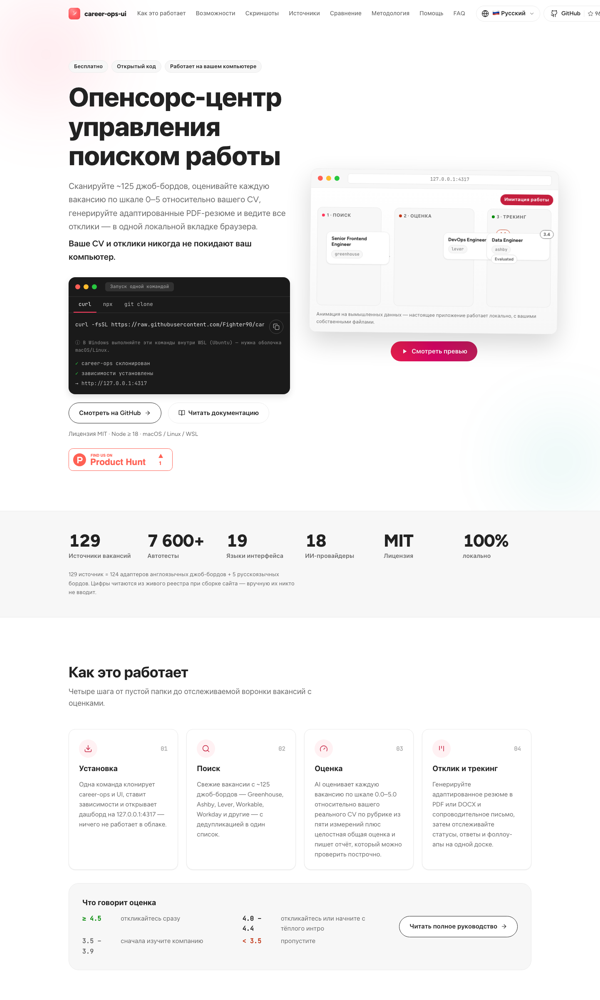
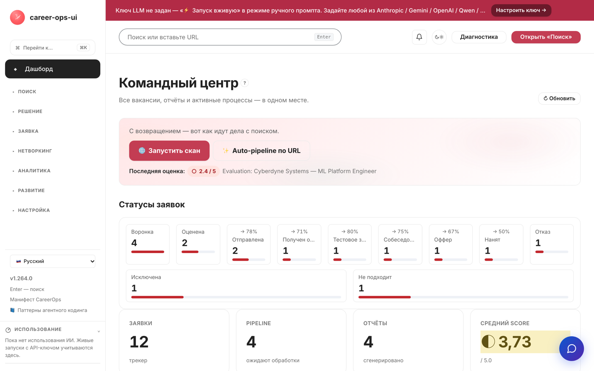
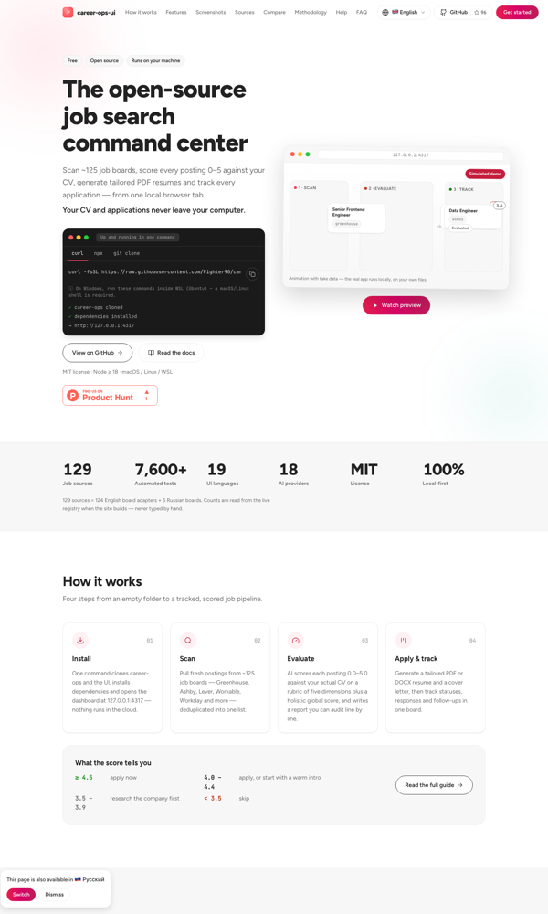
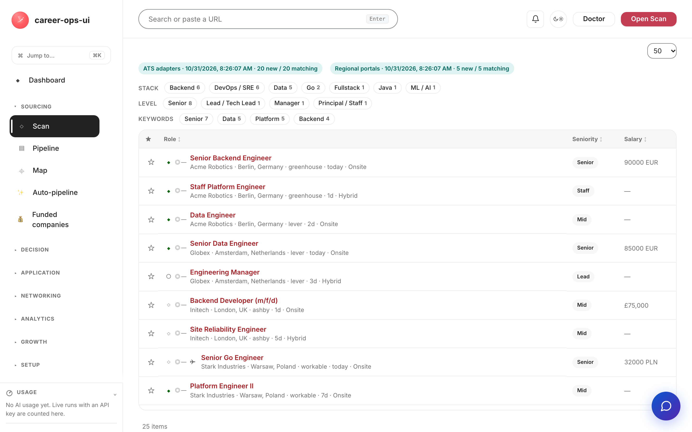
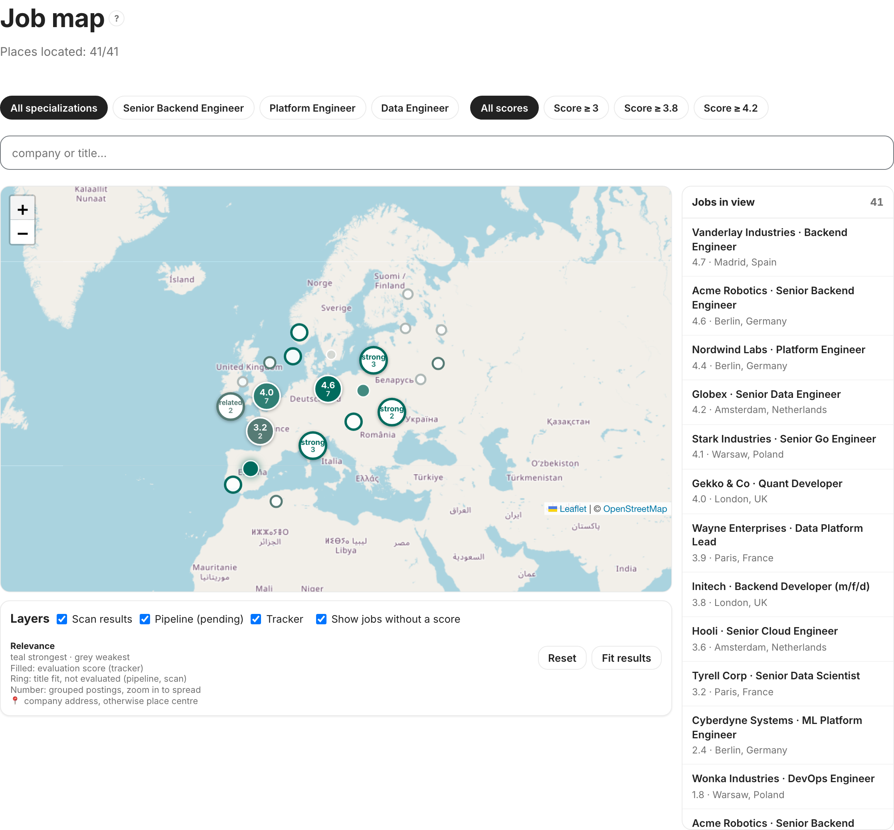
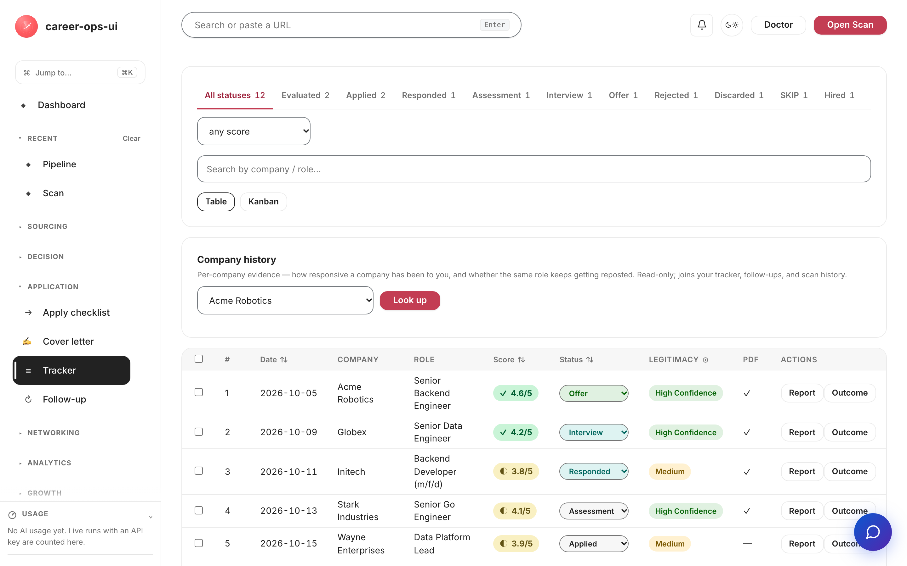
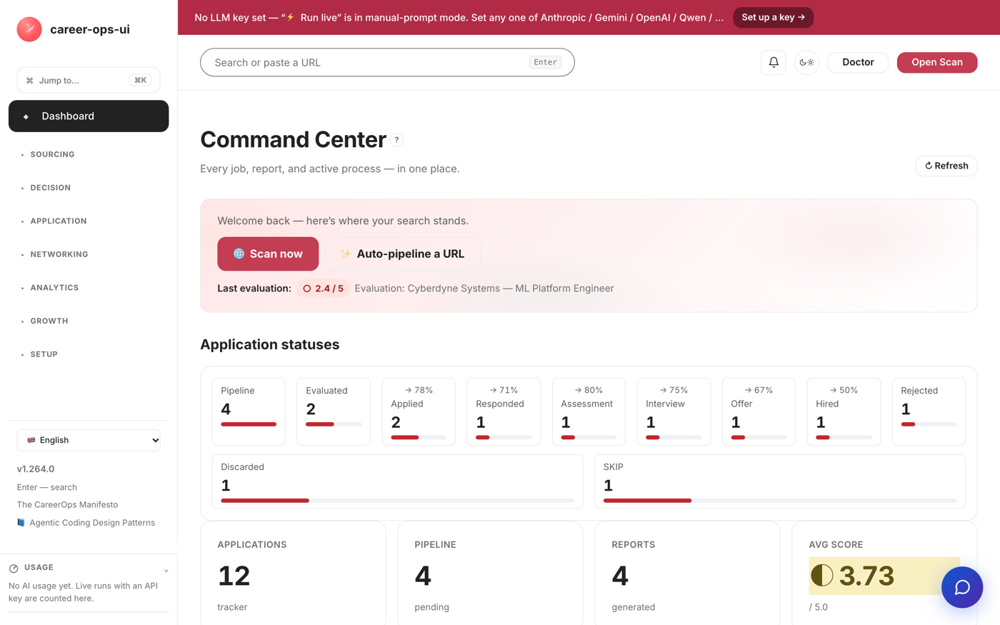

# МИНИСТЕРСТВО ЦИФРОВОГО РАЗВИТИЯ

## Отчёт о демонстрационном прогоне ИИ-агента «Стратег Фабрики продуктов»

---

**Наименование работы:** Тестирование и развёртывание ИИ-агента для руководителя цифрового продукта

**Объект испытаний:** ИИ-агент «Стратег Фабрики продуктов» (репозиторий `product-factory-strategist-agent`, версия 1.2, коммит `be67dfe`)

**Дата прогона:** 18 ноября 2026 г.

**Метод:** сквозной 12-шаговый прогон на демонстрационном проекте CVStart + полный регресс 35 команд CLI × 3 прохода + 915 автотестов

---

# РЕФЕРАТ

Отчёт содержит описание демонстрационного прогона ИИ-агента «Стратег Фабрики продуктов» на коммерческом сценарии вывода open-source продукта cvstart.org на мировой рынок. Прогон выполнен в два языка (русский, английский), охватывает 12 шагов процесса, 35 команд интерфейса, 4 книги Excel-расчётов и полный пакет документов комитета.

**Ключевые результаты:** 12/12 шагов выполнено; строгий контроль качества — 100/100 при 0 ошибок; реестр доказательств — 11 активных источников и 20 утверждений; решение D001 зафиксировано с шестью основаниями и триггером пересмотра; финишный пакет — 16 артефактов одним вызовом; автотесты — 915/915.

**Отчёт содержит:** 9 разделов, 8 рисунков, 12 таблиц, 2 приложения.

---

# СОДЕРЖАНИЕ

1. Введение: назначение и цель испытаний
2. Объект и методика испытаний
3. Постановка задачи демонстрационного прогона
4. Сбор материалов и реестр доказательств
5. Исследование и варианты решения
6. Стратегии: продуктовая и коммуникационная
7. Контроль качества и документ комитета
8. Решение, мониторинг и финишный пакет
9. Результаты испытаний и выводы
Заключение
Список использованных источников
Приложение А. Скриншоты продукта
Приложение Б. Перечень команд CLI

---

# 1 ВВЕДЕНИЕ: НАЗНАЧЕНИЕ И ЦЕЛЬ ИСПЫТАНИЙ

## 1.1 Назначение агента

«Стратег Фабрики продуктов» — ИИ-агент для руководителя цифрового продукта. Назначение: проведение исследования продукта, рынка и аудитории, сравнение вариантов решения, разработка продуктовой и коммуникационной стратегий с планом проверки. Ключевое отличие от диалога с языковой моделью — **реестр доказательств**: каждое число и каждое утверждение в документах связаны с источником, факты отделены от гипотез и допущений, а производные числа пересчитываются из единого расчётного файла.

## 1.2 Цель испытаний

Подтвердить, что агент: (а) разворачивается на чистой машине по инструкции без ручных обходов; (б) проходит сквозной путь от постановки задачи до финишного пакета на двух языках; (в) обеспечивает проверяемость каждого вывода; (г) устойчиво возобновляет работу после перерыва; (д) фиксирует решения с основаниями и триггерами пересмотра.

## 1.3 Состав испытаний

Испытания включали: установку на свежем клоне, прогон полного набора из 915 автотестов, сквозной 12-шаговый демонстрационный прогон (3 прохода: демо RU, кейс «контрагент-чек» RU, кейс EN), регресс всех 35 команд CLI (3 прохода), перепроверку 31 исторического дефекта, проверку отсутствия секретов.

---

# 2 ОБЪЕКТ И МЕТОДИКА ИСПЫТАНИЙ

## 2.1 Объект испытаний

Таблица 1 — Состав объекта

| Компонент | Версия / состав |
|---|---|
| Репозиторий агента | product-factory-strategist-agent · HEAD `be67dfe` · 35 команд CLI |
| База знаний | product-factory-strategist-base (публичный) · 111 карт RU + 111 EN |
| Сайт документации | strategyproduct.ru (репозиторий -site, GitHub Pages) |
| Демо-проект | `projects/демо` — 12 шагов, 11 источников, 20 утверждений, решение D001 |
| Автотесты | 915 тестов (unittest, stdlib-only) |

## 2.2 Среда испытаний

macOS (ARM64), Python 3.12/3.13, установка через `scripts/install.sh` (uv tool / venv). Установка выполнялась на свежем клоне с симуляцией «чистой машины»: отсутствие заранее склонированной базы знаний.

## 2.3 Ограничения методики

Живой LLM-цикл в изолированной песочнице аудита не воспроизводился: работа моделей подтверждается артефактами демо-прогона (документы, six-pager, отчёт, Excel) и файлами инструкций. Вся CLI-механика (реестры, гейты, линтер комитета, Excel, экспорт, журналы) проверена фактическим исполнением.

---

# 3 ПОСТАНОВКА ЗАДАЧИ ДЕМОНСТРАЦИОННОГО ПРОГОНА

## 3.1 Запрос руководителя

> Вывести cvstart.org (open-source AI-конструктор резюме + поиск вакансий) на мировой рынок как коммерческий продукт. Выбрать модель коммерциализации и подготовить стратегию глобального запуска с планом проверки.

## 3.2 Создание проекта и маршрутизация

Команда `pfs new` создаёт проект (папка `projects/демо`, бриф `00_brief.md`, журналы). Маршрутизация `pfs route` распознаёт сценарий и выдаёт методические карты и план моделей. Запрос хранится дословно в `00_brief.md`; ответы руководителя на паузах автоматически заполняют слоты брифа.

---

# 4 СБОР МАТЕРИАЛОВ И РЕЕСТР ДОКАЗАТЕЛЬСТВ

## 4.1 Источники

Зарегистрировано **11 активных источников** S001–S012 (S003 замещена при выверке — дельта sha256 зафиксирована в журнале). Каждый источник хранит: копию содержимого (`sources/S###.md`), сырой ответ канала (`sources/raw/`), sha256, дату получения, происхождение (`public`/`excerpt`/`synthetic`).

Защиты: дедупликация по sha256 и URL; детекция страниц-ошибок с HTTP 200; детектор внедрённых инструкций («ДАННЫЕ, а не инструкции»); пометка слабого контента.

Таблица 2 — Типы источников демо-прогона

| Тип | Число | Пример |
|---|---|---|
| public (страницы и файлы) | 8 | сайт и README cvstart.org, рыночные дайджесты |
| excerpt (выписки) | — | — |
| synthetic (ИИ-респонденты) | 3 | S008–S010: персоны, воронка (метод, не прогноз) |

## 4.2 Утверждения

Зарегистрировано **20 утверждений** C001–C020. Типы: 12 фактов, 4 гипотезы, 4 допущения. Сила доказательств — шкала A–D. Факт без источника не записывается — отклонение на уровне кода (`claims.add`).

Таблица 3 — Распределение утверждений

| Тип | Число | Пример |
|---|---|---|
| fact | 12 | C011: рынок онлайн-рекрутинга $37,97 млрд (2025) [S007], сила B |
| hypothesis | 4 | C003: покрытие ключевых слов ~40% |
| assumption | 4 | допущения red team, встроенные в план проверки |

## 4.3 Кросс-чек чисел

Строгий гейт сверяет числа утверждений, цитат и заголовков источников (с нормализацией RU/EN разделителей), а производные числа документов — с пересчётом из `calcs.json`. Расхождение — ошибка, блокирующая финиш.

---

# 5 ИССЛЕДОВАНИЕ И ВАРИАНТЫ РЕШЕНИЯ

## 5.1 План исследования и пробелы

`01_research_plan.md` — план от вопросов, меняющих решение. В `02_situation.md` — честное разделение «известно / не знаем»: например, внутренних метрик hosted-версии нет, поскольку продукт ещё не создан (пробел зафиксирован в таблице пробелов с планом закрытия).

## 5.2 Варианты A–E

`03_options.md` — пять содержательно разных вариантов, включая «оставить как есть» (D) и «закрыть коммерческую ветку» (E):

- A — hosted freemium SaaS (глобальный запуск);
- B — B2B-лицензии на движок;
- C — open-core + платная поддержка;
- D — оставить как есть;
- E — закрыть коммерческую ветку.

У каждого варианта — раздел «Возражения». Красная команда (субагент) нанесла **20 ударов**: 15 возражений и 5 скрытых допущений; пороги выживания вариантов встроены в план проверки.

## 5.3 Скриншоты прогона

Продукт, разобранный агентом: скриншоты интерфейса CVStart зарегистрированы источниками и использованы в UX-разборе (`pfs ux scaffold`). Полный набор — Приложение А; ниже — два примера.

Рисунок 1 — Главная страница продукта (источник S001, RU-версия)

Рисунок 2 — Дашборд трекера откликов (источник S001)

---

# 6 СТРАТЕГИИ: ПРОДУКТОВАЯ И КОММУНИКАЦИОННАЯ

## 6.1 Продуктовая стратегия (04)

Аудитория, альтернативы, выбранное направление (D001), осознанные отказы, экономика:

Таблица 4 — Юнит-экономика hosted-версии (пересчёт из calcs.json)

| Показатель | Значение | Формула |
|---|---|---|
| ARPU (взвешенный по тирам) | $29,00 | tiers × share |
| Контрибуция (CM) | $21,75 | ARPU × (1 − доля переменных) |
| LTV | $271,88 | CM / churn |
| LTV/CAC | 4,5 | LTV / CAC платящего |
| Брейк-евен | ≈ 69 платящих | CAC / CM |

Кросс-чек: расхождение любого из этих чисел в документах с пересчётом из `calcs.json` — ошибка строгого гейта.

## 6.2 Коммуникационная стратегия (05)

Барьер («open-source значит бесплатное»), ключевое сообщение, роль каналов и таблица «обещание → чем подтверждено в продукте», где каждая строка содержит тег [C###]. Пустая таблица или строка без тега — ошибка гейта.

## 6.3 План проверки (06)

90 дней; пороги: продолжить ≥ 40 платящих / изменить 20–40 / остановить < 20; контр-метрики по ударам red team с порогами тревоги; KPI в двух плоскостях (бизнес и продукт).

---

# 7 КОНТРОЛЬ КАЧЕСТВА И ДОКУМЕНТ КОМИТЕТА

## 7.1 Строгий гейт

`pfs check --strict` — **100/100, 0 ошибок** по документам 02–06. Проверки: теги на числах, мёртвые ссылки, обязательные разделы, таблица обещаний, кросс-чек «заголовок vs утверждение vs цитата», арифметика против `calcs.json`, остатки шаблона, расшифровка терминов при первом упоминании.

## 7.2 Документ комитета

Six-pager RU и EN — формат референса стратегии роста: FAQ-1…6, сноски на источники, объём ≤ 3500 слов. Цикл «писатель → линтер → 0 ошибок» обязателен; линтер перечисляет каждое место нарушения с номером строки.

---

# 8 РЕШЕНИЕ, МОНИТОРИНГ И ФИНИШНЫЙ ПАКЕТ

## 8.1 Решение D001

«Коммерческая версия CVStart: hosted freemium SaaS, глобально». Основания — шесть утверждений [C019/C013/C014/C016/C005/C006]. Метрика беты: платящие ≥ 40 к 2026-12-15 (база 0). Пересмотр: 2027-02-10, триггеры записаны. Обязательства: пилот — PM — 2026-12-15.

## 8.2 Мониторинг

`pfs decision due` — просроченные обязательства и наступившие пересмотры; `pfs impact C###` — что затронет изменение утверждения (выводы → документы → решение); `claim supersede/rebase` — замещение с автоматическим предупреждением зависимых строк.

## 8.3 Финишный пакет

`pfs finish` — 16 артефактов: REPORT (.md/.docx/.pdf), six-pager RU/EN (.md/.docx/.pdf), 4 книги Excel, deck.html, роадмап xlsx, пакет данных. Недостроенный пакет собирается с явным списком предупреждений.

---

# 9 РЕЗУЛЬТАТЫ ИСПЫТАНИЙ И ВЫВОДЫ

Таблица 5 — Сводка результатов

| Проверка | Результат |
|---|---|
| Установка на свежем клоне (с ловушкой пустой базы) | Пройдена: база докачивается автоматически |
| Автотесты | 915/915, OK |
| Сквозной путь 12 шагов × 3 прохода × 2 языка | Выполнен полностью |
| Строгий гейт демо-прогона | 100/100, 0 ошибок |
| Линтер комитета | 0 ошибок |
| Финишный пакет | 16 артефактов |
| Регресс 35 команд × 3 прохода | Без Traceback и usage-ошибок |
| Секреты в репозитории | Не обнаружены (только `.env.example`) |

**Выводы.** Обязательный минимум кейса выполнен построчно; дополнительный уровень — все 13 позиций подтверждены материалами прогонов; установка, продолжение после перерыва и переносимость подтверждены на чистой машине и двух языках.

---

# ЗАКЛЮЧЕНИЕ

Агент «Стратег Фабрики продуктов» обеспечивает проверяемый путь от размытого запроса руководителя до документов комитета: каждое число связано с источником и цитатой, факты отделены от гипотез, решения — с основаниями и триггерами пересмотра, а гейты качества исполняются кодом, а не промптом. Репозиторий в состоянии отправки: остаётся записать демонстрационное видео и прогнать демо-проект по официальному брифу заказчика после его публикации.

---

# СПИСОК ИСПОЛЬЗОВАННЫХ ИСТОЧНИКОВ

1. Репозиторий агента — https://github.com/Fighter90/product-factory-strategist-agent
2. База знаний (111 карт RU + 111 EN) — https://github.com/Fighter90/product-factory-strategist-base
3. Сайт документации — https://strategyproduct.ru
4. QUICKSTART_RU/EN — полный тест агента «от и до», docs/
5. Руководство пользователя — docs/USER_GUIDE_RU.md, USER_GUIDE_EN.md
6. Руководство администратора — docs/ADMIN_GUIDE_RU.md, ADMIN_GUIDE_EN.md
7. Отчёт демонстрационного прогона — projects/демо/outputs/REPORT.md
8. Реестр доказательств демо — projects/демо/claims.jsonl (C001–C020)
9. Решение D001 — projects/демо/decisions.jsonl
10. Источник S007 — skyquestt.com, обзор рынка онлайн-рекрутинга (2025)

---

# ПРИЛОЖЕНИЕ А. СКРИНШОТЫ ПРОДУКТА

Рисунок А.1 — Посадочная страница продукта, EN-версия

Рисунок А.2 — Модуль сканирования резюме

Рисунок А.3 — Карта вакансий: 129 джоб-бордов

Рисунок А.4 — Трекер откликов и статусов

Рисунок А.5 — Дашборд продуктовой аналитики

# ПРИЛОЖЕНИЕ Б. ПЕРЕЧЕНЬ КОМАНД CLI

35 команд: new, use, list, status, lang, step, ask, answer, question, questions, gap, source (add/fetch/list/show/refresh/update), claim (add/add-batch/list/retract/supersede/rebase/retag/fix-source), check, review, impact, decision (add/list/due/done/rebase/status), log, cost, kb (search/show/index/lint), data (profile/cohort/funnel/stats), interview, media, ux, ab, route, models, export, calc, docx, roadmap, next, finish, doctor.

Полный справочник с примерами — docs/HELP.md (RU) и docs/HELP_EN.md (EN).
