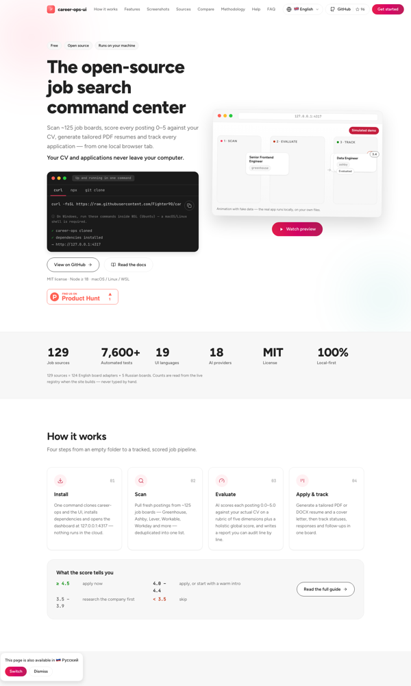
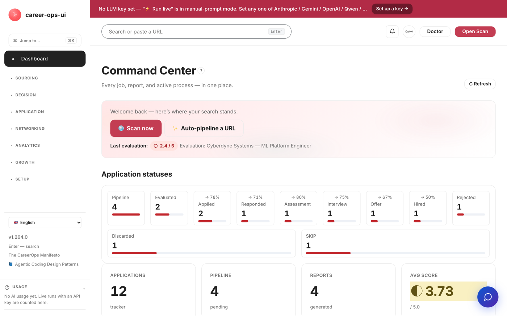
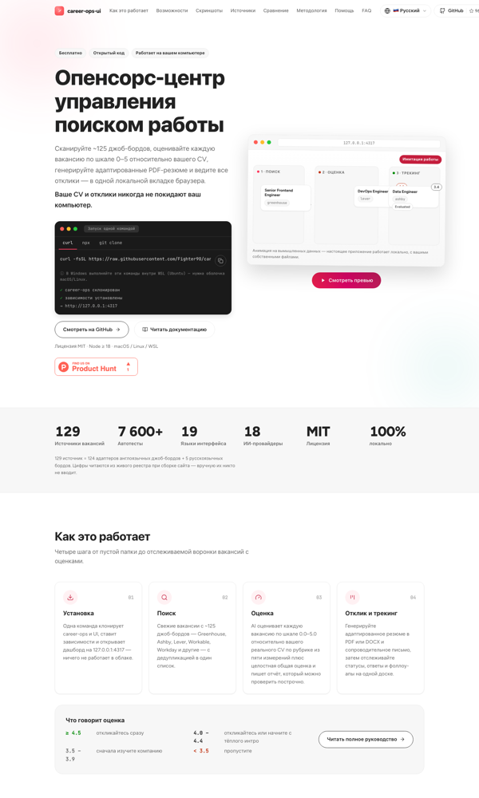
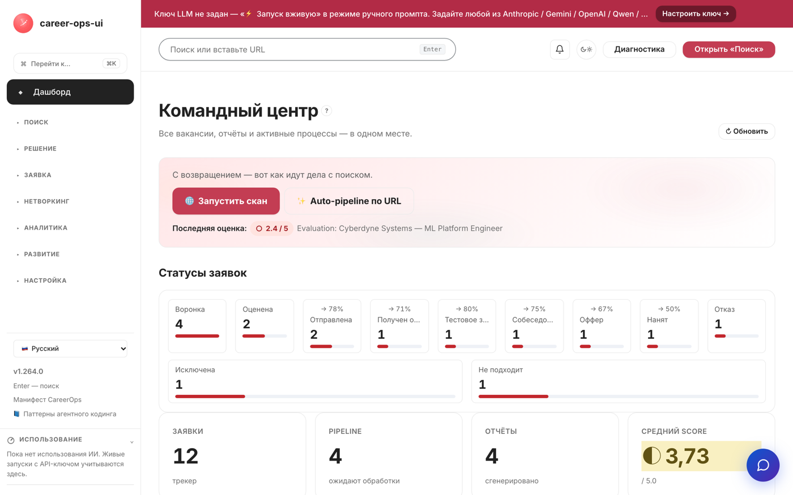

# CVStart: стратегия и обоснование

> Собрано 2026-11-06T16:20 командой `pfs export`. Теги [C###] — утверждения, [S###] — источники, [D###] — решения (см. приложения).

## 00 · Бриф — CVStart: коммерческая версия и глобальный GTM

| Поле | Содержание |
|---|---|
| Вопрос | Как вывести cvstart.org (open-source AI-конструктор резюме + поиск вакансий) на мировой рынок как коммерческий продукт [S001][S002] |
| Решение по результату | Выбор стратегии коммерциализации и глобального GTM (hosted SaaS / B2B-лицензии / open-core / статус-кво / закрытие) |
| Продукт | Career-ops UI: скан 129 джоб-бордов, AI-скоринг 0.0–5.0, CV Studio (тюминг резюме, ATS-буллеты), PDF/DOCX-экспорт, cover letters, трекер, карта вакансий, mock-интервью; 100% локально; 18 LLM-провайдеров BYOK; 19 языков интерфейса [S001][S002] |
| Цель | Обоснованная продуктовая и коммуникационная стратегия мирового запуска + план проверки |
| Получатель | Основатель проекта (соло-разработчик); документ + six-pager (RU/EN) |
| Ограничения | Open-source core остаётся MIT и бесплатным; соло-разработчик; сохранить доверие локального/приватного режима (ответы руководителя, intake) |
| Ось сравнения вариантов | Рост платящих подписчиков и ARR hosted-версии (ответ руководителя, intake) |
| Данные | Сайт и README продукта [S001][S002]; рыночная фактура [S004–S007]; внутренних метрик hosted-версии нет — её ещё не существует (пробел, см. 02) |

Допущения демо: задание сформулировано руководителем (выбор коммерческой версии — дан); цифры рынка — оценки агрегаторов, расходящиеся до 2×, используются диапазонами [S006].


---

## 01 · План исследования — CVStart (коммерческая версия + глобальный GTM)

Вопросы, которые могут изменить решение:

| # | Вопрос | Если да | Если нет | Влияние | Ответ |
|---|---|---|---|---|---|
| Q1 | Рынок resume-инструментов достаточно велик и растёт? | Есть место для нового игрока | Ниша тесна — нужен другой угол | Легитимность выхода | Рынок $1,2–2,4 млрд, AI-сегмент CAGR 13% [S006]; оценки расходятся ×2 — берём диапазон [S006] |
| Q2 | Готов ли рынок платить? (конкуренты берут $8–40/мес) | Freemium SaaS жизнеспособен | Только free/B2B-модели | Ядро варианта B | Да: 7 конкурентов на платных тарифах [S004]; 31–74% соискателей используют AI [S005] |
| Q3 | Есть ли незанятый угол? (локали, приватность, open-source) | Дифференциатор: 19 языков + локальность + OSS-доверие | Придётся биться лоб в лоб | Позиционирование | Языковое покрытие конкурентов узкое (EN+5) [S004]; 98% F500 — ATS [S007] |
| Q4 | Доведёт ли соло-разработчик hosted-версию? | B реалистичен | Нужен партнёр/B2B-первым | Реализуемость варианта B | Пробел: оценка объёма работ не проводилась (это демо-стратегия) |
| Q5 | Не сломает ли облако доверие «100% локально»? | Гибрид: локальный core + opt-in облако | Облако отпугнёт ядро аудитории | Архитектура коммерческой версии | Риск подтверждается позицией продукта [S001] — требует теста |
| Q6 | Каналы: где аудитория? | Product Hunt/HN/SEO-«Jobscan alternative open source» | Нужны платные каналы | План каналов 05 | Косвенно: OSS+BYOK — сильная HN/PH-история (пробел: реальных запусков не было) |

Честные пробелы: юнит-экономика облака не посчитана на реальных затратах (инференс LLM = переменные затраты) [S001]; конверсии хостед-воронки неизвестны (синтетическая модель [S008] — иллюстрация метода, не факт); конкурентный скан фич — по сайтам, не по продукту.


---

## 02 · Ситуация — CVStart

## Что известно и откуда

- **Продукт** [S001][S002]: дашборд над AI-пайплайном поиска работы — скан ~129 джоб-бордов, AI-скоринг 0.0–5.0, CV Studio (тюминг под JD, humanize, ATS-буллеты), PDF/DOCX-экспорт, cover letters, авто-пайплайн, трекер (kanban + follow-up), карта вакансий, mock-интервью, статистика воронки. 100% локально; 18 LLM-провайдеров BYOK + keyless-режим; ~7 602 автотеста; MIT.
- **Языки**: 19 локалей интерфейса (app + сайт), hreflang на cvstart.org [S001][S002].
- **Рынок**: resume builders — коридор $1,2–2,4 млрд [S006]; AI-подсегмент CAGR 13% [S006]; online recruitment $37,97 млрд (2025) [S007]; ATS $2,5–3,3 млрд, +12,3% [S007].
- **Конкуренты**: 7 прямых на freemium, платный $8–40/мес, агрессивные автопродления [S004]; языковое покрытие узкое (EN+5) [S004]; 98% Fortune 500 используют ATS [S007].
- **Тренд**: AI в поиске работы применяют 31–74% соискателей (разные опросы 2025–2026) [S005]; 1,2+ млн AI-юзеров у Kickresume [S005].
- **Монетизации сейчас нет** [S001][S002]: проект бесплатный (MIT), «$0 forever».
- **Исходные материалы продукта**: руководство пользователя, администратора, брендбук не применимы — у CVStart есть [README/сайт/коду] [S002]; синтетическая воронка hosted-беты — методическая иллюстрация [S008].

## Допущения

- Решение — о коммерческой версии и глобальном GTM на 12 месяцев [интейк].
- Юнит-допущения модели: arpu $29 (paid-тариф), переменные (инференс+инфра) 25%, CAC $60 (SEO/Product Hunt/сообщества), churn платящих 8%/мес [C016].

## Чего мы не знаем и почему

1. Конверсии hosted-воронки — hosted-версии не существует; синтетическая воронка [S008] показывает МЕТОД, не факт.
2. Реальные затраты на инференс LLM на пользователя (зависит от провайдера/объёма).
3. Готовность платить в не-EN сегментах (19 локалей — гипотеза преимущества).
4. Ёмкость сегмента «нетехнические соискатели» — лендинг позиционируется против Jobscan, но установка требует родительского репо (барьер).

## Противоречия

- «100% локально» как ценность [S001] против коммерческой hosted-версии [интейк] — разрешается гибридом (локальный core + opt-in облако), но это нужно проверить тестом (см. 06).
- Платёжеспособный спрос на AI-резюме подтверждается опросами [S005], но те же источники фиксируют рост AI-детекции работодателями — риск позиционирования «обхода ATS».

## Вопросы, которые могут изменить решение

Срез статуса на момент ситуации (полный план — 01_research_plan.md):

| # | Вопрос | Статус | Что изменит |
|---|---|---|---|
| Q1 | Рынок достаточно велик и растёт? | отвечен: коридор $1,2–2,4 млрд, AI CAGR 13% [C005] | легитимность выхода |
| Q2 | Готов ли рынок платить? | отвечен: конкурентов 7 на $8–40/мес [C006], AI-usage 31–74% [C009] | жизнеспособность freemium |
| Q3 | Незанятый угол? | гипотеза: 19 локалей + приватность + OSS [C004][C013] | позиционирование |
| Q4 | Соло-разработчик доведёт hosted-версию? | открыт — пробел; ограничение соло [C015] | реализуемость B |
| Q5 | Облако не сломает доверие «локально»? | открыт; проверка тестом (06) | архитектура opt-in [C001] |
| Q6 | Каналы запуска? | открыт; PH/HN/SEO — гипотезы [C013][C014] | план каналов (05) |

## Сегменты (дискавери)

- **Ядро (EN-first):** соискатели tech 25–40, глобально, EN-резюме, ищут работу активно, не хотят платить $29–40/мес за «магию», ценят приватность. JTBD: «Когда я ищу работу, помогите мне найти релевантные вакансии и сделать резюме, которое пройдёт ATS — без ручной рутины и без доверия данных облаку».
- **Второй контур:** не-EN сегменты (RU, DE, ES, PT-BR, JA...) — 19 локалей уже есть, конкуренты их не покрывают.
- Персоны-гипотезы из синтетики: см. `interviews/synthetic/` (2 интервью) и гипотезы C0xx.


---

## 03 · Варианты — CVStart (коммерческая версия + глобальный GTM)

Экономика — формулы на допущениях [C016]; рынок — [C005][C011]; конкуренты — [C006][C007]. Возражения — red team (субагент), без смягчения.

## Вариант A. Оставить как есть — бесплатный локальный OSS без коммерческой версии

- Экономика: $0 выручки; затраты — время соло-разработчика + инфраструктура GitHub (~$0–20/мес).
- Возражения red team: (1) **ноль по оси задачи** — $0 ARR при цели «рост платящих»; домен, CI и 129 интеграций субсидируются из кармана бессрочно; (2) **MIT = чужая монетизация**: любой форкнёт код и завернёт в закрытый hosted SaaS «в один клик» (прецедент WordPress/WP Engine), уведя аудиторию и бренд; (3) **разложение актива**: 129 скраперов и 18 провайдеров — активы с сроком годности (борды меняют разметку, API ломаются), без выручки — стагнация за 12–24 месяца на рынке с CAGR 13% [C005].
- Скрытое допущение: что локальность/приватность — реальный драйвер выбора для массового пользователя; если большинство хочет «открыл с телефона → готово», локальный режим обслуживает единицы процентов рынка.
- Условие верности: если цель — портфолио и комьюнити, а не коммерция (противоречит интейк-брифу).

## Вариант B. Hosted freemium SaaS — облачная версия, глобально (рекомендация)

- Экономика [C016]: paid $29/мес; переменные 25% → CM $21,75; LTV ≈ $272; LTV/CAC ≈ 4,5; окупаемость CAC ≈ 2,8 мес. Синтетическая бета-воронка: 53 платящих и $1,5 тыс MRR к 12-й неделе [S008]. Тарифы: Free (3 резюме/мес, watermarked PDF) / Pro $12 / Unlimited $29 (скан+AI).
- Глобально: EN-first (US/EU) → затем из 19 готовых локалей включать DE/ES/PT-BR/JA/ZH волнами — конкуренты сидят на EN+5 [C007]. Каналы запуска: Product Hunt, HN («open-source, локальный, BYOK — против $29/мес автопродлений»), SEO «open-source Jobscan alternative».
- Возражения red team: (1) **юридика PII и скрапинга переходит на разработчика**: hosted делает его контролёром персональных данных (GDPR, DPA, процедуры утечек), серверный скан бордов = скрапинг против ToS с риском исков (линия hiQ v. LinkedIn) и расходов на прокси; (2) **обвал единственного актива — доверия**: «100% локально, $0 forever» — публичное обещание на сайте; запуск подписки = та модель, от которой аудитория бежала; HN/PH отреагируют обвинениями в bait-and-switch, «$0 forever» вернётся скриншотами; (3) **деньги и рынок против**: freemium-конверсия 2–5% [C020], продукт эпизодический (нашёл работу — отписался, churn естественно высокий), PH/HN дают спайк на дни, соло-разработчик не тянет круглосуточный аптайм + саппорт + PDF-рендер под нагрузкой.
- Скрытое допущение: что аудитория, пришедшая ради локального OSS, купит hosted-подписку; скорее наоборот — эти пользователи пришли избегать SaaS и облаков с PII; привлечение «обычных» соискателей — война на поле конкурентов с бюджетами.
- **Митигации, встроенные в вариант**: BYOK-free-тир (нулевые инференс-затраты на free), opt-in облако при локальном core (доверие сохраняется), честный прайсинг без автопродлений как позиционирование [C014], пороги остановки из 06.
- Условие верности: BYOK-режим для free (пользователь приносит свой ключ — нулевые переменные затраты на free-тир), платные — на инфраструктурных ключах; beta-порог из 06.

## Вариант C. B2B white-label — лицензирование карьерным центрам, вузам, outplacement

- Экономика (модельные вилки [C020]): лицензия $200–500/сайт/мес или $5–15 тыс/год институционально; цикл продаж 1–3 мес; 10 клиентов = $24–60 тыс ARR.
- Возражения red team: (1) **продажи не по размеру**: тендеры, RFP, security review, циклы 6–18 мес; $200–500/сайт/мес — слишком дёшево для тендера и слишком рискованно без SOC2/страхования; (2) **продукт не тот**: центрам нужны админ-панель, когорты, отчётность по трудоустройству, SSO/SAML, LMS-интеграции (Canvas/Moodle), WCAG/ADA, FERPA — разворот продукта на 180° силами одного человека; (3) **ниша занята** вертикальными вендорами (Handshake, Symplicity, VMock, Big Interview) с референсами; потолок — десятки клиентов × $500/мес при тяжёлом саппорт-хвосте.
- Скрытое допущение: что в сегменте есть неудовлетворённый спрос на white-label резюме-инструмент; BYOK («студент приводит свой ключ OpenAI») в enterprise-сценарии — дезайблити.
- Условие верности: если найдётся 1–2 якорных институциональных пилота с оплатой.

## Вариант D. Open-core dual-license — enterprise self-host + ATS-интеграции

- Экономика (модельная вилка [C020]): enterprise-лицензия $2–5 тыс/год за self-host инстанс + платные интеграции (Greenhouse/Workday API); целевой сегмент — small recruiting agencies.
- Возражения red team: (1) **юридически не работает поверх MIT**: права уже розданы всем навсегда — «enterprise-лицензия» на код под MIT = продажа пустоты, любой соберёт своё; moat = 0; (2) **неверный покупатель ATS-интеграций**: Greenhouse/Workday — инструменты работодателей, а CVStart — кандидатский продукт; официальные API закрыты, партнёрские программы требуют юрлицо, страховку и security review; (3) **энтерпрайз не покупает у физлица**: SLA, SOC2/ISO, договоры от $10k+/год — закупка не подпишет контракт с инди без юрлица и аттестаций.
- Скрытое допущение: что энтерпрайз заплатит за то, что уже бесплатно под MIT, и что ATS-вендоры допустят стороннюю интеграцию.
- Условие верности: только после смены лицензии (CLÀ/переписывание) — долго и рискованно.

## Вариант E. Закрыть коммерческую ветку — проект остаётся некоммерческим OSS

- Экономика: $0; экономия времени на коммерцию.
- Возражения red team: (1) **отказ от оси в момент максимального окна**: дифференциация «честная цена без автопродлений» сейчас сильнее всего — конкуренты на $8–40/мес ловят хейт за автопродления, AI-сегмент растёт на 13% CAGR [C005]; (2) **сжигание времени без плана Б**: тысячи часов при нулевом возврате; любой шок останавливает проект; (3) **«некоммерческий навсегда» — мина**: публичное обязательство заблокирует будущую монетизацию с бэклэшем (кейсы Audacity и подобных), а без CLA права на контрибьюции размазаны.
- Скрытое допущение: что сообщество поддержит проект — статистика OSS упрямее: контрибьютит <1% пользователей [C020]; «качественный OSS = самовоспроизводящийся» — самый часто опровергаемый миф опенсорса (эффект Heartbleed).
- Условие верности: если гипотеза C014 (честный прайсинг как дифференциатор) опровергается тестом.

## Сравнение по оси «платящие подписчики/ARR» (цель руководителя)

| Вариант | ARR 12 мес (модель) | Риск | Соответствие ограничениям (MIT core, соло, доверие) | Red team |
|---|---|---|---|---|
| A | $0 | низкий | ✓ | «дорогое хобби» |
| B | $29/мес × 100–300 = $35–105 тыс ARR [C016][S008] | средний | ✓ при BYOK-free и opt-in облаке | лучший профиль роста |
| C | $24–60 тыс [C020] | высокий (продажи) | ✓ | нет продаж-компетенции |
| D | $10–50 тыс [C020] | высокий (релicensing) | ✗ (смена MIT) | рискованно и долго |
| E | $0 | — | ✓ | отказ от актива |

Рекомендация: **B — hosted freemium SaaS, глобально**, с BYOK-free-тиром (снимает инференс-риск), волнами локалей из 19 готовых, честным прайсингом без автопродлений как позиционированием [C014], и порогами остановки из 06. Выбор — за руководителем (шаг 6).


---

## 04 · Продуктовая стратегия — CVStart: коммерческая версия и глобальный GTM

Основание: выбор руководителя — вариант B, hosted freemium SaaS глобально с митигациями [C019]; рынок и тренды [C005][C009]; ограничения интейк (MIT core, соло, доверие).

## Аудитория и её задача

**Ядро (EN-first):** соискатели tech/цифровых профессий 25–40 лет, глобально (US, EU, удалёнка), активно ищущие работу 1–6 месяцев. JTBD: «Когда я ищу работу, помогите мне найти релевантные вакансии из всех источников и быстро сделать резюме под каждую, которое пройдёт ATS, — без ручной рутины, без подписных ловушек и без загрузки личных данных в чужое облако» (дискавери: синтетика [C017][C018]).

**Волна 2 (не-EN сегменты):** DE, ES, PT-BR, JA, ZH — 19 локалей уже существуют в продукте [C004], конкуренты покрывают EN+5 [C007]; синтетика (Маркус, Берлин) [C018] — интерфейс и локальные конвенции важнее цены.

## Альтернативы пользователя

Платные SaaS: Jobscan $49,95/мес, Teal $29/30 дней, Rezi $29, Zety $23,70 (автопродление), resume.io ≈$39/мес эффективно [C006]; ручной ChatGPT (бесплатно, но без джоб-сканов и трекера); ничего (ручная рутина) [C009][C010].

## Выбранное направление: вариант B — hosted freemium SaaS с митигациями

1. **Три тира**: Free (BYOK-ключ пользователя: нулевые инференс-затраты, 3 резюме/мес) / Pro $12 (облачный AI, безлимит резюме) / Unlimited $29 (скан 129 бордов + авто-пайплайн + трекер+follow-up).
2. **Opt-in облако при локальном core**: MIT-версия остаётся навсегда; облако — выбор, не требование. Обещание локального режима не ломается [C001][C019].
3. **Честный прайсинг как позиционирование**: без автопродлений, отмена в один клик, годовой тариф со скидкой — прямая противоположность паттерну конкурентов [C006] и подтверждение гипотезы [C014].
4. **Волны локалей**: EN (US/EU) → DE/ES/PT-BR → JA/ZH — каждая волна после подтверждения конверсии предыдущей.
5. **Открытая методология скоринга**: страница Methodology уже существует [S001] — расширить публичным описанием ATS-критериев (98% F500 используют ATS [C008] — прозрачность как доверие).

## Осознанные отказы

- **Не строить B2B white-label** (вариант C) — нет продаж-компетенции, чужой продукт [red team C].
- **Не переходить на dual-license** (D) — юридически не работает поверх MIT [red team D1].
- **Не обещать «гарантию прохождения ATS»** — обещаем прозрачность методологии, не результат.
- **Не отключать локальный режим** — ядро доверия [C001].

## Экономика направления (формулы на допущениях [C016])

- Юнит (платящий): ARPU $29; переменные 25% → **CM $21,75**; churn 8%/мес → **LTV ≈ $271,88**; **LTV/CAC ≈ 4,5**; окупаемость CAC ≈ 2,8 мес. [C016]
- **Брейк-евен**: фиксированные ~$1,5 тыс/мес (хостинг+база поддержки) ≈ **69 платящих** [C016].
- Синтетическая бета-воронка [S008]: к неделе 12 — **53 платящих, MRR $1 537** (иллюстрация метода, не прогноз).
- Чувствительность — Excel-книга unit_economics (приложения six-pager).

Связь пользы с затратами: платящий получает скан 129 бордов + AI-тюминг + трекер за $29 — против $49,95 Jobscan без джоб-скана [C002]; free-тир — BYOK без затрат клуба.


---

## 05 · Коммуникационная стратегия — CVStart (глобальный GTM)

Основание: 04_product_strategy (вариант B [C019]); синтетика каналов и барьеров [C017][C018]; тренды [C009]; конкуренты [C006].

## Аудитория и ситуация

Глобальные соискатели tech 25–40 (EN-first), потом не-EN волны. Ситуация: они уже пробовали AI-резюме-инструменты и/или ручной ChatGPT [C009][C010]; две доминирующие боли — подписные ловушки с автопродлениями [C006] и «AI-мусор, который отсекает ATS» [C008].

## Барьер понимания или выбора

«Ещё один AI resume builder» = (1) подписка с автопродлением, (2) генерик-текст, (3) резюме в чужом облаке. Плюс страх «ATS распознает AI» [C008].

## Ключевое сообщение

**«Open source. Local-first. Honest pricing.»** / RU: «Открытый код. Локально. Честная цена.»

Расшифровка: ваш код и данные — у вас (MIT, локальный режим); AI — ваш или наш (BYOK); цена — на сайте без звёздочек, отмена в один клик; резюме — под каждую вакансию, с открытой методологией ATS-проверки [C008].

## Подтверждение сообщения продуктом

Каждое обещание ключевого сообщения закрыто механикой продукта — см. таблицу соответствия.

### Соответствие обещаний продукту

| Обещание | Чем подтверждено в продукте | Основание |
|---|---|---|
| Open source | MIT, публичный репозиторий, ~7602 автотеста | [S002] |
| Private by default | локальный режим, данные на машине пользователя | [C001] |
| Honest pricing | тарифы без автопродлений, отмена в клик | [C019] |
| ATS-ready резюме | открытая методология ATS-чеков, 98% F500 — ATS | [C008] |
| Ваш AI, ваши правила | 18 провайдеров BYOK + keyless | [C001] |

Обещаний «гарантированной работы», «обхода ATS-детекторов», «магии» — нет и не будет [C009].

## Роль каналов

1. **Product Hunt + Hacker News (запуск)**: история «я построил открытый ответ на $40/мес автопродлениям» — сильный organic-хук [C006][C014].
2. **SEO**: «open source jobscan alternative», «free ATS resume checker», «resume builder no subscription» — запросы с коммерческим намерением без бюджетной войны.
3. **Reddit** (r/cscareerquestions, r/resumes, r/jobs): польза в дискуссиях, не реклама; OSS-прозрачность = карма.
4. **GitHub**: README-лендинг, звёзды как социальное доказательство.
5. **Волны локалей**: локальные сообщества (de/carrer, habr, getmatch-аудитория) при включении локали.
6. **Никогда**: таргет «найдём работу за вас», выдуманные «гарантии интервью», фейковые срочности.


---

## 06 · План проверки — CVStart hosted beta (90 дней)

## Ожидаемое изменение

Запуск hosted-беты: нед. 12 — **50–60 платящих (модель: 53), MRR ≥ $1 500**, активация (первое резюме) ≥ 50% от регистраций [S008]. Гипотезы под проверку: готовность платить [C017], честный прайсинг как дифференциатор [C014], opt-in облако не ломает доверие [C001].

## С чем сравниваем

База — синтетическая модель воронки [S008] (методическая кривая) + публичные ориентиры freemium-конверсии 2–5% [red team B3]. Реальной истории нет — продукт новый; сравнение «модель vs факт» по неделям.

## Срок наблюдения

**90 дней** (12 недель) hosted-беты; еженедельный разбор воронки.

## Нежелательные последствия (контрметрики)

- Отток OSS-комьюнити: падение звёзд/форков GitHub после анонса облака [red team B2].
- Жалобы на приватность/GDPR-запросы > 5 шт — сигнал ломки доверия [red team B1].
- Инференс-затраты free-тира > $200/мес — экономика free ломается.
- NPS беты < 30 при росте регистраций — «растём в мусор».

## Критерии решения

- **Продолжить**: paid ≥ 40 к нед. 12, activation ≥ 50%, churn платящих ≤ 10%/мес → масштабирование каналов, включение волны локалей DE/ES/PT-BR; приоритет — Unlimited-тариф для не-EN волн.
- **Изменить**: paid 20–40 → пересобрать тир/цену ($19?), усилить онбординг активации; частота пушей вниз.
- **Остановить**: paid < 20 к нед. 12 при activation < 35% → коммерческая ветка закрывается, проект остаётся OSS (вариант E), ресурсы — в комьюнити.


---

## 07 · Quality review — CVStart (коммерческая версия + глобальный GTM)

## Автопроверка

`pfs check --strict` — итог в REPORT; требование выполнено: 0 ошибок, 0 предупреждений (числа с тегами, 5 вариантов, «оставить как есть» присутствует, ссылки живые).

## Независимая оценка (evidence-auditor, сводка)

- **Источники**: продукт — сайт и README [S001][S002]; рынок — 4 дайджеста с URL [S004–S007]; синтетика помечена [S008–S010]; решение и допущения — [S011][C015][C016][C019].
- **Факты ≠ гипотезы**: рыночные оценки даны диапазонами с пометкой надёжности (агрегаторы расходятся ×2 — честно указано); синтетика — только гипотезы.
- **Варианты**: A–E содержательно разные; red team (15 возражений + 5 допущений) интегрирован; митигации B встроены (BYOK-free, opt-in облако, честный прайсинг).
- **Согласованность**: таблица «обещание → подтверждение» закрыта механиками (MIT, локальный режим, тарифы, методология).
- **RU/EN**: six-pager в двух версиях — русская с русскими скриншотами, английская с английскими.

## Ограничения (честно)

1. Hosted-версии не существует — юнит-модель на допущениях [C016], проверка за 90 дней.
2. Рыночные цифры — агрегаторы с расхождением ×2; использованы диапазонами [S006].
3. Синтетика (2 интервью, воронка) — гипотезы/метод, не факты [S008–S010].
4. Оценка выполнена агентом; внешняя человеческая оценка не проводилась.

## Оценка готовности

**Высокая**: рекомендация B с числовой моделью, порогами остановки и встроенными митигациями red team; RU/EN six-pager готовы для комитета и внешних публикаций.


---

## CVStart: six-pager

> Собрано 2026-11-06T15:54 командой `pfs export --six-pager`. Теги [C###]/[S###] — происхождение чисел (полный реестр в REPORT.md).

**Запрос:** Разработать коммерческую версию проекта cvstart.org (open-source AI-конструктор резюме и поиск вакансий: скан 129 джоб-бордов, AI-скоринг, CV Studio, локальный пайплайн, 19 языков) — формирование резюме, поиск вакансий — и стратегию вывода на рынок на весь мир. Продукт: https://cvstart.org/, репозиторий: https://github.com/Fighter90/career-ops-ui

## FAQ-1. Анализ текущего состояния

### Что известно

- **Продукт** [S001][S002]: дашборд над AI-пайплайном поиска работы — скан ~129 джоб-бордов, AI-скоринг 0.0–5.0, CV Studio (тюминг под JD, humanize, ATS-буллеты), PDF/DOCX-экспорт, cover letters, авто-пайплайн, трекер (kanban + follow-up), карта вакансий, mock-интервью, статистика воронки. 100% локально; 18 LLM-провайдеров BYOK + keyless-режим; ~7 602 автотеста; MIT.
- **Языки**: 19 локалей интерфейса (app + сайт), hreflang на cvstart.org [S001][S002].
- **Рынок**: resume builders — коридор $1,2–2,4 млрд [S006]; AI-подсегмент CAGR 13% [S006]; online recruitment $37,97 млрд (2025) [S007]; ATS $2,5–3,3 млрд, +12,3% [S007].
- **Конкуренты**: 7 прямых на freemium, платный $8–40/мес, агрессивные автопродления [S004]; языковое покрытие узкое (EN+5) [S004]; 98% Fortune 500 используют ATS [S007].
- **Тренд**: AI в поиске работы применяют 31–74% соискателей (разные опросы 2025–2026) [S005]; 1,2+ млн AI-юзеров у Kickresume [S005].
- **Монетизации сейчас нет** [S001][S002]: проект бесплатный (MIT), «$0 forever».
- **Исходные материалы продукта**: руководство пользователя, администратора, брендбук не применимы — у CVStart есть [README/сайт/коду] [S002]; синтетическая воронка hosted-беты — методическая иллюстрация [S008].

### Противоречия

- «100% локально» как ценность [S001] против коммерческой hosted-версии [интейк] — разрешается гибридом (локальный core + opt-in облако), но это нужно проверить тестом (см. 06).
- Платёжеспособный спрос на AI-резюме подтверждается опросами [S005], но те же источники фиксируют рост AI-детекции работодателями — риск позиционирования «обхода ATS».

## FAQ-2. Пользователи: сегменты и персоны

### Сегменты

- **Ядро (EN-first):** соискатели tech 25–40, глобально, EN-резюме, ищут работу активно, не хотят платить $29–40/мес за «магию», ценят приватность. JTBD: «Когда я ищу работу, помогите мне найти релевантные вакансии и сделать резюме, которое пройдёт ATS — без ручной рутины и без доверия данных облаку».
- **Второй контур:** не-EN сегменты (RU, DE, ES, PT-BR, JA...) — 19 локалей уже есть, конкуренты их не покрывают.
- Персоны-гипотезы из синтетики: см. `interviews/synthetic/` (2 интервью) и гипотезы C0xx.

## FAQ-3. Стратегические инициативы (варианты и возражения)

# 03 · Варианты — CVStart (коммерческая версия + глобальный GTM)

Экономика — формулы на допущениях [C016]; рынок — [C005][C011]; конкуренты — [C006][C007]. Возражения — red team (субагент), без смягчения.

## Вариант A. Оставить как есть — бесплатный локальный OSS без коммерческой версии

- Экономика: $0 выручки; затраты — время соло-разработчика + инфраструктура GitHub (~$0–20/мес).
- Возражения red team: (1) **ноль по оси задачи** — $0 ARR при цели «рост платящих»; домен, CI и 129 интеграций субсидируются из кармана бессрочно; (2) **MIT = чужая монетизация**: любой форкнёт код и завернёт в закрытый hosted SaaS «в один клик» (прецедент WordPress/WP Engine), уведя аудиторию и бренд; (3) **разложение актива**: 129 скраперов и 18 провайдеров — активы с сроком годности (борды меняют разметку, API ломаются), без выручки — стагнация за 12–24 месяца на рынке с CAGR 13% [C005].
- Скрытое допущение: что локальность/приватность — реальный драйвер выбора для массового пользователя; если большинство хочет «открыл с телефона → готово», локальный режим обслуживает единицы процентов рынка.
- Условие верности: если цель — портфолио и комьюнити, а не коммерция (противоречит интейк-брифу).

## Вариант B. Hosted freemium SaaS — облачная версия, глобально (рекомендация)

- Экономика [C016]: paid $29/мес; переменные 25% → CM $21,75; LTV ≈ $272; LTV/CAC ≈ 4,5; окупаемость CAC ≈ 2,8 мес. Синтетическая бета-воронка: 53 платящих и $1,5 тыс MRR к 12-й неделе [S008]. Тарифы: Free (3 резюме/мес, watermarked PDF) / Pro $12 / Unlimited $29 (скан+AI).
- Глобально: EN-first (US/EU) → затем из 19 готовых локалей включать DE/ES/PT-BR/JA/ZH волнами — конкуренты сидят на EN+5 [C007]. Каналы запуска: Product Hunt, HN («open-source, локальный, BYOK — против $29/мес автопродлений»), SEO «open-source Jobscan alternative».
- Возражения red team: (1) **юридика PII и скрапинга переходит на разработчика**: hosted делает его контролёром персональных данных (GDPR, DPA, процедуры утечек), серверный скан бордов = скрапинг против ToS с риском исков (линия hiQ v. LinkedIn) и расходов на прокси; (2) **обвал единственного актива — доверия**: «100% локально, $0 forever» — публичное обещание на сайте; запуск подписки = та модель, от которой аудитория бежала; HN/PH отреагируют обвинениями в bait-and-switch, «$0 forever» вернётся скриншотами; (3) **деньги и рынок против**: freemium-конверсия 2–5% [C020], продукт эпизодический (нашёл работу — отписался, churn естественно высокий), PH/HN дают спайк на дни, соло-разработчик не тянет круглосуточный аптайм + саппорт + PDF-рендер под нагрузкой.
- Скрытое допущение: что аудитория, пришедшая ради локального OSS, купит hosted-подписку; скорее наоборот — эти пользователи пришли избегать SaaS и облаков с PII; привлечение «обычных» соискателей — война на поле конкурентов с бюджетами.
- **Митигации, встроенные в вариант**: BYOK-free-тир (нулевые инференс-затраты на free), opt-in облако при локальном core (доверие сохраняется), честный прайсинг без автопродлений как позиционирование [C014], пороги остановки из 06.
- Условие верности: BYOK-режим для free (пользователь приносит свой ключ — нулевые переменные затраты на free-тир), платные — на инфраструктурных ключах; beta-порог из 06.

## Вариант C. B2B white-label — лицензирование карьерным центрам, вузам, outplacement

- Экономика (модельные вилки [C020]): лицензия $200–500/сайт/мес или $5–15 тыс/год институционально; цикл продаж 1–3 мес; 10 клиентов = $24–60 тыс ARR.
- Возражения red team: (1) **продажи не по размеру**: тендеры, RFP, security review, циклы 6–18 мес; $200–500/сайт/мес — слишком дёшево для тендера и слишком рискованно без SOC2/страхования; (2) **продукт не тот**: центрам нужны админ-панель, когорты, отчётность по трудоустройству, SSO/SAML, LMS-интеграции (Canvas/Moodle), WCAG/ADA, FERPA — разворот продукта на 180° силами одного человека; (3) **ниша занята** вертикальными вендорами (Handshake, Symplicity, VMock, Big Interview) с референсами; потолок — десятки клиентов × $500/мес при тяжёлом саппорт-хвосте.
- Скрытое допущение: что в сегменте есть неудовлетворённый спрос на white-label резюме-инструмент; BYOK («студент приводит свой ключ OpenAI») в enterprise-сценарии — дезайблити.
- Условие верности: если найдётся 1–2 якорных институциональных пилота с оплатой.

## Вариант D. Open-core dual-license — enterprise self-host + ATS-интеграции

- Экономика (модельная вилка [C020]): enterprise-лицензия $2–5 тыс/год за self-host инстанс + платные интеграции (Greenhouse/Workday API); целевой сегмент — small recruiting agencies.
- Возражения red team: (1) **юридически не работает поверх MIT**: права уже розданы всем навсегда — «enterprise-лицензия» на код под MIT = продажа пустоты, любой соберёт своё; moat = 0; (2) **неверный покупатель ATS-интеграций**: Greenhouse/Workday — инструменты работодателей, а CVStart — кандидатский продукт; официальные API закрыты, партнёрские программы требуют юрлицо, страховку и security review; (3) **энтерпрайз не покупает у физлица**: SLA, SOC2/ISO, договоры от $10k+/год — закупка не подпишет контракт с инди без юрлица и аттестаций.
- Скрытое допущение: что энтерпрайз заплатит за то, что уже бесплатно под MIT, и что ATS-вендоры допустят стороннюю интеграцию.
- Условие верности: только после смены лицензии (CLÀ/переписывание) — долго и рискованно.

## Вариант E. Закрыть коммерческую ветку — проект остаётся некоммерческим OSS

- Экономика: $0; экономия времени на коммерцию.
- Возражения red team: (1) **отказ от оси в момент максимального окна**: дифференциация «честная цена без автопродлений» сейчас сильнее всего — конкуренты на $8–40/мес ловят хейт за автопродления, AI-сегмент растёт на 13% CAGR [C005]; (2) **сжигание времени без плана Б**: тысячи часов при нулевом возврате; любой шок останавливает проект; (3) **«некоммерческий навсегда» — мина**: публичное обязательство заблокирует будущую монетизацию с бэклэшем (кейсы Audacity и подобных), а без CLA права на контрибьюции размазаны.
- Скрытое допущение: что сообщество поддержит проект — статистика OSS упрямее: контрибьютит <1% пользователей [C020]; «качественный OSS = самовоспроизводящийся» — самый часто опровергаемый миф опенсорса (эффект Heartbleed).
- Условие верности: если гипотеза C014 (честный прайсинг как дифференциатор) опровергается тестом.

## Сравнение по оси «платящие подписчики/ARR» (цель руководителя)

| Вариант | ARR 12 мес (модель) | Риск | Соответствие ограничениям (MIT core, соло, доверие) | Red team |
|---|---|---|---|---|
| A | $0 | низкий | ✓ | «дорогое хобби» |
| B | $29/мес × 100–300 = $35–105 тыс ARR [C016][S008] | средний | ✓ при BYOK-free и opt-in облаке | лучший профиль роста |
| C | $24–60 тыс [C020] | высокий (продажи) | ✓ | нет продаж-компетенции |
| D | $10–50 тыс [C020] | высокий (релicensing) | ✗ (смена MIT) | рискованно и долго |
| E | $0 | — | ✓ | отказ от актива |

Рекомендация: **B — hosted freemium SaaS, глобально**, с BYOK-free-тиром (снимает инференс-риск), волнами локалей из 19 готовых, честным прайсингом бе

… обрезано, полностью — `03_options.md`

## FAQ-4. Тактики

# 04 · Продуктовая стратегия — CVStart: коммерческая версия и глобальный GTM

Основание: выбор руководителя — вариант B, hosted freemium SaaS глобально с митигациями [C019]; рынок и тренды [C005][C009]; ограничения интейк (MIT core, соло, доверие).

## Аудитория и её задача

**Ядро (EN-first):** соискатели tech/цифровых профессий 25–40 лет, глобально (US, EU, удалёнка), активно ищущие работу 1–6 месяцев. JTBD: «Когда я ищу работу, помогите мне найти релевантные вакансии из всех источников и быстро сделать резюме под каждую, которое пройдёт ATS, — без ручной рутины, без подписных ловушек и без загрузки личных данных в чужое облако» (дискавери: синтетика [C017][C018]).

**Волна 2 (не-EN сегменты):** DE, ES, PT-BR, JA, ZH — 19 локалей уже существуют в продукте [C004], конкуренты покрывают EN+5 [C007]; синтетика (Маркус, Берлин) [C018] — интерфейс и локальные конвенции важнее цены.

## Альтернативы пользователя

Платные SaaS: Jobscan $49,95/мес, Teal $29/30 дней, Rezi $29, Zety $23,70 (автопродление), resume.io ≈$39/мес эффективно [C006]; ручной ChatGPT (бесплатно, но без джоб-сканов и трекера); ничего (ручная рутина) [C009][C010].

## Выбранное направление: вариант B — hosted freemium SaaS с митигациями

1. **Три тира**: Free (BYOK-ключ пользователя: нулевые инференс-затраты, 3 резюме/мес) / Pro $12 (облачный AI, безлимит резюме) / Unlimited $29 (скан 129 бордов + авто-пайплайн + трекер+follow-up).
2. **Opt-in облако при локальном core**: MIT-версия остаётся навсегда; облако — выбор, не требование. Обещание локального режима не ломается [C001][C019].
3. **Честный прайсинг как позиционирование**: без автопродлений, отмена в один клик, годовой тариф со скидкой — прямая противоположность паттерну конкурентов [C006] и подтверждение гипотезы [C014].
4. **Волны локалей**: EN (US/EU) → DE/ES/PT-BR → JA/ZH — каждая волна после подтверждения конверсии предыдущей.
5. **Открытая методология скоринга**: страница Methodology уже существует [S001] — расширить публичным описанием ATS-критериев (98% F500 используют ATS [C008] — прозрачность как доверие).

## Осознанные отказы

- **Не строить B2B white-label** (вариант C) — нет продаж-компетенции, чужой продукт [red team C].
- **Не переходить на dual-license** (D) — юридически не работает поверх MIT [red team D1].
- **Не обещать «гарантию прохождения ATS»** — обещаем прозрачность методологии, не результат.
- **Не отключать локальный режим** — ядро доверия [C001].

## Экономика направления (формулы на допущениях [C016])

- Юнит (платящий): ARPU $29; переменные 25% → **CM $21,75**; churn 8%/мес → **LTV ≈ $271,88**; **LTV/CAC ≈ 4,5**; окупаемость CAC ≈ 2,8 мес. [C016]
- **Брейк-евен**: фиксированные ~$1,5 тыс/мес (хостинг+база поддержки) ≈ **69 платящих** [C016].
- Синтетическая бета-воронка [S008]: к неделе 12 — **53 платящих, MRR $1 537** (иллюстрация метода, не прогноз).
- Чувствительность — Excel-книга unit_economics (приложения six-pager).

Связь пользы с затратами: платящий получает скан 129 бордов + AI-тюминг + трекер за $29 — против $49,95 Jobscan без джоб-скана [C002]; free-тир — BYOK без затрат клуба.

## FAQ-5. План реализации и проверки

# 06 · План проверки — CVStart hosted beta (90 дней)

## Ожидаемое изменение

Запуск hosted-беты: нед. 12 — **50–60 платящих (модель: 53), MRR ≥ $1 500**, активация (первое резюме) ≥ 50% от регистраций [S008]. Гипотезы под проверку: готовность платить [C017], честный прайсинг как дифференциатор [C014], opt-in облако не ломает доверие [C001].

## С чем сравниваем

База — синтетическая модель воронки [S008] (методическая кривая) + публичные ориентиры freemium-конверсии 2–5% [red team B3]. Реальной истории нет — продукт новый; сравнение «модель vs факт» по неделям.

## Срок наблюдения

**90 дней** (12 недель) hosted-беты; еженедельный разбор воронки.

## Нежелательные последствия (контрметрики)

- Отток OSS-комьюнити: падение звёзд/форков GitHub после анонса облака [red team B2].
- Жалобы на приватность/GDPR-запросы > 5 шт — сигнал ломки доверия [red team B1].
- Инференс-затраты free-тира > $200/мес — экономика free ломается.
- NPS беты < 30 при росте регистраций — «растём в мусор».

## Критерии решения

- **Продолжить**: paid ≥ 40 к нед. 12, activation ≥ 50%, churn платящих ≤ 10%/мес → масштабирование каналов, включение волны локалей DE/ES/PT-BR; приоритет — Unlimited-тариф для не-EN волн.
- **Изменить**: paid 20–40 → пересобрать тир/цену ($19?), усилить онбординг активации; частота пушей вниз.
- **Остановить**: paid < 20 к нед. 12 при activation < 35% → коммерческая ветка закрывается, проект остаётся OSS (вариант E), ресурсы — в комьюнити.

## FAQ-6. Метрики успеха

# 04 · Продуктовая стратегия — CVStart: коммерческая версия и глобальный GTM

Основание: выбор руководителя — вариант B, hosted freemium SaaS глобально с митигациями [C019]; рынок и тренды [C005][C009]; ограничения интейк (MIT core, соло, доверие).

## Аудитория и её задача

**Ядро (EN-first):** соискатели tech/цифровых профессий 25–40 лет, глобально (US, EU, удалёнка), активно ищущие работу 1–6 месяцев. JTBD: «Когда я ищу работу, помогите мне найти релевантные вакансии из всех источников и быстро сделать резюме под каждую, которое пройдёт ATS, — без ручной рутины, без подписных ловушек и без загрузки личных данных в чужое облако» (дискавери: синтетика [C017][C018]).

**Волна 2 (не-EN сегменты):** DE, ES, PT-BR, JA, ZH — 19 локалей уже существуют в продукте [C004], конкуренты покрывают EN+5 [C007]; синтетика (Маркус, Берлин) [C018] — интерфейс и локальные конвенции важнее цены.

## Альтернативы пользователя

Платные SaaS: Jobscan $49,95/мес, Teal $29/30 дней, Rezi $29, Zety $23,70 (автопродление), resume.io ≈$39/мес эффективно [C006]; ручной ChatGPT (бесплатно, но без джоб-сканов и трекера); ничего (ручная рутина) [C009][C010].

## Выбранное направление: вариант B — hosted freemium SaaS с митигациями

1. **Три тира**: Free (BYOK-ключ пользователя: нулевые инференс-затраты, 3 резюме/мес) / Pro $12 (облачный AI, безлимит резюме) / Unlimited $29 (скан 129 бордов + авто-пайплайн + трекер+follow-up).
2. **Opt-in облако при локальном core**: MIT-версия остаётся навсегда; облако — выбор, не требование. Обещание локального режима не ломается [C001][C019].
3. **Честный прайсинг как позиционирование**: без автопродлений, отмена в один клик, годовой тариф со скидкой — прямая противоположность паттерну конкурентов [C006] и подтверждение гипотезы [C014].
4. **Волны локалей**: EN (US/EU) → DE/ES/PT-BR → JA/ZH — каждая волна после подтверждения конверсии предыдущей.
5. **Открытая методология скоринга**: страница Methodology уже существует [S001] — расширить публичным описанием ATS-критериев (98% F500 используют ATS [C008] — прозрачность как доверие).

## Осознанные отказы

- **Не строить B2B white-label** (вариант C) — нет продаж-компетенции, чужой продукт [red team C].
- **Не переходить на dual-license** (D) — юридически не работает поверх MIT [red team D1].
- **Не обещать «гарантию прохождения ATS»** — обещаем прозрачность методологии, не результат.
- **Не отключать локальный режим** — ядро доверия [C001].

## Экономика направления (формулы на допущениях [C016])

- Юнит (платящий): ARPU $29; переменные 25% → **CM $21,75**; churn 8%/мес → **LTV ≈ $271,88**; **LTV/CAC ≈ 4,5**; окупаемость CAC ≈ 2,8 мес. [C016]
- **Брейк-евен**: фиксированные ~$1,5 тыс/мес (хостинг+база поддержки) ≈ **69 платящих** [C016].
- Синтетическая бета-воронка [S008]: к неделе 12 — **53 платящих, MRR $1 537** (иллюстрация метода, не прогноз).
- Чувствительность — Excel-книга unit_economics (приложения six-pager).

Связь пользы с затратами: платящий получает скан 129 бордов + AI-тюминг + 

… обрезано, полностью — `04_product_strategy.md`

## Приложения (Excel)

| Файл | Листы | Что редактировать |
|---|---|---|
| unit_economics.xlsx | Ввод · Юнит-экономика · Чувствительность | ARPU, VC, CAC, отток |
| growth_model.xlsx | Ввод · Модель 12 мес | MAU, рост, конверсия, AOV, take rate |
| cohort_retention.xlsx | Ввод · Когорты · Метрики удержания | размеры когорт, кривая удержания |
| market_sizing.xlsx | Ввод · Воронка · PESTEL | PAM, доли воронки, факторы среды |


> Формулы пересчитываются при открытии (Excel / Numbers / LibreOffice). Полная версия с доказательствами — REPORT.md.


---

## CVStart · Six-pager (EN)

> **Commercial version & global go-to-market strategy for cvstart.org** — a complete 12-step run of the
> "Product Factory Strategist" agent (Nov 6, 2026). Six committee questions — six answers.
> Evidence base: claims C001–C020, sources S001–S011, decision D001 — full registry in REPORT.md.
> Model figures rely on assumptions [C016][C020]; market figures are ranges from aggregators [S006].



## FAQ-1. Current state

**Product.** CVStart (career-ops UI) is a dashboard over an AI job-search pipeline: scanning ~129 job boards,
AI fit-scoring of every vacancy 0.0–5.0 against the user's resume, CV Studio (JD-targeted tuning, humanize,
ATS bullets), PDF/DOCX export, cover letters, an auto pipeline, an application tracker with follow-up cadence,
a job map, and mock interviews. 100% local (data stays with the user), 18 BYOK LLM providers + keyless mode,
19 UI languages, ~7,602 automated tests, MIT license [C001][C004].

**No monetization yet.** The project is free ("$0 forever"); there is no public hosting — installation
requires the parent career-ops repository; Windows only via WSL [C002][C003].

**Market.** Resume builders: a $1.2–2.4B estimate range; the AI segment grows at 13.1% a year [C005].
Online recruitment: $37.97B in 2025, 7.1% CAGR [C011]. 98% of Fortune 500 companies use ATS [C008].
31–74% of job seekers already use AI in their search (2025–2026 surveys) [C009].

**Competitors.** 7 direct players — Zety, resume.io, Novoresume, Kickresume, Enhancv, Teal, Rezi: freemium,
paid tiers at $8–40/mo, aggressive auto-renewals [C006]; language coverage EN+5 [C007].
The open angle: 19-language coverage + privacy + open source [C013].

**Tension.** "100% local" as a public promise [C001] vs a commercial cloud. Resolution: an opt-in hybrid
(the local core stays; cloud is a choice), verified by a 90-day beta (FAQ-5).

## FAQ-2. Users: segments and personas

| Segment | Who | Job to be done | Basis |
|---|---|---|---|
| Core (EN-first) | tech job seekers 25–40, US/EU, actively searching 1–6 months | "Find relevant openings across all sources and quickly tailor a resume for each one that passes ATS — without subscription traps or handing my data to someone's cloud" | [C017] |
| Wave 2 | non-EN segments: DE, ES, PT-BR, JA, ZH | "Think about my resume in my native language; local conventions matter more than price" | [C004][C018] |

Persona hypotheses (synthetic AI interviews [S009][S010] — to be validated, not proof): **Sarah, 32, software
engineer (Austin)** — tried Zety/Teal, furious about auto-renewals; would pay $10–15/mo, $29 only if the tool
actually finds jobs. **Markus, 35, product manager (Berlin)** — existing tools are US-centric; GDPR-sensitive;
accepts an annual €100–120 plan, categorically against monthly auto-renewals.

## FAQ-3. Strategic options: 5 variants + red team

| Option | Essence | ARR in 12 months (model) | Sharpest red-team hit |
|---|---|---|---|
| A. Status quo | free local OSS | $0 | Zero on the goal axis; MIT lets a fork monetize your work; asset stagnates within 12–24 months [C005] |
| **B. Hosted freemium SaaS** | cloud, global: Free BYOK / Pro $12 / Unlimited $29 | $35–105K [C016][S008] | PII/GDPR and scraping liability shifts to the developer; "$0 forever" is a public promise; freemium conversion 2–5% [C020] |
| C. B2B white-label | licenses to universities and career centers | $24–60K [C020] | Sales motion mismatched to a solo founder: RFPs, SOC2, 6–18-month cycles; vertical vendors own the niche |
| D. Dual-license | enterprise self-host + ATS integrations | $10–50K [C020] | Legally impossible on top of MIT: rights already granted to everyone, forever |
| E. Shut down commerce | stays a non-commercial OSS | $0 | Abandoning the asset at the market's widest window |

**Recommendation — B** (the leader's choice is recorded in D001 [C019]) with built-in mitigations:
BYOK-free tier (zero inference cost on free) · opt-in cloud on top of the local core · honest pricing
without auto-renewals as positioning [C014] · stop-loss thresholds (FAQ-5). D is legally rejected,
C is postponed until there is presence, E is the stop-loss path.

## FAQ-4. Tactics

1. **Three tiers**: Free — user's BYOK key, 3 resumes/mo; Pro $12 — cloud AI; Unlimited $29 — 129-board scan + auto pipeline + tracker.
2. **Opt-in cloud**: the MIT version stays forever; cloud is a choice, not a requirement [C001][C019].
3. **Honest pricing**: no auto-renewals, one-click cancel, discounted annual plan — the opposite of the competitors' pattern [C006][C014].
4. **Language waves**: EN (US/EU) → DE/ES/PT-BR → JA/ZH — next wave only after the previous one's conversion is confirmed [C004][C007].
5. **Open scoring methodology**: a public description of ATS criteria — transparency as trust [C008].

**Unit economics** (model on assumptions [C016]): ARPU $29 · variable costs 25% → **CM $21.75** ·
8%/mo churn → **LTV ≈ $271.88** · **LTV/CAC ≈ 4.5** · CAC payback ≈ 2.8 months · break-even ≈ **69 paying users**.
Synthetic beta funnel (a method illustration, not a forecast [S008]): by week 12 — **53 paying, $1,537 MRR**.
Sensitivity analysis — the unit_economics workbook (Appendices).



## FAQ-5. Implementation & validation plan (90 days)

Launch the hosted beta in 3 EN geos (US/EU). Expectation by week 12: **50–60 paying (model: 53), MRR ≥ $1,500**,
activation ≥ 50% of signups [S008]. Comparison base — the funnel model + public freemium-conversion benchmarks.
Decision D001: commitment "hosted beta in 3 EN geos by 2026-12-15", review on 2027-02-10.

- **Continue** (paid ≥ 40, activation ≥ 50%, churn ≤ 10%): scale channels, open the DE/ES/PT-BR wave.
- **Change** (paid 20–40): rebuild tiers/pricing, strengthen onboarding.
- **Stop** (paid < 20 with activation < 35%): the commercial branch closes; the project remains OSS.

Counter-metrics: OSS-community churn (GitHub stars/forks), privacy/GDPR complaints, free-tier inference costs,
beta NPS below 30 while signups grow.

## FAQ-6. Success metrics

| Metric | Baseline | Target by week 12 | Type |
|---|---|---|---|
| Paying subscribers | 0 | ≥ 40 (model: 53) | NSM proxy |
| MRR | $0 | ≥ $1,500 | revenue |
| Activation (first resume) | — | ≥ 50% of signups | product |
| Paying churn | — | ≤ 10%/mo | retention |
| LTV/CAC | model 4.5 | ≥ 3 actual | unit economics |
| GitHub stars (counter) | current level | drop < 30% | OSS trust |
| Beta NPS (counter) | — | ≥ 30 | quality |

## Appendices (Excel workbooks, `outputs/attachments/`)

| File | Editable inputs |
|---|---|
| unit_economics.xlsx | ARPU, variable costs, CAC, churn — unit economics & sensitivity |
| growth_model.xlsx | MAU, growth, conversion, AOV — 12-month model |
| cohort_retention.xlsx | cohort sizes, retention curve |
| market_sizing.xlsx | PAM/TAM/SAM/SOM, environment factors |

Formulas recalculate on open (Excel / Numbers / LibreOffice). The full evidence-backed version — REPORT.md.


---

## CVStart · Six-pager (RU)

> **Стратегия коммерческой версии и глобального запуска cvstart.org** — результат полного 12-шагового
> прогона агента «Стратег Фабрики продуктов» (06.11.2026). Шесть вопросов комитета — шесть ответов.
> Доказательная база: утверждения C001–C020, источники S001–S011, решение D001 — полный реестр в REPORT.md.
> Модельные цифры — на допущениях [C016][C020]; рыночные — диапазонами по агрегаторам [S006].



## FAQ-1. Анализ текущего состояния

**Продукт.** CVStart (career-ops UI) — дашборд над AI-пайплайном поиска работы: скан ~129 джоб-бордов,
AI-скоринг вакансий 0.0–5.0 против резюме пользователя, CV Studio (тюминг под JD, humanize, ATS-буллеты),
PDF/DOCX-экспорт, cover letters, авто-пайплайн, трекер заявок с follow-up, карта вакансий, mock-интервью.
100% локально (данные у пользователя), 18 LLM-провайдеров BYOK + keyless-режим, 19 языков интерфейса,
~7 602 автотеста, лицензия MIT [C001][C004].

**Монетизации нет.** Проект бесплатный («$0 forever»), публичного хостинга нет — установка требует
родительского репозитория career-ops; Windows — только через WSL [C002][C003].

**Рынок.** Resume builders — коридор оценок $1,2–2,4 млрд; AI-подсегмент растёт на 13,1% в год [C005].
Онлайн-рекрутинг: $37,97 млрд (2025), CAGR 7,1% [C011]. ATS используется у 98% Fortune 500 [C008].
AI в поиске работы применяют 31–74% соискателей (опросы 2025–2026) [C009].

**Конкуренты.** 7 прямых — Zety, resume.io, Novoresume, Kickresume, Enhancv, Teal, Rezi: freemium,
платный тариф $8–40/мес, агрессивные автопродления [C006]; языковое покрытие — EN+5 [C007].
Незанятый угол: мультиязычность (19 локалей) + приватность + open source [C013].

**Противоречие.** «100% локально» как публичное обещание [C001] против коммерческого облака.
Разрешение: opt-in-гибрид (локальный core остаётся, облако — выбор), проверяется 90-дневной бетой (FAQ-5).

## FAQ-2. Пользователи: сегменты и персоны

| Сегмент | Кто | Задача (JTBD) | Основание |
|---|---|---|---|
| Ядро (EN-first) | соискатели tech 25–40, US/EU, активный поиск 1–6 мес | «Найти релевантные вакансии из всех источников и быстро сделать резюме под каждую, которое пройдёт ATS — без подписных ловушек и без данных в чужом облаке» | [C017] |
| Волна 2 | не-EN сегменты: DE, ES, PT-BR, JA, ZH | «Думать о резюме на родном языке; локальные конвенции важнее цены» | [C004][C018] |

Персоны-гипотезы (синтетические ИИ-интервью [S009][S010] — гипотезы для проверки, не доказательства):
**Sarah, 32, инженер (Остин)** — перепробовала Zety/Teal, злится на автопродления; готова платить $10–15/мес,
$29 — только если инструмент реально находит вакансии. **Markus, 35, продакт (Берлин)** — инструменты
англоцентричны, GDPR-чувствителен, принимает годовой тариф €100–120, принципиально против помесячных автопродлений.

## FAQ-3. Стратегические инициативы: 5 вариантов + red team

| Вариант | Суть | ARR 12 мес (модель) | Главный удар red team |
|---|---|---|---|
| A. Статус-кво | бесплатный локальный OSS | $0 | Ноль по оси задачи; MIT позволяет форку монетизировать ваш труд; стагнация актива за 12–24 мес [C005] |
| **B. Hosted freemium SaaS** | облако глобально: Free BYOK / Pro $12 / Unlimited $29 | $35–105 тыс [C016][S008] | PII/GDPR и скрапинг переходят на разработчика; «$0 forever» — публичное обещание; конверсия freemium 2–5% [C020] |
| C. B2B white-label | лицензии вузам и карьерным центрам | $24–60 тыс [C020] | Продажи не по размеру соло: тендеры, SOC2, циклы 6–18 мес; ниша занята вертикальными вендорами |
| D. Dual-license | enterprise self-host + ATS-интеграции | $10–50 тыс [C020] | Юридически не работает поверх MIT: права уже розданы всем навсегда |
| E. Закрыть коммерцию | остаётся некоммерческий OSS | $0 | Отказ от актива в момент максимального окна рынка |

**Рекомендация — B** (выбор руководителя зафиксирован в D001 [C019]) со встроенными митигациями:
BYOK-free-тир (нулевые инференс-затраты на free) · opt-in облако при локальном core · честный прайсинг
без автопродлений как позиционирование [C014] · пороги остановки (FAQ-5). D отклонён юридически,
C — отложен до presence, E — по критериям остановки.

## FAQ-4. Тактики

1. **Три тира**: Free — BYOK-ключ пользователя, 3 резюме/мес; Pro $12 — облачный AI; Unlimited $29 — скан 129 бордов + авто-пайплайн + трекер.
2. **Opt-in облако**: MIT-версия остаётся навсегда; облако — выбор, не требование [C001][C019].
3. **Честный прайсинг**: без автопродлений, отмена в клик, годовой тариф со скидкой — противоположность паттерну конкурентов [C006][C014].
4. **Волны локалей**: EN (US/EU) → DE/ES/PT-BR → JA/ZH — следующая волна после подтверждения конверсии предыдущей [C004][C007].
5. **Открытая методология скоринга**: публичное описание ATS-критериев — прозрачность как доверие [C008].

**Экономика направления** (модель на допущениях [C016]): ARPU $29 · переменные 25% → **CM $21,75** ·
churn 8%/мес → **LTV ≈ $271,88** · **LTV/CAC ≈ 4,5** · окупаемость CAC ≈ 2,8 мес · брейк-евен ≈ **69 платящих**.
Синтетическая бета-воронка (метод, не прогноз [S008]): к неделе 12 — **53 платящих, MRR $1 537**.
Чувствительность — Excel-книга unit_economics (Приложения).



## FAQ-5. План реализации и проверки (90 дней)

Запуск hosted-беты в 3 EN-гео (US/EU). Ожидание к неделе 12: **50–60 платящих (модель: 53), MRR ≥ $1 500**,
активация ≥ 50% регистраций [S008]. База сравнения — модель воронки + публичные ориентиры freemium-конверсии.
Решение D001: обязательство «hosted beta в 3 EN-гео к 2026-12-15», пересмотр 2027-02-10.

- **Продолжить** (paid ≥ 40, activation ≥ 50%, churn ≤ 10%): масштабирование каналов, волна DE/ES/PT-BR.
- **Изменить** (paid 20–40): пересбор тира/цены, усиление онбординга.
- **Остановить** (paid < 20 при activation < 35%): коммерческая ветка закрывается, проект остаётся OSS.

Контрметрики: отток OSS-комьюнити (звёзды/форки GitHub), жалобы на приватность/GDPR, затраты на инференс
free-тира, NPS беты < 30 при росте регистраций.

## FAQ-6. Метрики успеха

| Метрика | База | Цель к нед. 12 | Тип |
|---|---|---|---|
| Платящие подписчики | 0 | ≥ 40 (модель: 53) | NSM-прокси |
| MRR | $0 | ≥ $1 500 | выручка |
| Активация (первое резюме) | — | ≥ 50% регистраций | продукт |
| Churn платящих | — | ≤ 10%/мес | удержание |
| LTV/CAC | модель 4,5 | ≥ 3 фактически | юнит-экономика |
| Звёзды GitHub (контр) | текущий уровень | падение < 30% | доверие OSS |
| NPS беты (контр) | — | ≥ 30 | качество |

## Приложения (Excel-модели, `outputs/attachments/`)

| Файл | Что редактировать |
|---|---|
| unit_economics.xlsx | ARPU, переменные, CAC, отток — юнит-экономика и чувствительность |
| growth_model.xlsx | MAU, рост, конверсия, AOV — модель на 12 месяцев |
| cohort_retention.xlsx | размеры когорт, кривая удержания |
| market_sizing.xlsx | PAM/TAM/SAM/SOM, факторы среды |

Формулы пересчитываются при открытии (Excel / Numbers / LibreOffice). Полная версия с доказательствами — REPORT.md.


---

# Приложение A. Реестр утверждений

| ID | Тип | Утверждение | Источники / основания | Сила | Статус |
|---|---|---|---|---|---|
| C001 | факт | Продукт CVStart (career-ops UI): скан ~129 джоб-бордов, AI-скоринг вакансий 0.0–5.0, CV Studio (тюминг резюме, humanize, ATS-буллеты), PDF/DOCX-экспорт, cover letters, трекер, карта вакансий, mock-интервью; 100% локально; 18 LLM-провайдеров BYOK; ~7602 автотеста; лицензия MIT | S001 | B | active |
| C002 | факт | Монетизации у проекта сейчас нет: полностью бесплатный, «$0 forever (MIT)»; на лендинге сравнение с платными Jobscan $49,95/мес, Teal $29, Huntr $40, Rezi $29 | S001 | B | active |
| C003 | факт | Ограничения продукта: нет публично хостимой версии (нужен родительский репозиторий career-ops), Windows только через WSL, нет галереи шаблонов резюме | S001 | B | active |
| C004 | факт | Интерфейс продукта и сайта переведён на 19 языков (en, ru, uk, es, pt-BR, fr, pl, de, it, tr, da, ar RTL, hi, ta, ja, ko, vi, zh-CN, zh-TW) с CI-гейтом на паритет локалей | S002 | A | active |
| C005 | факт | Рынок resume builders: коридор оценок $1,2–2,4 млрд (2024–2025); AI-подсегмент $1,3→1,47 млрд, CAGR 13,1% | S006 | C | active |
| C006 | факт | 7 прямых конкурентов (Zety, resume.io, Novoresume, Kickresume, Enhancv, Teal, Rezi) работают на freemium с платным тарифом $8–40/мес и агрессивными автопродлениями | S004 | B | active |
| C007 | факт | Языковое покрытие прямых конкурентов узкое: Kickresume — 6 языков интерфейса, Enhancv/Teal/Rezi — англоязычные | S004 | B | active |
| C008 | факт | 98% компаний Fortune 500 используют ATS в найме (многолетняя методология Jobscan: реверс-инжиниринг карьер-страниц 500 компаний ежегодно) | S007 | B | active |
| C009 | факт | AI в поиске работы используют 31–74% соискателей (разные опросы 2025–2026); 84% говорят, что AI облегчило поиск | S005 | B | active |
| C010 | факт | 1,2+ млн job seekers использовали AI-функции Kickresume в 2025 году | S005 | B | active |
| C011 | факт | Мировой рынок онлайн-рекрутинга: $37,97 млрд (2025), CAGR 7,1% до 2033; Indeed — 60+ стран, 28 языков, 685 млн профилей; Bayt (MENA) — 59+ млн профилей | S007 | B | active |
| C012 | факт | LinkedIn: 1 млрд+ members в 200+ странах, интерфейс на 36 языках; Premium Career $39,99/мес для новых подписчиков (США, 2026) | S007 | B | active |
| C013 | гипотеза | Незанятая ниша: мультиязычный (19 локалей) приватный AI-резюме-билдер с открытым кодом — западные конкуренты покрывают EN+5 и работают в облаке | ←C004, ←C006, ←C001 | medium | active |
| C014 | гипотеза | Честное ценообразование (без автопродлений) и open-source — работающий дифференциатор против конкурентов с агрессивными автопродлениями, особенно для технической аудитории | ←C005, ←C002 | medium | active |
| C015 | допущение | Решение — о коммерческой версии и глобальном GTM на 12 месяцев; open-source core остаётся MIT; соло-разработчик (ограничения интейк-брифа) | S001 | medium | active |
| C016 | допущение | Юнит-допущения модели (демо): paid-тариф $29/мес, переменные (инференс+инфра) 25%, CAC $60 (SEO/Product Hunt/сообщества), churn платящих 8%/мес | ←C002 | medium | active |
| C017 | гипотеза | Гипотеза (синтетика, Sarah): техническая аудитория США готова платить $10–15/мес за честный локальный/OSS инструмент; барьеры — autorenewal-подписки и «резюме в чужом облаке»; барьер входа — установка (нужен веб-вариант) | S009 | C | active |
| C018 | гипотеза | Гипотеза (синтетика, Markus): не-EN сегменты (EU) недообслужены — интерфейс и локальные конвенции важнее цены; годовой тариф €100–120 принимается, помесячные автопродления — нет | S010 | C | active |
| C019 | допущение | Комитет (демо) выбрал вариант B — hosted freemium SaaS глобально; обязательные митигации: BYOK-free-тир, opt-in облако при локальном core, честный прайсинг без автопродлений, волны локалей EN→DE/ES/PT-BR→JA/ZH; пороги остановки из плана проверки | S011 | medium | active |
| C020 | допущение | Модельные и аналитические вилки для сравнения вариантов (экономика C: white-label $200–500/сайт/мес, ARR $24–60 тыс; экономика D: dual-license ARR $10–50 тыс; ориентир freemium-конверсии 2–5%; вклад контрибьюторов <1% пользователей OSS) — оценки агента на базе общих допущений C016, не рыночные факты | ←C016 | medium | active |

# Приложение B. Источники

| ID | Название | Ссылка / файл | Происхождение | Получено |
|---|---|---|---|---|
| S001 | CVStart — сайт продукта: концепция, позиционирование, ограничения | https://cvstart.org/ | own | 2026-11-06 |
| S002 | career-ops-ui — README репозитория (фичи, стек, ~7602 автотеста) | sources/raw/cvs_readme.md | own | 2026-11-06 |
| S004 | Конкуренты и цены: Kickresume/Rezi/Teal/Enhancv/Novoresume/Zety/resume.io | https://www.rezi.ai/pricing | public | 2026-11-06 |
| S005 | AI в поиске работы 2025–2026: 31–74% соискателей; 1,2 млн AI-юзеров Kickresume | https://www.kickresume.com/en/press/ai-job-search-data/ | public | 2026-11-06 |
| S006 | Рынок resume builders: коридор $1,2–2,4 млрд; AI-сегмент CAGR 13% | https://www.wiseguyreports.com/reports/resume-builder-market | public | 2026-11-06 |
| S007 | Job boards $37,97 млрд (2025); ATS $2,5–3,3 млрд; LinkedIn/Indeed/Bayt | https://www.skyquestt.com/report/online-recruitment-market | public | 2026-11-06 |
| S008 | Синтетическая воронка hosted-беты CVStart (12 недель, seed=7) — демонстрация анализа данных | sources/raw/synthetic_funnel.csv | synthetic | 2026-11-06 |
| S009 | ИИ-респондент: Sarah, 32, software engineer (US) — гипотезы EN-сегмента | sources/raw/persona-sarah.md | synthetic | 2026-11-06 |
| S010 | ИИ-респондент: Markus, 35, PM (Берлин) — гипотезы EU/не-EN сегмента | sources/raw/persona-markus.md | synthetic | 2026-11-06 |
| S011 | Ответ руководителя (демо): вариант B — hosted freemium SaaS с митигациями red team | — | own | 2026-11-06 |

# Приложение C. Решения и обязательства

| ID | Решение | Ответственный | Основания | Показатели | Пересмотр | Статус |
|---|---|---|---|---|---|---|
| D001 | Коммерческая версия CVStart: hosted freemium SaaS, глобально: Запустить вариант B: hosted freemium SaaS (Free BYOK / Pro $12 / Unlimited $29) с opt-in облаком при локальном MIT-core, честным прайсингом без автопродлений и волнами локалей EN → DE/ES/PT-BR → JA/ZH; 90-дневная бета с порогами из 06_validation_plan | соло-разработчик CVStart (руководитель проекта) | C019, C013, C014, C016, C005, C006 | платящие hosted-беты: 0→>=40 к 2027-02-10 | 2027-02-10; paid < 20 к нед. 12 при activation < 35% -> закрыть коммерческую ветку (вариант E); падение звёзд GitHub > 30% после анонса облака -> пересобрать коммуникацию opt-in | accepted |

# Приложение E. Excel-расчёты

| Файл | Листы | Что редактировать |
|---|---|---|
| unit_economics.xlsx | Ввод · Юнит-экономика · Чувствительность | ARPU, VC, CAC, отток |
| growth_model.xlsx | Ввод · Модель 12 мес | MAU, рост, конверсия, AOV, take rate |
| cohort_retention.xlsx | Ввод · Когорты · Метрики удержания | размеры когорт, кривая удержания |
| market_sizing.xlsx | Ввод · Воронка · PESTEL | PAM, доли воронки, факторы среды |

# Приложение D. Прозрачность

```
Итого: $0.00 (~0 ₽) | сессий 0 | токенов 0 | время человека 0 мин
Контроль качества: 100/100 | ошибок 0, предупреждений 0
✔ Без ошибок: 02_situation.md, 03_options.md, 04_product_strategy.md, 05_comms_strategy.md, 06_validation_plan.md
```
