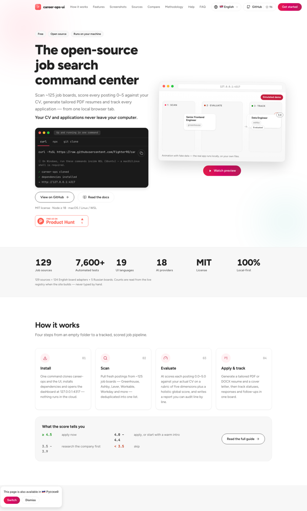
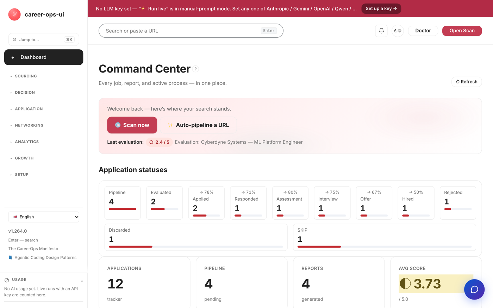

# CVStart · Six-pager (EN)

> **Commercial version & global go-to-market strategy for cvstart.org** — a complete 12-step run of the
> "Product Factory Strategist" agent (Nov 6, 2026). Six committee questions — six answers.
> Evidence base: claims C001–C020, sources S001–S011, decision D001 — full registry in REPORT.md.
> Model figures rely on assumptions [C016][C020]; market figures are ranges from aggregators [S006].

## FAQ-1. Current state

**Product.** CVStart (career-ops UI) is a dashboard over an AI job-search pipeline: scanning ~129 job boards,
AI fit-scoring of every vacancy 0.0–5.0 against the user's resume, CV Studio (JD-targeted tuning, humanize,
ATS bullets), PDF/DOCX export, cover letters, an auto pipeline, an application tracker with follow-up cadence,
a job map, and mock interviews. 100% local (data stays with the user), 18 BYOK LLM providers + keyless mode,
19 UI languages, ~7,602 automated tests, MIT license [C001][C004].

**No monetization yet.** The project is free ("$0 forever"); there is no public hosting — installation
requires the parent career-ops repository; Windows only via WSL [C002][C003].

**Market.** Resume builders: a $1.2–2.4B estimate range; the AI segment grows at 13.1% a year [C005].
Online recruitment: $37.97B in 2025, 7.1% CAGR [C011]. 98% of Fortune 500 companies use ATS [C008].
31–74% of job seekers already use AI in their search (2025–2026 surveys) [C009].

**Competitors.** 7 direct players — Zety, resume.io, Novoresume, Kickresume, Enhancv, Teal, Rezi: freemium,
paid tiers at $8–40/mo, aggressive auto-renewals [C006]; language coverage EN+5 [C007].
The open angle: 19-language coverage + privacy + open source [C013].

**Tension.** "100% local" as a public promise [C001] vs a commercial cloud. Resolution: an opt-in hybrid
(the local core stays; cloud is a choice), verified by a 90-day beta (FAQ-5).

## FAQ-2. Users: segments and personas

| Segment | Who | Job to be done | Basis |
|---|---|---|---|
| Core (EN-first) | tech job seekers 25–40, US/EU, actively searching 1–6 months | "Find relevant openings across all sources and quickly tailor a resume for each one that passes ATS — without subscription traps or handing my data to someone's cloud" | [C017] |
| Wave 2 | non-EN segments: DE, ES, PT-BR, JA, ZH | "Think about my resume in my native language; local conventions matter more than price" | [C004][C018] |

Persona hypotheses (synthetic AI interviews [S009][S010] — to be validated, not proof): **Sarah, 32, software
engineer (Austin)** — tried Zety/Teal, furious about auto-renewals; would pay $10–15/mo, $29 only if the tool
actually finds jobs. **Markus, 35, product manager (Berlin)** — existing tools are US-centric; GDPR-sensitive;
accepts an annual €100–120 plan, categorically against monthly auto-renewals.

## FAQ-3. Strategic options: 5 variants + red team

| Option | Essence | ARR in 12 months (model) | Sharpest red-team hit |
|---|---|---|---|
| A. Status quo | free local OSS | $0 | Zero on the goal axis; MIT lets a fork monetize your work; asset stagnates within 12–24 months [C005] |
| **B. Hosted freemium SaaS** | cloud, global: Free BYOK / Pro $12 / Unlimited $29 | $35–105K [C016][S008] | PII/GDPR and scraping liability shifts to the developer; "$0 forever" is a public promise; freemium conversion 2–5% [C020] |
| C. B2B white-label | licenses to universities and career centers | $24–60K [C020] | Sales motion mismatched to a solo founder: RFPs, SOC2, 6–18-month cycles; vertical vendors own the niche |
| D. Dual-license | enterprise self-host + ATS integrations | $10–50K [C020] | Legally impossible on top of MIT: rights already granted to everyone, forever |
| E. Shut down commerce | stays a non-commercial OSS | $0 | Abandoning the asset at the market's widest window |

**Recommendation — B** (the leader's choice is recorded in D001 [C019]) with built-in mitigations:
BYOK-free tier (zero inference cost on free) · opt-in cloud on top of the local core · honest pricing
without auto-renewals as positioning [C014] · stop-loss thresholds (FAQ-5). D is legally rejected,
C is postponed until there is presence, E is the stop-loss path.

## FAQ-4. Tactics

1. **Three tiers**: Free — user's BYOK key, 3 resumes/mo; Pro $12 — cloud AI; Unlimited $29 — 129-board scan + auto pipeline + tracker.
2. **Opt-in cloud**: the MIT version stays forever; cloud is a choice, not a requirement [C001][C019].
3. **Honest pricing**: no auto-renewals, one-click cancel, discounted annual plan — the opposite of the competitors' pattern [C006][C014].
4. **Language waves**: EN (US/EU) → DE/ES/PT-BR → JA/ZH — next wave only after the previous one's conversion is confirmed [C004][C007].
5. **Open scoring methodology**: a public description of ATS criteria — transparency as trust [C008].

**Unit economics** (model on assumptions [C016]): ARPU $29 · variable costs 25% → **CM $21.75** ·
8%/mo churn → **LTV ≈ $271.88** · **LTV/CAC ≈ 4.5** · CAC payback ≈ 2.8 months · break-even ≈ **69 paying users**.
Synthetic beta funnel (a method illustration, not a forecast [S008]): by week 12 — **53 paying, $1,537 MRR**.
Sensitivity analysis — the unit_economics workbook (Appendices).

## FAQ-5. Implementation & validation plan (90 days)

Launch the hosted beta in 3 EN geos (US/EU). Expectation by week 12: **50–60 paying (model: 53), MRR ≥ $1,500**,
activation ≥ 50% of signups [S008]. Comparison base — the funnel model + public freemium-conversion benchmarks.
Decision D001: commitment "hosted beta in 3 EN geos by 2026-12-15", review on 2027-02-10.

- **Continue** (paid ≥ 40, activation ≥ 50%, churn ≤ 10%): scale channels, open the DE/ES/PT-BR wave.
- **Change** (paid 20–40): rebuild tiers/pricing, strengthen onboarding.
- **Stop** (paid < 20 with activation < 35%): the commercial branch closes; the project remains OSS.

Counter-metrics: OSS-community churn (GitHub stars/forks), privacy/GDPR complaints, free-tier inference costs,
beta NPS below 30 while signups grow.

## FAQ-6. Success metrics

| Metric | Baseline | Target by week 12 | Type |
|---|---|---|---|
| Paying subscribers | 0 | ≥ 40 (model: 53) | NSM proxy |
| MRR | $0 | ≥ $1,500 | revenue |
| Activation (first resume) | — | ≥ 50% of signups | product |
| Paying churn | — | ≤ 10%/mo | retention |
| LTV/CAC | model 4.5 | ≥ 3 actual | unit economics |
| GitHub stars (counter) | current level | drop < 30% | OSS trust |
| Beta NPS (counter) | — | ≥ 30 | quality |

## Appendices (Excel workbooks, `outputs/attachments/`)

| File | Editable inputs |
|---|---|
| unit_economics.xlsx | ARPU, variable costs, CAC, churn — unit economics & sensitivity |
| growth_model.xlsx | MAU, growth, conversion, AOV — 12-month model |
| cohort_retention.xlsx | cohort sizes, retention curve |
| market_sizing.xlsx | PAM/TAM/SAM/SOM, environment factors |

Formulas recalculate on open (Excel / Numbers / LibreOffice). The full evidence-backed version — REPORT.md.
