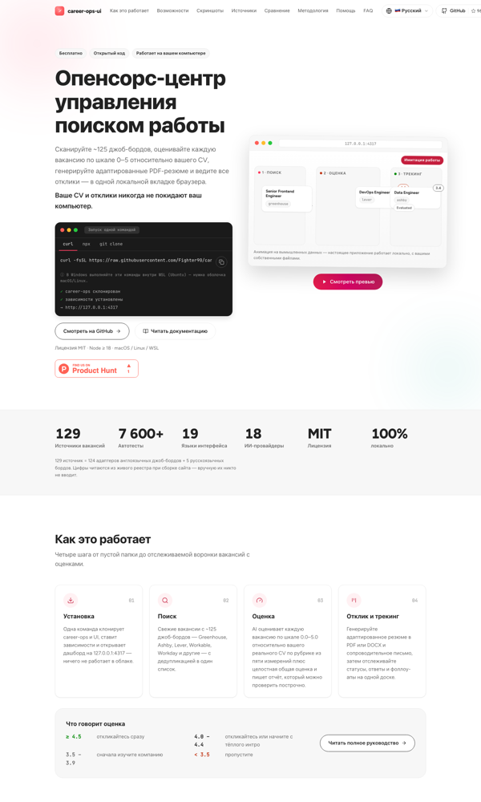
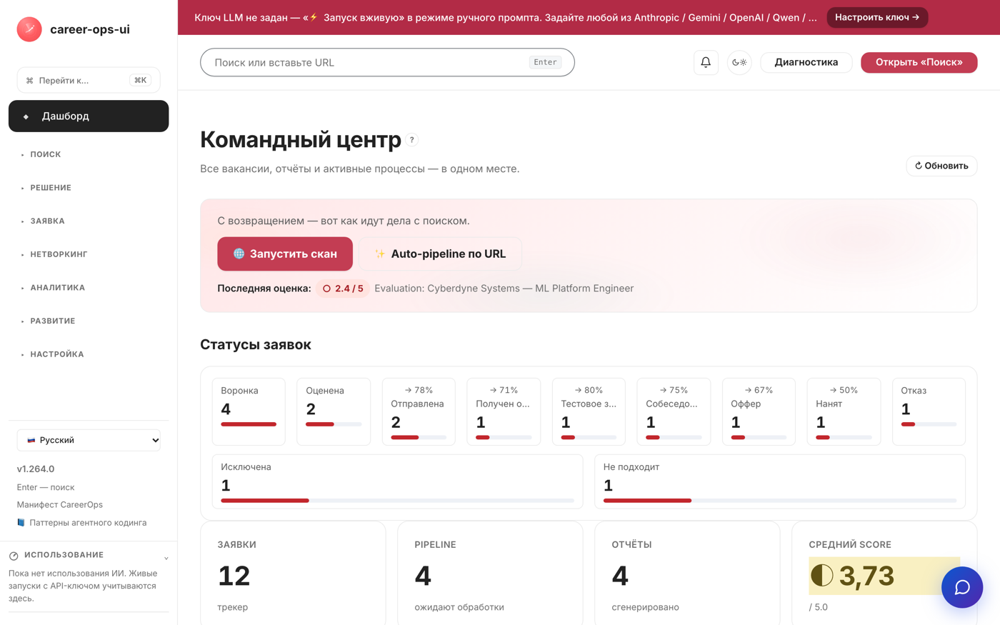

# CVStart · Six-pager (RU)

> **Стратегия коммерческой версии и глобального запуска cvstart.org** — результат полного 12-шагового
> прогона агента «Стратег Фабрики продуктов» (06.11.2026). Шесть вопросов комитета — шесть ответов.
> Доказательная база: утверждения C001–C020, источники S001–S011, решение D001 — полный реестр в REPORT.md.
> Модельные цифры — на допущениях [C016][C020]; рыночные — диапазонами по агрегаторам [S006].

## FAQ-1. Анализ текущего состояния

**Продукт.** CVStart (career-ops UI) — дашборд над AI-пайплайном поиска работы: скан ~129 джоб-бордов,
AI-скоринг вакансий 0.0–5.0 против резюме пользователя, CV Studio (тюминг под JD, humanize, ATS-буллеты),
PDF/DOCX-экспорт, cover letters, авто-пайплайн, трекер заявок с follow-up, карта вакансий, mock-интервью.
100% локально (данные у пользователя), 18 LLM-провайдеров BYOK + keyless-режим, 19 языков интерфейса,
~7 602 автотеста, лицензия MIT [C001][C004].

**Монетизации нет.** Проект бесплатный («$0 forever»), публичного хостинга нет — установка требует
родительского репозитория career-ops; Windows — только через WSL [C002][C003].

**Рынок.** Resume builders — коридор оценок $1,2–2,4 млрд; AI-подсегмент растёт на 13,1% в год [C005].
Онлайн-рекрутинг: $37,97 млрд (2025), CAGR 7,1% [C011]. ATS используется у 98% Fortune 500 [C008].
AI в поиске работы применяют 31–74% соискателей (опросы 2025–2026) [C009].

**Конкуренты.** 7 прямых — Zety, resume.io, Novoresume, Kickresume, Enhancv, Teal, Rezi: freemium,
платный тариф $8–40/мес, агрессивные автопродления [C006]; языковое покрытие — EN+5 [C007].
Незанятый угол: мультиязычность (19 локалей) + приватность + open source [C013].

**Противоречие.** «100% локально» как публичное обещание [C001] против коммерческого облака.
Разрешение: opt-in-гибрид (локальный core остаётся, облако — выбор), проверяется 90-дневной бетой (FAQ-5).

## FAQ-2. Пользователи: сегменты и персоны

| Сегмент | Кто | Задача (JTBD) | Основание |
|---|---|---|---|
| Ядро (EN-first) | соискатели tech 25–40, US/EU, активный поиск 1–6 мес | «Найти релевантные вакансии из всех источников и быстро сделать резюме под каждую, которое пройдёт ATS — без подписных ловушек и без данных в чужом облаке» | [C017] |
| Волна 2 | не-EN сегменты: DE, ES, PT-BR, JA, ZH | «Думать о резюме на родном языке; локальные конвенции важнее цены» | [C004][C018] |

Персоны-гипотезы (синтетические ИИ-интервью [S009][S010] — гипотезы для проверки, не доказательства):
**Sarah, 32, инженер (Остин)** — перепробовала Zety/Teal, злится на автопродления; готова платить $10–15/мес,
$29 — только если инструмент реально находит вакансии. **Markus, 35, продакт (Берлин)** — инструменты
англоцентричны, GDPR-чувствителен, принимает годовой тариф €100–120, принципиально против помесячных автопродлений.

## FAQ-3. Стратегические инициативы: 5 вариантов + red team

| Вариант | Суть | ARR 12 мес (модель) | Главный удар red team |
|---|---|---|---|
| A. Статус-кво | бесплатный локальный OSS | $0 | Ноль по оси задачи; MIT позволяет форку монетизировать ваш труд; стагнация актива за 12–24 мес [C005] |
| **B. Hosted freemium SaaS** | облако глобально: Free BYOK / Pro $12 / Unlimited $29 | $35–105 тыс [C016][S008] | PII/GDPR и скрапинг переходят на разработчика; «$0 forever» — публичное обещание; конверсия freemium 2–5% [C020] |
| C. B2B white-label | лицензии вузам и карьерным центрам | $24–60 тыс [C020] | Продажи не по размеру соло: тендеры, SOC2, циклы 6–18 мес; ниша занята вертикальными вендорами |
| D. Dual-license | enterprise self-host + ATS-интеграции | $10–50 тыс [C020] | Юридически не работает поверх MIT: права уже розданы всем навсегда |
| E. Закрыть коммерцию | остаётся некоммерческий OSS | $0 | Отказ от актива в момент максимального окна рынка |

**Рекомендация — B** (выбор руководителя зафиксирован в D001 [C019]) со встроенными митигациями:
BYOK-free-тир (нулевые инференс-затраты на free) · opt-in облако при локальном core · честный прайсинг
без автопродлений как позиционирование [C014] · пороги остановки (FAQ-5). D отклонён юридически,
C — отложен до presence, E — по критериям остановки.

## FAQ-4. Тактики

1. **Три тира**: Free — BYOK-ключ пользователя, 3 резюме/мес; Pro $12 — облачный AI; Unlimited $29 — скан 129 бордов + авто-пайплайн + трекер.
2. **Opt-in облако**: MIT-версия остаётся навсегда; облако — выбор, не требование [C001][C019].
3. **Честный прайсинг**: без автопродлений, отмена в клик, годовой тариф со скидкой — противоположность паттерну конкурентов [C006][C014].
4. **Волны локалей**: EN (US/EU) → DE/ES/PT-BR → JA/ZH — следующая волна после подтверждения конверсии предыдущей [C004][C007].
5. **Открытая методология скоринга**: публичное описание ATS-критериев — прозрачность как доверие [C008].

**Экономика направления** (модель на допущениях [C016]): ARPU $29 · переменные 25% → **CM $21,75** ·
churn 8%/мес → **LTV ≈ $271,88** · **LTV/CAC ≈ 4,5** · окупаемость CAC ≈ 2,8 мес · брейк-евен ≈ **69 платящих**.
Синтетическая бета-воронка (метод, не прогноз [S008]): к неделе 12 — **53 платящих, MRR $1 537**.
Чувствительность — Excel-книга unit_economics (Приложения).

## FAQ-5. План реализации и проверки (90 дней)

Запуск hosted-беты в 3 EN-гео (US/EU). Ожидание к неделе 12: **50–60 платящих (модель: 53), MRR ≥ $1 500**,
активация ≥ 50% регистраций [S008]. База сравнения — модель воронки + публичные ориентиры freemium-конверсии.
Решение D001: обязательство «hosted beta в 3 EN-гео к 2026-12-15», пересмотр 2027-02-10.

- **Продолжить** (paid ≥ 40, activation ≥ 50%, churn ≤ 10%): масштабирование каналов, волна DE/ES/PT-BR.
- **Изменить** (paid 20–40): пересбор тира/цены, усиление онбординга.
- **Остановить** (paid < 20 при activation < 35%): коммерческая ветка закрывается, проект остаётся OSS.

Контрметрики: отток OSS-комьюнити (звёзды/форки GitHub), жалобы на приватность/GDPR, затраты на инференс
free-тира, NPS беты < 30 при росте регистраций.

## FAQ-6. Метрики успеха

| Метрика | База | Цель к нед. 12 | Тип |
|---|---|---|---|
| Платящие подписчики | 0 | ≥ 40 (модель: 53) | NSM-прокси |
| MRR | $0 | ≥ $1 500 | выручка |
| Активация (первое резюме) | — | ≥ 50% регистраций | продукт |
| Churn платящих | — | ≤ 10%/мес | удержание |
| LTV/CAC | модель 4,5 | ≥ 3 фактически | юнит-экономика |
| Звёзды GitHub (контр) | текущий уровень | падение < 30% | доверие OSS |
| NPS беты (контр) | — | ≥ 30 | качество |

## Приложения (Excel-модели, `outputs/attachments/`)

| Файл | Что редактировать |
|---|---|
| unit_economics.xlsx | ARPU, переменные, CAC, отток — юнит-экономика и чувствительность |
| growth_model.xlsx | MAU, рост, конверсия, AOV — модель на 12 месяцев |
| cohort_retention.xlsx | размеры когорт, кривая удержания |
| market_sizing.xlsx | PAM/TAM/SAM/SOM, факторы среды |

Формулы пересчитываются при открытии (Excel / Numbers / LibreOffice). Полная версия с доказательствами — REPORT.md.
